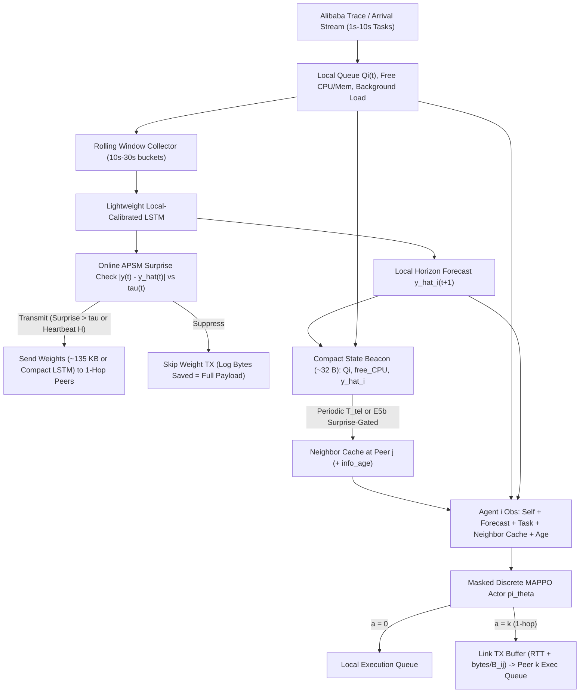

# Phase 3 Research Gap, Feasibility, and Architecture Design Review

> **Review Mode:** Critical engineering & research design audit (zero code written, zero repository files modified). Builds directly upon the codebase verification in [`APSM_Knowledge_Audit.md`](file:///C:/Users/parth/.gemini/antigravity/brain/d54aa77b-89c4-4cc4-89a1-2c200ccf8e66/APSM_Knowledge_Audit.md) and literature/trace verification in [`Phase3_Literature_and_Research_Audit.md`](file:///C:/Users/parth/.gemini/antigravity/brain/d54aa77b-89c4-4cc4-89a1-2c200ccf8e66/Phase3_Literature_and_Research_Audit.md).

---

## 1. Challenging the Proposed Architecture

Intended Phase 3 pipeline:

$$\text{APSM + Gossip Learning} \longrightarrow \text{Decentralized Workload Forecasting} \longrightarrow \text{Peer Workload Info} \longrightarrow \text{MARL Agents} \longrightarrow \text{Proactive Offloading}$$

When audited link-by-link as a distributed systems design, **the naive transition from "Gossip Learning weights" to "Peer workload info" is broken**, and two major assumptions carry severe failure risks unless redesigned.

### 1.1 Does exchanging model weights allow a node to predict another node's workload?
**No. Categorically impossible.**  
A neural forecaster defines a parameterized function $f_{w_j}(X_j(t)) \to \hat{y}_j(t+1)$. In [`marshal_model`](file:///d:/coolage%20study%20materials/MTP/src/gossiplearning/node.py#L271-L285) and [`WeightsMessage`](file:///d:/coolage%20study%20materials/MTP/src/gossiplearning/models.py#L51-L55), node $j$ transmits flattened neural network parameters $w_j$ plus scalar `model_weight` (sample-age) — **not** peer $j$'s recent local input sequence $X_j(t)$ (last 4+ intervals of load and temporal state) and **not** peer $j$'s live queue depth $Q_j(t)$.  
Therefore, receiving $w_j$ lets node $i$ improve a shared predictor of *its own* future traffic $f_{w_{\text{merged}}}(X_i(t))$, **not** evaluate $\hat{y}_j(t+1)$ on node $j$ without violating raw-data privacy (sending $X_j$) or adding a separate telemetry channel.

### 1.2 Does a node need peer telemetry in addition to gossip model exchange?
**Yes — unless you drop proactive peer capacity awareness entirely.**  
Weights train a **long-term statistical mapping**, whereas proactive offloading requires **short-term operational state**: peer free CPU/RAM, queued backlog $Q_j(t)$, and peer $j$'s locally computed forward forecast $\hat{y}_j(t+1)$.  
Crucially, there is a **~4,000×–5,600× payload asymmetry** in the current architecture:
* [`create_LSTM`](file:///d:/coolage%20study%20materials/MTP/src/utils/model_creators.py#L10-L48) (`input_features=9`, two 50-unit LSTMs + 32-unit Dense + output) contains **`33,865` parameters** $\approx \mathbf{135.5\text{ KB}}$ in uncompressed `float32` (`WeightsMessage`), simulated with `25–35s` TX latency ([`gossip_training.py`](file:///d:/coolage%20study%20materials/MTP/src/utils/gossip_training.py#L54-L55)).
* A scalar neighbor status tuple `(node_id, timestamp, free_cpu, free_mem, q_len, y_hat_next)` is **`24–32` bytes** (`round_trip_time = 1`s or ms-scale propagation).

Confusing *model-weight gossip* with *runtime peer-load telemetry* is the single biggest conceptual defect in the raw proposal.

### 1.3 Can a model trained on one node's workload generalize to another node?
**Only across shared statistical structure, and naive global weight averaging harms heterogeneous nodes.**  
* **Where Gossip helps:** Under short/sparse local histories (e.g., Alibaba's 12-hour window or bursty cold-start towers), nodes share common temporal/diurnal motifs, arrival shapes, and feature correlations. Age-weighted merging transfers pattern-recognition weights faster than isolated local fitting.
* **Where naive Gossip fails:** Nodes differ strongly in absolute load scale, online-container base occupancy, and phase (in [`2_dataset_generation.py`](file:///d:/coolage%20study%20materials/MTP/src/2_dataset_generation.py#L162-L178), urban vs outer towers differ by up to $3\times$ and invert morning/evening bias; in Alibaba `cluster-trace-v2017`, machines hold heterogeneous co-located Sigma containers and capacities). Pure [`merge_weights_with_age_weighted_avg`](file:///d:/coolage%20study%20materials/MTP/src/gossiplearning/aggregators.py#L56-L101) averages weights toward a cluster-mean curve—erasing local amplitude/bias calibration unless inputs are locally normalized (e.g., % utilization) or nodes retain personalized calibration layers / local fine-tuning.

### 1.4 How should node identity, workload heterogeneity, and temporal patterns be handled?
* **Do NOT use one-hot `node_id`:** Breaks permutation invariance, explodes parameter count at $N=50$–$100$, and prevents policy generalization to nodes with different degrees or unseen neighbors.
* **Correct representation for Forecasting:** Normalize target series into **capacity-relative load** (utilization fraction / queue pressure) alongside **continuous static/rolling context features** (node capacity tier, rolling baseline mean $\mu_i$ and $\sigma_i$, cyclic $\sin/\cos$ time-of-day encodings replacing rigid `BinaryEncoder` buckets if extrapolating). Retain either per-node output denormalization or lightweight local fine-tuning (`1–2` calibration layers).
* **Correct representation for MARL:** Use **topology-agnostic neighbor feature vectors** per link (`rtt_ij`, `q_j / q_max_j`, `avail_cpu_j / cap_cpu_j`, `y_hat_j / cap_cpu_j`, `info_age_j`) sorted by neighbor rank or fixed max-degree slot with validity masks.

### 1.5 What happens when neighbor forecasts are stale?
Stale neighbor telemetry of age $\Delta t_j = t - t_j^{\text{recv}}$ induces **two classic distributed control pathologies**:
1. **Thundering-Herd Oscillation (Outdated "Idle" Signal):** If peer $j$ was idle 15s ago, multiple neighbors ($\deg \ge 3$) simultaneously offload onto $j$ during the same window before the next telemetry beacon arrives, spiking $j$'s queue above capacity.
2. **Capacity Starvation (Outdated "Busy" Signal):** A transient spike on $j$ clears quickly, but neighbors remain blind to its recovery until the staleness window expires, artificially overloading other peers or dropping local tasks.
* **Mandatory mitigation:** Include staleness $\Delta t_j$ explicitly inside node $i$'s MARL state $o_i(t)$, adjust effective peer estimate using locally tracked in-flight offloads $\hat{Q}_{i\to j}^{\text{inflight}}(t)$ (what node $i$ *already* sent to $j$ since $t_j^{\text{recv}}$), and enforce **receiver-side admission/rejection** when $j$'s true queue/RAM fills.

### 1.6 How does APSM's communication suppression affect forecast availability?
We must separate **local availability** from **network freshness**, and note a **critical Phase 2 implementation flaw**:
* **Local Availability:** Suppressing outbound weight broadcasts in [`should_suppress_transmission`](file:///d:/coolage%20study%20materials/MTP/src/gossiplearning/node.py#L156-L189) **does NOT stop node $j$ from computing its own local forecast** $\hat{y}_j(t+1)$ — local inference stays 100% live.
* **Weight Freshness Degradation:** Suppressing weights delays propagation of abrupt workload regime shifts across sparse graphs (`100n` already incurred $+6.64\%$ MSE degradation in Phase 2).
* **Critical APSM Trigger Flaw for Phase 3:** Current APSM computes surprise in [`update_semantic_state`](file:///d:/coolage%20study%20materials/MTP/src/gossiplearning/node.py#L134-L154) as $|\text{best\_update\_val\_loss} - \text{lifetime\_best\_val\_loss}|$ on static datasets (`latest_weights` still gets sent, causing Update-1 outliers and Update-51 threshold cliffs). On **live streaming workloads** (Alibaba bursts), comparing against a frozen offline best loss stops capturing real-time drift! Moreover, **if APSM is also applied to telemetry beacons**, neighbors lose updates for up to $H$ intervals—requiring MARL to treat absent updates as *"peer load remained within predicted noise $\tau_j$"* rather than missing data.

### 1.7 Can the MARL policy operate with incomplete peer information?
**Yes**, because sparse $k$-edge graphs (`K_EDGE_CONNECTIVITY = 3`, with actual node degrees $3\text{--}5+$ verified in `adj_list.txt`) already confine visibility to **1-hop neighbors** (making the problem a **Dec-POMDP** by construction).  
However, MARL **cannot** operate safely with *unbounded, unmasked* missing information. It requires:
1. Bounded fixed-capacity neighbor observation slots ($K_{\max}$) with binary **active/valid masks**.
2. Explicit **staleness counters** ($\Delta t_j$) per neighbor slot.
3. Conservative fallback / local admission rules so partial blindness yields cautious local queueing rather than blind drops.

---

## 2. Examining Alternative Architectures (A, B, C, D)

### Architecture Definitions
* **A (Personalized LSTM + Weight Gossip Only):** Each node keeps local adaptations/personal LSTM weights and exchanges updates via GL (`WeightsMessage` only); no peer forecast/load telemetry exchange.
* **B (Shared Collaboratively Learned LSTM via GL Only):** Nodes train one common/converging LSTM via GL age-weighted averaging (`Phase 2 setup`), still without separate peer telemetry.
* **C (Pure Local LSTM + Separate Peer Load/Forecast Telemetry):** Nodes disable Gossip Learning (`0` weight transfers), train independent local LSTMs, and exchange compact `(y_hat_j, Q_j, free_cpu_j)` telemetry packets (`DECOFFEE`-style local forecasting + lightweight telemetry).
* **D (Hybrid: Personalized/Calibrated GL Forecasting + APSM Gating + Lightweight Peer Telemetry):** Shared Gossip Learning (with local capacity normalization/fine-tuning) filtered by APSM **paired with** bounded 1-hop peer `(Q_j, cpu_free_j, y_hat_j)` telemetry (optionally telemetry-gated too).

### Systematic 7-Criteria Comparison

| Criterion | **Arch A:** Personalized LSTM + Weight GL Only | **Arch B:** Shared LSTM + Weight GL Only | **Arch C:** Local LSTM + Telemetry Only (No GL) | **Arch D:** Hybrid GL + APSM + Bounded Peer Telemetry |
| :--- | :--- | :--- | :--- | :--- |
| **Advantages** | Handles non-IID local scales better than B; zero extra telemetry packets beyond weights. | Minimal change to Phase 2 DES; fast pattern transfer across sparse data. | Zero heavy `135 KB` weight broadcasts; exact peer queue + forecast visibility; easiest debugging and fastest RL loop. | **Fixes the weights $\neq$ state gap**, retains Phase 1–2 GL+APSM core contribution, provides MARL with real peer load/forecasts, supports cross-node transfer on short 12h traces. |
| **Disadvantages** | **Broken for peer offloading:** Node $i$ still cannot see $Q_j$ or predict $\hat{y}_j$ without $X_j$; naive averaging risks weight mismatch. | **Broken for peer offloading** (same $X_j$ blindness) **plus** degrades heterogeneous nodes toward mean traffic. | **Abandons Gossip Learning & APSM weight filtering**, invalidating continuity with Phases 1–2; struggles on short/sparse node traces (12h Alibaba). | Highest architectural & accounting complexity; telemetry traffic can undermine APSM savings if poorly scheduled or unmeasured. |
| **Comm. Overhead** | High weight bytes (`~135 KB × deg × sends`, cut 9–50% depending on APSM); `0` telemetry bytes. | Same heavy weight bytes as A; `0` telemetry bytes. | **`0` weight bytes**; tiny telemetry beacons (`~32 B × deg × rate`). **Strict total-byte lowest!** | Weight bytes (`APSM-gated`) **plus** telemetry bytes (`~32 B` packets, either piggybacked, periodic, or surprise-gated). Must measure **total bytes**. |
| **Forecasting Implications** | Accurate local calibration if head stays local; slower cross-node convergence. | High bias on skewed/bursty servers (`server_usage` varies wildly across machines). | High variance / underfitting on sparse/12h traces (`720` samples/node in Alibaba 1m). | Best forecasting accuracy on short/heterogeneous traces via cross-node GL + local scaling/calibration. |
| **Implementation Complexity** | Medium (needs personalized layer exclusion in `aggregators.py`, still unsolved telemetry). | Low to extend forecasting, **impossible** for peer-aware offloading. | **Low** (cleanest codebase). | **Medium–High** (requires clean separation between slow forecast/GL timescale and fast offloading/telemetry timescale). |
| **Compatibility with APSM** | High on weights; irrelevant to offloading decisions. | High on weights; irrelevant to offloading decisions. | **Low / Contradictory** unless APSM is redefined exclusively as telemetry-suppression. | **High & Dual-Compatible:** APSM governs weight plane (`Phase 2`) and can optionally gate/annotate forecast surprise for MARL (`Phase 3 novelty`). |
| **Suitability for MARL** | **Unsuitable** (no peer queues/forecasts -> effectively local-obs only, defeating "proactive peer" premise). | **Unsuitable** (blind offloading). | **High** (clean MDP observations, strong baseline comparator). | **High** — *if* observation staleness and telemetry budget are explicitly modeled. |

### Skeptical Architecture Verdict & Recommendation
* **Architectures A and B are rejected outright:** Neither can convey peer queue state $Q_j(t)$ or peer future arrivals $\hat{y}_j(t+1)$ to node $i$'s MARL agent without leaking raw time series $X_j(t)$. Using them leaves the offloading agent peer-blind.
* **Architecture C is technically clean and should be implemented strictly as an experimental baseline (`MARL + Local Forecasts`, analogous to DECOFFEE)** — because omitting Gossip Learning disconnects Phases 1–2 from the thesis.
* **Recommended Architecture: Option D (Hybrid Two-Timescale Architecture with Total Control-Byte Auditing).**  
  Specifically:
  1. Nodes maintain locally calibrated/normalized **Gossip-Learned LSTMs** (using APSM to suppress redundant weight transfers on the slow forecasting plane).
  2. Nodes broadcast tiny **`32`-byte 1-hop state/forecast summaries** `(Q_j, cpu_free_j, mem_free_j, y_hat_j)` either at coarse slots or gated/annotated by semantic surprise—explicitly logging **every weight byte AND every telemetry byte** so no hidden communication is smuggled past APSM.

---

## 3. Selecting the MARL Approach

Let's evaluate the 4 candidate algorithms against the reality of our system: **`N = 10` to `50` (and `100`) decentralized edge nodes**, **variable node degrees (`3..5+` in `adj_list.txt`)**, **discrete per-task / per-slot target routing**, **1-hop partial observations with staleness**, and **M.Tech compute/time budgets**.

| Criterion | **Double Dueling MADQN (IDQN)** | **MAPPO (Parameter-Shared CTDE + Masking)** | **MADDPG** | **QMIX** |
| :--- | :--- | :--- | :--- | :--- |
| **Discrete Offloading Actions** | **Native** (`Q(o, a)` over discrete `{local, nbr_1..nbr_K}`). Needs action masking for degree `< K_max`. | **Native** via masked Categorical softmax actor (`pi(a\|o)`). Handles variable degree trivially by setting masked logits to $-\infty$. | **Poor fit** (continuous deterministic actor; requires discrete Gumbel-Softmax relaxations with tuning overhead). | **Native** (`Q_i(o_i, a_i)` discrete), needs masking. |
| **Scaling ($N = 10, 50, 100$)** | Good at `N=10`; degrades at `N=50–100` due to **replay-buffer non-stationarity** when all peers shift policies concurrently. | **Strong at `N=10, 50, 100`** with parameter-shared actor + bounded/aggregated critic. On-policy discard eliminates stale replay drift. | **Breaks past `N=15–20`:** centralized critic $Q_i(\mathbf{s}, \mathbf{a})$ input scales as $\mathcal{O}(N \cdot (|o|+|a|))$, exploding variance & memory. | **Moderate (`10–30`)**: hypernetwork input $s$ grows $\mathcal{O}(N)$, difficult optimization past 50 heterogeneous agents. |
| **Cooperative Reward** | Handles local + neighbor-blended reward natively; lacks explicit cross-agent variance reduction. | **Excellent:** critic learns joint congestion baselines while actor optimizes local + neighbor-cooperative reward. | Supports multi-agent continuous critics, unstable on sparse drop/deadline penalties. | Requires **strictly shared team scalar reward $R_{\text{tot}}$** + **monotonicity ($\partial Q_{\text{tot}}/\partial Q_i \ge 0$)**—often violated when one congested node causes asymmetric cascade penalties. |
| **Partial Observations** | Works with fixed-slot observations; Q-learning sensitive to aliased/stale observations without DRQN/LSTM. | **Robust:** stochastic clipped PPO policies naturally mix probabilities (reducing thundering-herd lockstep!) and easily accept recurrent/staleness features. | Deterministic actor suffers severe oscillation / herding under stale peer states. | Vulnerable when global state $\mathbf{s}$ diverges strongly from stale local $o_i$. |
| **Training Complexity** | Low per-network, high instability under 50-agent non-stationarity (replay size, target updates, $\epsilon$-decay tuning). | **Moderate & predictable:** standard GAE + clipped surrogate PPO; parameter sharing gives $N\times$ effective batch samples per step! | **High:** $N$ actors + $N$ large critics + target networks + exploration noise scheduling. | **High:** hypernetwork weight clamping, mixer architecture, global state construction, fragile training curves. |
| **CTDE Compatibility** | Purely Independent (non-CTDE) by default — zero centralized training assumption! | **Native CTDE** (global/neighborhood critic during training, purely decentralized actor at execution). **Trivial 1-line switch to IPPO** if strict CTDE-free training is required. | Native CTDE (heaviest centralized dependency). | Native CTDE (strictly centralized mixer training). |
| **Implementation & Eval Ease** | **Easiest** (~150 lines PyTorch); ideal value-based baseline mirroring DECOFFEE. | **High** (~200–250 lines clean PyTorch); rock-solid action masking & reproducible PPO logs. | **Hardest to stabilize.** | **Hard to debug** when team loss stalls. |

### Recommended Initial MARL Algorithm: **Parameter-Shared Masked Discrete MAPPO** *(with IPPO toggle & Double Dueling MADQN as baseline comparator)*

**Justification (strictly pragmatic, not hype-driven):**
1. **Fixes the Variable-Degree Graph Reality:** Our own Porto networks ([`1_network_generation.py`](file:///d:/coolage%20study%20materials/MTP/src/1_network_generation.py#L61)) produce $k$-edge-augmented graphs where node degrees vary (`3, 4, 5+`). **Action masking over $K_{\max}$ neighbor slots** in a Categorical actor is mathematically exact in PPO, whereas continuous simplex vectors struggle cleanly with masking dynamic discrete topologies and MADDPG blows up at 50–100 nodes.
2. **Eliminates Replay-Buffer Non-Stationarity:** On-policy PPO avoids optimizing Q-targets against outdated peer offloading policies stored 50,000 steps earlier in a replay buffer — the #1 failure mode of MADQN/MADDPG at `N=50`.
3. **Natural Anti-Herding via Stochastic Policies:** When two neighboring peers look equally favorable, a deterministic $\arg\max Q$ agent routes 100% of burst tasks to the same peer synchronously, whereas PPO's entropy-regularized stochastic policy smoothly splits load probabilistically.
4. **CTDE vs. Strict-Decentralized Flexibility:** If your supervisor approves offline CTDE simulation training, `MAPPO` uses a lightweight pooled cluster/neighborhood critic during training and 100% local execution at runtime. If your supervisor insists on zero centralized training too, replacing global state in $V_\phi$ with local+1-hop observation converts the exact codebase into **IPPO** immediately.
5. **Clean DECOFFEE Bridge:** Implementing **Masked Double Dueling MADQN** alongside as the *Local-LSTM Offload Baseline (Exp 3)* gives direct parity with DECOFFEE without tying the main 50-node benchmark to replay-buffer instability.

---

## 4. Defining the Proposed Simulation Environment

To avoid building an unmanageable, non-reproducible monolith, the Phase 3 simulation must separate **fast vector/slot task execution** from **heavyweight Keras model rebuilding**. In Phase 2, running just 10 nodes on synthetic data without RL took `125+ minutes` because [`Node.train_model`](file:///d:/coolage%20study%20materials/MTP/src/gossiplearning/node.py#L233-L248) rebuilt a Keras graph on every single update! **Phase 3 must use lightweight PyTorch modules and discrete simulation steps ($\Delta t = 1\text{ s}$ or sub-second event queue).**

### 4.1 Core Environment Entities & Mechanics

1. **Edge Nodes ($\mathcal{V} = \{0, \dots, N-1\}$):**
   - Connected by static undirected graph $\mathcal{E}$ (from `adj_list.txt` with `K_EDGE_CONNECTIVITY = 3`, max degree padded to $K_{\max}$, e.g. $6\text{--}8$).
   - **Node State:** Each node $i$ has total CPU capacity $C_i^{\text{cpu}}$ (normalized units/sec, e.g., mapped from `server_event.capacity:CPU`), RAM capacity $C_i^{\text{mem}}$ (`capacity:memory`), background online-service utilization $u_i^{\text{bg}}(t) \in [0, 1)$, and effective free batch capacity $C_i^{\text{avail}}(t) = C_i^{\text{cpu}} \cdot (1 - u_i^{\text{bg}}(t))$.
2. **Task Arrivals & Resource Footprint:**
   - Discrete time slot $\Delta t$ (e.g., $\Delta t = 1\text{ s}$ or $5\text{ s}$) receives a batch/stream of arriving offloadable tasks $\mathcal{T}_i(t)$ mapped from Alibaba `batch_task.csv` + `batch_instance.csv`:
     - Compute demand $w_m$: derived from `plan_cpu` $\times$ actual runtime duration (`end_timestamp - start_timestamp`).
     - Memory footprint $r_m$: derived from `plan_mem` / `real_mem_max`.
     - **Synthesized Input Payload ($b_m$):** bytes (e.g., sampled per task class from realistic edge range, e.g., $50\text{ KB} \text{--} 2\text{ MB}$).
     - **Synthesized Deadline ($\tau_m^{\text{dl}}$):** relative slack added to arrival time, $t_{\text{arr}} + \kappa \cdot t_{\text{exec,base}}$ (e.g., $\kappa \in [2.0, 5.0]$).
3. **Local Execution & Queueing:**
   - Each node maintains a **bounded execution queue** of max capacity $Q_{\max}$ tasks (or memory cap $C_i^{\text{mem}}$).
   - Tasks are processed in FCFS (or Earliest-Deadline-First) order consuming remaining work against $C_i^{\text{avail}}(t)$ (or multi-slot processor sharing).
4. **Neighbor Offloading (Strict 1-Hop Rule in v1):**
   - Upon arrival at node $i$, task $m$ is routed to `action = 0` (**Local Queue**) or `action = k ∈ {1..K_max}` (**1-Hop Neighbor $j = \mathcal{N}_i[k-1]$**).
   - **Anti-Loop Invariant (Mandatory for v1):** Offloaded tasks are flagged `already_offloaded = True` and **cannot be re-offloaded** a second time by receiver $j$ (preventing ping-pong infinite loops and uncreditable multi-hop delays).
5. **Network Delay (Fixing Phase 2's Hardcoded `rtt=1`):**
   - Link $(i, j)$ has propagation RTT $\text{rtt}_{ij}$ (derived from Haversine distance or realistic edge distribution, e.g., $2\text{--}20\text{ ms}$ WAN / $5\text{--}50\text{ ms}$ MEC mesh, NOT hardcoded `1s`!) and bandwidth $B_{ij}$ (Mbps).
   - Offload transfer latency: $d_{\text{net}}(m, i \to j) = \frac{\text{rtt}_{ij}}{2} + \frac{8 \cdot b_m}{B_{ij}} + d_{\text{tx\_queue}, ij}$, handled explicitly via link transmission buffers/events.
6. **Completion, Deadline Misses, Overload & Rejection:**
   - **Completion:** If finished at $t_{\text{fin}} \le \tau_m^{\text{dl}}$ -> **Success**, latency $L_m = t_{\text{fin}} - t_{\text{arr}}$.
   - **Deadline Miss / Timeout:** Either proactively dropped once $t > \tau_m^{\text{dl}}$ (hard timeout) or finished after $\tau_m^{\text{dl}}$ (flagged `missed_deadline = True`).
   - **Node Overload & Rejection:** If destination $j$'s queue is at $Q_{\max}$ or free memory $< r_m$ upon task arrival, task $m$ is **Rejected / Dropped** (or falls back to failure penalty), emitting a rejection count & explicit high negative reward signal.

### 4.2 Mapping Alibaba Cluster Trace 2017 (`cluster-trace-v2017`) & Necessary Simulations

#### Resolving the Crucial Time-Scale & Sample-Count Issue First
`cluster-trace-v2017` spans **only 12 consecutive hours** (`43,200` seconds) across ~1,300 physical servers.
* **Why Phase 2's 15-min LSTM setup FAILS on Alibaba 2017:** $43,200 / 900 = 48$ samples total per node (versus $34,837$ in Phase 2!). Training an LSTM on 48 points is impossible.
* **Viable Alibaba Mapping:** Sample task arrivals & machine utilizations at **`10s`–`30s` intervals** (`1,440–4,320` steps over 12 hours), OR interpolate `server_usage.csv` (`60s` intervals = `720` samples/node) combined with exact per-second `batch_task.create_timestamp` burst intensities (`10s` buckets $\to$ `4,320` steps/node, `~2,600` train / `430` val / `1,290` test!). At this granularity, **individual nodes STILL have relatively scarce local sequences (few thousand steps over 12h)** — which gives a **scientifically authentic reason why Gossip Learning improves generalization over isolated Local LSTMs!**

#### Trace vs. Synthesized Boundaries

| Simulation Property | Source from `cluster-trace-v2017` | Synthesized / Simulated Component |
| :--- | :--- | :--- |
| **Edge Nodes ($N=10, 50$)** | Sample $N$ active machines from `server_event.csv` filtered for clean `server_usage.csv` + `batch_instance.csv` overlap (avoiding sparse/zero-task machines). | Downscaling `~1,300` servers to `10` or `50` edge nodes (grouping servers into virtual edge clusters if single-machine batch arrival rate is too sparse!). |
| **CPU & Mem Capacity** | `capacity:CPU`, `capacity:memory` (`server_event.csv`). | Mapping normalized capacities (e.g., `64`/`100`) to edge-scale MIPS/units per second and available queue slots `Q_max`. |
| **Background Load** | `util:CPU`, `util:memory` from `server_usage.csv` (co-located Sigma online services baseline) minus batch footprint, or interpolated `60s` background load trajectory. | Sub-minute (`1s`–`10s`) stochastic micro-jitter around 60s observed `server_usage` levels. |
| **Task Arrivals & Demand** | Real `create_timestamp`, `instance_num` (`batch_task.csv`); real `plan_cpu`, `plan_mem`, and actual runtime `(end - start)` & `real_cpu_avg` (`batch_instance.csv`). | Scaling multi-instance Fuxi jobs down to single/small-batch edge tasks if `instance_num` spans thousands (preventing instant saturation of 10 edge nodes). |
| **Network Graph & Delays** | *Absent in trace.* | $k$-edge-connected mesh (`adj_list.txt`) + heterogeneous bandwidths $B_{ij}$ (e.g., 50–200 Mbps) & propagation RTTs (5–40 ms) + optional background congestion. |
| **Payload Bytes & Deadlines** | *Absent in trace.* | Synthesized payload sizes $b_m$ (e.g., uniform/log-normal by CPU demand) and task deadlines $\tau_m^{\text{dl}}$ calibrated so naive local execution drops ~15–35% of peak bursts (non-trivial operating point!). |
| **Failures & Rejections** | Machine error distribution / task interruption rate (`harderror`/`softerror` in `server_event`, `Interrupted`/`Failed` in `batch_instance`). | Explicit finite buffer `Q_max`, receiver-full drop behavior, and hard deadline expiration drops. |

---

## 5. Controlled Experiment & Metric Design

### 5.1 Proposed 5-Way Experiment Suite (+ Sanity Floor & Oracle)

To isolate every component rigorously, **all baselines must share identical traces, capacities, queues, RTTs, and random arrival seeds**:

| Exp ID | Configuration Name | Forecasting Model | Peer Telemetry Sent | Offloading Policy | What It Isolates |
| :--- | :--- | :--- | :--- | :--- | :--- |
| **B0** *(Add!)* | **Local-Only (No Offload)** | None | None | Always local (`action = 0`) | Lower bound verifying traffic actually causes local overload needing offloading. |
| **E1** | **Reactive Greedy Heuristic** | None | `1`-hop `(Q_j, free_cpu_j)` | Threshold + min estimated `(queue_wait_j + rtt_ij)` | Sanity check: Does RL actually beat a fast zero-training heuristic? |
| **E2** | **MARL without Forecast** (*Adu-style*) | None | `1`-hop `(Q_j, free_cpu_j)` | Masked MAPPO / MADQN | **Value of Forecasting:** isolates `E3 vs E2` (proactive vs purely reactive RL). |
| **E3** | **MARL + Local LSTM** (*DECOFFEE-style*) | Local-only LSTM (no GL) | `1`-hop `(Q_j, free_cpu_j, y_hat_j)` | Masked MAPPO / MADQN | **Value of Gossip Learning:** isolates `E4 vs E3` (does GL actually help forecast/offload better than standalone LSTM?). |
| **E4** | **MARL + Unfiltered GL Forecasts** | Standard GL LSTM (`is_baseline=True`) | `1`-hop `(Q_j, free_cpu_j, y_hat_j)` | Masked MAPPO / MADQN | **Communication Cost of GL + Accuracy Upper Bound:** isolates `E5 vs E4`. |
| **E5** | **MARL + APSM-Enhanced GL Forecasts** *(Ours)* | APSM-gated GL LSTM | `1`-hop `(Q_j, free_cpu_j, y_hat_j)` (+ optional APSM telemetry gate ablation `E5b`) | Masked MAPPO / MADQN | **Core Thesis Claim:** total bytes saved (weight + telemetry) vs any latency/drop penalty relative to `E4`, `E3`, `E2`, `E1`. |
| **O1** *(Add!)* | **Centralized Global-Info Oracle** *(Upper Bound)* | Ideal/shared + full state | Global full state (zero comm budget limit) | Global MAPPO / Optimal Dispatch | Quantifies theoretical headroom lost to decentralization & staleness. |

### 5.2 Critical Audit: Which Comparisons Can Turn Inappropriate or Misleading?

1. **Comparing `E4` vs `E3` when GL averages away local spikes:** If nodes on Alibaba have vastly different load levels and GL averages un-normalized weights naively, **`E3` (Local LSTM) will achieve LOWER forecasting MAE/RMSE than `E4` (GL)** — making `E4` and `E5` look strictly worse than no-gossip `E3`! *Fix:* Normalize node series locally before GL **and** validate offline first that GL beats (or matches under sparse cold-start/short-data partitions) local LSTM before plugging into RL!
2. **Comparing `E5` vs `E4` using Phase 2's Event-Suppression Denominator:** In Phase 2, [`run_all_comparisons.py`](file:///d:/coolage%20study%20materials/MTP/src/run_all_comparisons.py#L327-L328) reported `50–54%` using `suppressed_5s_polls / (GL_messages + suppressed_5s_polls)`, when physical messages dropped only `9–17%`. **Never reuse that formula in Phase 3.** Measure actual **total physical control messages AND total physical control bytes (`weight_bytes + telemetry_bytes`)**.
3. **Hidden Telemetry Confounder (`E1`–`E5` vs `B0`):** If `E1`–`E5` send fast `1s` telemetry beacons while boasting that `E5` cut `30s` LSTM weights via APSM, compute total bytes transparently across both planes (`~135 KB` weights vs `~32 B` telemetry). Even better: include **`E5b` (APSM gating on BOTH weights and surprising telemetry states)** vs **`E5a` (APSM gating on weights only)**!
4. **Latency Survival Bias (`Latency` without Drop Accounting):** Policies that reject/drop large complex tasks achieve artificially low *mean completed latency* while failing half the workload! **Completed-task latency must ALWAYS be plotted alongside Deadline-Miss Rate & Penalty-Imputed Latency** ($L_m^{\text{eff}} = \tau_m^{\text{dl}} \times P_{\text{drop}}$ for dropped tasks).
5. **Compute Non-Determinism / Leakage:** Ensure `E3`/`E4`/`E5` LSTMs **never train on test episodes** used for MARL evaluation! Evaluate on strictly held-out unseen time windows/shards across **`>= 3`–`5` seeds**.

### 5.3 Formal Evaluation Metrics

1. **Mean Task Completion Latency ($L_{\text{mean}}$, `s` or `ms`):** Report BOTH mean completion latency of **succeeded tasks** AND **effective latency with timeout/drop penalty** (plus P95 / P99 tail latency!).
2. **Deadline-Miss Rate ($\text{DMR}$, `%`):** $\frac{\text{Completed\_Late} + \text{Expired}}{\text{Total\_Arrived}} \times 100$.
3. **Task Success Rate ($\text{TSR}$, `%`):** $\frac{\text{Completed\_OnTime}}{\text{Total\_Arrived}} \times 100$. (Clearly distinguish *Rejected at Admission* vs *Expired in Queue*!)
4. **Node Utilization ($U_{\text{mean}}$, `%`):** Mean fraction of node CPU capacity occupied across active episode duration.
5. **Cluster Load Imbalance ($I_{\text{Jain}}$ or $\sigma_u$):** Either standard deviation $\text{std}_i(U_i)$ across $N$ nodes OR Jain's Fairness / Coefficient of Variation $\text{CoV}(U) = \sigma_u / \mu_u$ (lower = better load balancing).
6. **Communication Messages & Bytes (Control Plane — Audited Separately & Combined!):**
   - `model_msgs`, `model_bytes` (`~33.8k params × 4B` per sent neighbor link)
   - `telemetry_msgs`, `telemetry_bytes` (`~32 B` per neighbor beacon)
   - `offload_data_bytes` (task payload bytes moved over network links)
   - `total_control_bytes = model_bytes + telemetry_bytes` (crucial truth metric!).
7. **Forecasting Accuracy (MAE & RMSE on local un-normalized scale + scaled `[0,1]`):** Measured strictly on **live/online causal test traces** (`t -> t+1`) per node, comparing Local LSTM vs GL vs APSM-GL.
8. **Training Time & Computational Overhead:** RL training wall-clock time to convergence, episodic inference latency per step ($\text{ms/node}$), and peak memory/FLOPs budget.

---

## 6. Identified Risks and Stop Conditions

Implementation **MUST NOT BEGIN** if any of the following red flags remain unresolved:

### 6.1 Architectural Contradictions
* **Stop Condition 1 — The "Weights Equal Peer Forecasts" Fallacy:** Proceeding with Option A or B under the assumption that sharing LSTM weights tells node $i$ how busy node $j$ will be next second.
* **Stop Condition 2 — Undefined CTDE Compliance:** Coding `MAPPO` or `QMIX` without written agreement from supervisor/committee that *Centralized Training + Decentralized Execution* satisfies the *"zero centralized coordination"* thesis rule ([`MASTER_RESEARCH_HANDOVER_CONTEXT.md`](file:///d:/coolage%20study%20materials/MTP/docs/MASTER_RESEARCH_HANDOVER_CONTEXT.md#L200)).
* **Stop Condition 3 — Offload Ping-Pong Loops:** Letting tasks be re-offloaded repeatedly across neighbors without a strict `max_hops = 1` invariant (destroys credit assignment and creates unbounded queues).

### 6.2 Unsupported Literature & Repository Claims
* **Stop Condition 4 — Unverified External Baselines:** Claiming verbatim equation equivalence with **Chen et al. (2023)** (`paywalled`) or **DECOFFEE (`arXiv:2604.24507`, abstract-only)** without acquiring their full PDFs—or trusting the unverified `"Yao, Liu, Dai 2025"` reference and wrong Tundo co-author names currently sitting in [`MASTER_RESEARCH_HANDOVER_CONTEXT.md`](file:///d:/coolage%20study%20materials/MTP/docs/MASTER_RESEARCH_HANDOVER_CONTEXT.md#L27-L37).
* **Stop Condition 5 — Carrying Over Phase 2 Defects Without Isolation:** Reusing [`Node`](file:///d:/coolage%20study%20materials/MTP/src/gossiplearning/node.py#L134-L390) + [`event.py`](file:///d:/coolage%20study%20materials/MTP/src/gossiplearning/event.py#L145-L359) directly with its `5s` suppressed-polling loop, pre-training `_evaluate()`, `best_val_loss` vs `latest_weights` mismatch, hardcoded `rtt = 1`, and broken bandwidth reduction formula (`suppressed / (GL_sent + suppressed)`). Keep Phase 2 results archived as historical MTP-1 baseline, and fix these bugs cleanly in Phase 3.

### 6.3 Dataset Incompatibilities
* **Stop Condition 6 — 12-Hour LSTM Collapse:** Attempting to bin Alibaba `cluster-trace-v2017` at Phase 2's `15-min` resolution yields only `48` rows per server—guaranteed model collapse! Must first download `cluster-trace-v2017`, run EDA on machine task density, and verify exact `10s–60s` bin counts, stationarity, and non-empty nodes.
* **Stop Condition 7 — Synthetic Over-Dominance:** If Alibaba batch arrivals are so sparse on random individual machines that >80% of workload behavior comes from synthetic deadlines, payload bytes, and artificial load bursts, reviewers will reject the Alibaba claim. Must verify high-activity server subsets or virtual edge cluster aggregation empirically first.

### 6.4 Unclear Algorithm & Complexity Traps
* **Stop Condition 8 — Online Keras `model.fit()` Inside RL Episodes:** Running multi-epoch TensorFlow `model.fit()` inside an RL step loop will make 500 MARL training episodes take **weeks** of wall-clock time (`1` GL run alone took `125 min` on GPU!). Forecasting weights and RL policies must run cleanly on decoupled schedules (or PyTorch vectorized execution / pre-trained + periodic batched online updates).
* **Stop Condition 9 — Action-Reward Misalignment:** Using continuous split ratios (`alpha_i`) when discrete individual tasks with memory constraints require atomic routing, OR optimizing unpenalized mean latency where MARL learns to drop every heavy task!

### 6.5 Non-Isolating Experiments
* **Stop Condition 10 — Unfair Evaluation Splits & Single Seeds:** Any Phase 3 run using `N_SEEDS = 1` (like Phase 2's [`experiment_config.py`](file:///d:/coolage%20study%20materials/MTP/src/experiment_config.py#L38)) or asymmetric test sets between baselines cannot support thesis claims. Minimum **`3`–`5` seeds** on fixed held-out episodes is mandatory.

---

## 7. Final Design Recommendation (A–I)

### A. Recommended Architecture
Adopt **Option D — Hybrid Two-Timescale Architecture (Personalized Gossip-Learned Forecasting + APSM Weight & Optional Telemetry Gating + Bounded 1-Hop Telemetry + Audited Total Control Bytes)**:
* **Slow Plane (Forecasting & Gossip Learning):** Nodes maintain locally calibrated PyTorch/TF LSTM workload predictors trained incrementally or periodically on local `10s–60s` load windows, exchanging weights via age-weighted Gossip Learning gated by an improved **online prediction-drift APSM filter** (fixing Phase 2's static validation-loss trigger & Update-1 outlier cliff).
* **Fast Plane (Proactive Offloading & Bounded Telemetry):** Nodes send compact `32`-byte 1-hop state tuples `(Q_j, avail_cpu_j, avail_mem_j, y_hat_j)` to direct neighbors every coarse telemetry interval $T_{\text{tel}}$ (e.g., every `5s`–`15s`) — with an explicit ablation comparing unfiltered telemetry (`E5a`) vs **APSM-surprise-gated telemetry (`E5b`)**. Both weight bytes and telemetry bytes are logged strictly.

### B. Recommended MARL Algorithm
* **Primary Algorithm:** **Parameter-Shared Masked Discrete MAPPO** (CTDE critic using global/cluster utilization summary during offline training; fully decentralized masked actor executing strictly on local + 1-hop neighbor observations; trivial switch to **IPPO** by hiding global state from the critic if strict no-central-training is enforced).
* **Baseline Value-Based Comparator:** **Parameter-Shared Masked Double Dueling MADQN** (aligned with DECOFFEE's RL paradigm for clean comparative benchmarking on `N=10` and testing off-policy vs on-policy stability at `N=50`).

### C. Proposed State, Action, and Reward Design
Let node $i$ have $K_{\max}$ padded neighbor slots ($j_1, \dots, j_{K_{\max}}$ sorted deterministically, e.g., by base RTT or node ID):

1. **Local Actor Observation $o_i(t)$** (all continuous values normalized to $[0, 1]$ or clipped z-scores):
   - **Self Compute & Queue:** `[Q_i / Q_max, avail_cpu_i / cap_cpu_i, avail_mem_i / cap_mem_i, bg_util_i]`
   - **Self Forecast & Semantic Signal:** `[y_hat_i(t+1) / cap_cpu_i, y_hat_i(t+2) / cap_cpu_i, apsm_normalized_surprise_i]` *(lets MARL sense forecast uncertainty!)*
   - **Pending Task Profile (for per-task routing):** `[task_cpu_work, task_mem, task_bytes, slack_remaining / deadline_scale]`
   - **Per-Neighbor Slot $k \in \{1..K_{\max}\}$ (masked `0` if slot empty):** `[valid_mask_k, rtt_ik, avail_cpu_jk / cap_cpu_jk, Q_jk / Q_max, y_hat_jk / cap_cpu_jk, in_flight_from_i_to_jk, info_age_ik / T_max]`
2. **CTDE Critic State $\mathbf{s}(t)$** *(training only; zero runtime use)*:
   - Concatenation/pooling of all nodes' true `[Q_n, avail_cpu_n, bg_util_n, y_true_n(t+1)]` summaries (e.g., mean, max, p90 cluster utilization + local $o_i(t)$ so critic stays scale-invariant across $10\text{--}50$ nodes!).
3. **Discrete Action Space $a_i(t) \in \{0, 1, \dots, K_{\max}\}$** *(masked by `valid_mask`)*:
   - `a = 0`: Enqueue/execute incoming task locally on node $i$.
   - `a = k (1 <= k <= K_max)`: Offload 1-hop to neighbor in slot $k$ (`already_offloaded = True`, zero re-offload hops). *(If slot $k$ doesn't exist for a node with degree $< K_{\max}$, logit is masked to $-\infty$.)*
4. **Reward Function $R_i(t)$** *(computed per finished/dropped task or aggregated per decision slot, carefully bounded and weighted)*:
   $$R_i(t) = - \left[ w_{\text{lat}} \cdot \min\left(\frac{L_m}{\tau_m^{\text{dl}}}, 1.5\right) + w_{\text{drop}} \cdot \mathbb{I}_{\text{drop/miss}} + w_{\text{imb}} \cdot |U_{\text{target}} - \bar{U}_{\text{nbr}}| + w_{\text{net}} \cdot \mathbb{I}_{\text{offload}} \cdot \frac{d_{\text{net}}}{\tau_m^{\text{dl}}} \right]$$
   - Where $w_{\text{drop}} \gg w_{\text{lat}}$ (e.g., `w_drop = 2.0–5.0`, `w_lat = 1.0`, `w_imb = 0.2`, `w_net = 0.1`) ensures agents **cannot game latency by dropping hard tasks**, while $w_{\text{net}}$ prevents gratuitous ping-pong offloading when local capacity suffices. Optionally blend $(1-\beta) R_i + \beta R_{\text{nbr}}$ ($\beta \approx 0.2\text{--}0.3$) to incentivize avoiding neighbor crashes.

### D. Forecasting and Peer-Information Flow

### E. Dataset Preprocessing Requirements (Alibaba `cluster-trace-v2017`)
1. **Schema-Strict Ingestion:** Parse raw headerless CSVs (`server_event.csv`, `server_usage.csv`, `batch_task.csv`, `batch_instance.csv`, `container_usage.csv`) strictly against `schema.csv`. Drop/document corrupt or negative timestamps per `trace_201708.md`.
2. **Active Machine & Edge-Cluster Mapping:** Filter physical machines with continuous 12h telemetry and substantial batch + online container activity; cluster/sample them cleanly into $N=10$ and $N=50$ virtual edge nodes, mapping each node's baseline background load (`server_usage`) + discrete arriving batch tasks (`batch_task` joined with `batch_instance` runtimes & `real_cpu_avg`).
3. **Time-Series Extraction for LSTM (`10s` or `30s` buckets):** Resample task arrivals + utilization per node over `12 hours` (`4,320` 10s steps or `1,440` 30s steps) into sliding `(W_in -> 1)` normalized windows (`[0, 1]` local max or per-node z-score + capacity factor), split **chronologically** (e.g., Hours 0–7 Train, Hours 7–9 Val/Warmup, Hours 9–12 Held-out MARL + Forecast Eval Episodes) so zero future data leaks into training!
4. **Deterministic Delay/Deadline Overlay:** Pair nodes with spatial P2P edge topology (`adj_list.txt` generated via `build_network`), deriving calibrated bandwidth $B_{ij}$, base RTT (proportional to distance, not `1`), task bytes $b_m$, and SLA tightness $\kappa$ calibrated cleanly via **Baseline B0 (Local-Only)** showing `15–35%` peak drop rate under local-only execution.

### F. Experiment & Baseline Plan
* **Phase A (Forecast Validation on Alibaba Trace — Offline Before RL):** Run `Local LSTM` vs `GL` vs `APSM-GL` (with fixed APSM online trigger!) across `10` and `50` nodes (`3` seeds) to prove GL+APSM achieves competitive or better online MAE/RMSE at significantly lower physical weight bytes.
* **Phase B (Full Offloading Benchmark at `N=10`, `>= 5` seeds):** Compare **B0 (Local)**, **E1 (Greedy)**, **E2 (Reactive MARL)**, **E3 (Local-LSTM MARL / DECOFFEE-style)**, **E4 (Unfiltered GL-LSTM + MARL)**, **E5a (APSM-Weights GL + Periodic Telemetry + MARL)**, **E5b (APSM-Weights + APSM-Telemetry + MARL)**, and **O1 (Oracle)**.
* **Phase C (Scalability Evaluation at `N=50`, `>= 3` seeds + optional `N=100` zero-shot transfer test):** Evaluate `E1, E2, E3, E4, E5a/b` under parameter-shared MAPPO to prove stability, load balancing fairness, SLA drop suppression, and end-to-end **total control-plane byte savings**.

### G. Implementation Phases & Dependencies
1. **Stage 3.0 — Data Audit & Schema Scripts:** Download `cluster-trace-v2017`, run exploratory data profiling (`task rate/machine`, `usage distribution`, `10s vs 30s` autocorrelations), verify non-trivial load bursts. *(Gate: Confirm 12h trace gives viable train/eval episode lengths.)*
2. **Stage 3.1 — Fast Task-Queueing DES & Gym Environment:** Build lightweight deterministic Python simulator (`SimPy` or vectorized slot/event simulator) supporting queues, 1-hop links, deadlines, rejections, `B0`, and `E1` heuristics. *(Gate: Verify `B0` shows 15–35% overload drops and `E1` improves over `B0` without bugs or NaNs.)*
3. **Stage 3.2 — Reactive & Local-LSTM MARL (`E2`, `E3`):** Integrate PyTorch Parameter-Shared Masked MAPPO (and MADQN comparator) with clean logging of rewards, latencies, drops, and fairness. *(Gate: Confirm stable multi-seed convergence at `N=10` and `N=50` beating `E1`.)*
4. **Stage 3.3 — Decentralized GL + APSM Closed-Loop Integration (`E4`, `E5a`, `E5b`):** Connect lightweight PyTorch Gossip LSTM forecaster + fixed online APSM gate + total-byte telemetry accounting. *(Gate: Reconcile `model_bytes + telemetry_bytes` honestly.)*
5. **Stage 3.4 — Final Benchmarks & Ablations (`10n`/`50n` + Paper/Thesis Plots):** Multi-seed statistical intervals, Pareto curves (`Total Control Bytes vs Task Success Rate & Mean Latency`), staleness sensitivity plots.

### H. Unresolved Decisions Requiring User Approval
1. **CTDE Approval:** Confirm with advisor whether offline **CTDE (`MAPPO` critic)** is accepted under the *"zero centralized coordination"* constraint, or if **strict IPPO (no global critic)** is mandatory.
2. **Telemetry Gating Scope:** Choose **`E5a` (APSM on weights only + fixed coarse telemetry)**, **`E5b` (APSM on both weights and surprising telemetry)**, or benchmark **both** (`recommended`).
3. **Paper Access:** Confirm whether full PDFs for **DECOFFEE (`2604.24507`)**, **Chen et al. (2023)**, and **Tundo et al. (2025)** can be supplied locally so baselines reflect exact vs inspired formulations truthfully.
4. **Phase 2 Legacy vs Fix Boundary:** Confirm locking Phase 2 artifacts unchanged as MTP-1 historical record while fixing DES flaws (`online surprise trigger`, `best_weights` consistency, physical RTT/byte counters) in the new Phase 3 codebase.
5. **Trace Scale Decision:** Confirm `cluster-trace-v2017` (`12h`, `10s–30s` buckets, virtual edge machine sampling/grouping) as the sole Phase 3 trace, vs pairing with Azure Functions if 12h proves too stationary across day/night boundaries.

### I. What Should Explicitly NOT Be Implemented in v1
To protect thesis completion timelines and avoid fragile complexity, **explicitly exclude** from Phase 3 v1:
* **No multi-hop forwarding loops** (strictly `max_hops = 1`: execute at chosen neighbor or reject/fail).
* **No task DAG dependency scheduling** (`cluster-trace-v2017` lacks explicit DAG parent/child edge tables; treat tasks as independent atomic units).
* **No wireless PHY/MAC grant-free collision simulator** (Adu et al.'s wireless Rayleigh fading/random access adds orthogonal physical-layer noise irrelevant to P2P edge server task routing; model bandwidth & RTT cleanly instead).
* **No Keras `model.fit()` inside RL inner loops** (pre-step lightweight PyTorch LSTMs or asynchronous coarse epochs to avoid 100+ hour wall times).
* **No simultaneous Gossip Learning over RL actor weights** (do NOT gossip MARL neural weights on top of LSTM neural weights in v1 — impossible to disentangle which gossip loop drove convergence!).
* **No speculative unverified energy hardware equations** unless tied to a simple validated CPU/TX power linear proxy and cleanly flagged as analytical simulation.
* **No `N=100` multi-seed MARL hyperparameter sweeps** from scratch before proving `N=10` ablations and `N=50` convergence first (test `N=100` via zero-shot parameter-shared transfer evaluation if `N=50` succeeds).
