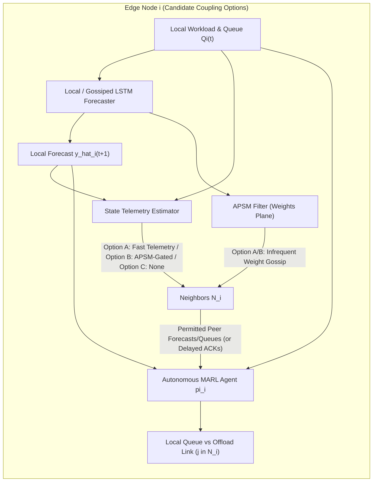

# Phase 3 Research Knowledge, Literature, and Feasibility Audit

> **Audit Scope & Guardrails:** This document reconstructs current research knowledge, workspace artifacts, external literature, RL/MARL technical foundations, dataset suitability (`cluster-trace-v2017`), and open architectural decisions for **Phase 3 (MARL-based autonomous task offloading over APSM + Gossip Learning)**.  
> No repository files were modified, no architecture or MARL algorithm has been finalized, and novelty claims are critically audited rather than assumed. Whenever a referenced paper is paywalled or only accessible via abstract/metadata without full PDF equations, unverified specifics are explicitly marked as **Unverified**.

---

## 1. Understanding the Intended Phase 3 Architecture

In Phases 1 and 2, the implemented codebase (`gl-forecasting-edge` + APSM) is purely a **passive forecasting and communication-gating simulator**: nodes ingest static preprocessed `.npz` time series offline, exchange Keras LSTM parameters across a discrete-event P2P mesh in [`Simulator`](file:///d:/coolage%20study%20materials/MTP/src/gossiplearning/simulator.py#L36-L206), and suppress redundant weight broadcasts inside [`Node`](file:///d:/coolage%20study%20materials/MTP/src/gossiplearning/node.py#L37-L414). Nothing executes live task arrivals, queues, deadlines, or offloading decisions.

**Phase 3 proposes closing the loop from passive prediction to autonomous actuation** by pairing two decentralized planes per edge node $i \in \{0, \dots, N-1\}$:

1. **Local Observation & Time-Series Ingestion:** Each edge node continuously observes its local workload trace (request arrivals, resource utilization, and local queue backlog $Q_i(t)$).
2. **Local LSTM Forecasting:** Using [`create_LSTM`](file:///d:/coolage%20study%20materials/MTP/src/utils/model_creators.py#L10-L48) (or a redesigned online forecaster), node $i$ processes recent historical windows to predict upcoming load $\hat{y}_i(t+1)$ (or horizon $\hat{y}_i(t+1:t+H)$).
3. **Decentralized Gossip Learning (Model Plane):** Nodes periodically merge local LSTM weights with peer weights received over 1-hop links [`Link`](file:///d:/coolage%20study%20materials/MTP/src/gossiplearning/models.py#L63-L70) via age-weighted averaging ([`merge_weights_with_age_weighted_avg`](file:///d:/coolage%20study%20materials/MTP/src/gossiplearning/aggregators.py#L56-L101)), improving generalization without raw data sharing or a central parameter server.
4. **APSM Communication Gating:** Before broadcasting weights in [`process_send_model_event`](file:///d:/coolage%20study%20materials/MTP/src/gossiplearning/event.py#L145-L238), node $i$ runs [`Node.should_suppress_transmission`](file:///d:/coolage%20study%20materials/MTP/src/gossiplearning/node.py#L156-L189), suppressing redundant weight gossip when surprise $\varepsilon_i(t)$ falls inside adaptive noise band $\tau_i(t)$, subject to heartbeat $H$ to prevent starvation.
5. **Self & Peer Future Workload Estimation (Critical Interface Gap):** Each node generates its own forward workload estimate $\hat{y}_i(t+1)$ and requires permitted estimates/capacities $\{\hat{y}_j(t+1), Q_j(t), C_j^{\text{free}}(t)\}_{j \in \mathcal{N}_i}$ for candidate offload targets. **Important distinction:** In existing Phase 2 code, nodes only exchange *LSTM weight tensors*, NOT peer forecasts or recent local history windows $X_j(t)$ — meaning node $i$ **cannot** compute peer $j$'s future load $\hat{y}_j(t+1)$ from gossiped weights alone without an explicit state/forecast exchange protocol or probing mechanism.
6. **Autonomous Per-Node MARL Agent:** Each node hosts an RL decision policy $\pi_i(a_i(t) \mid o_i(t))$ invoked whenever tasks arrive or at decision epochs $\Delta t$.
7. **State-Conditioned Offloading Decision:** Observing local queue depth, remaining compute capacity, self workload forecast $\hat{y}_i(t+1)$, link metrics (RTT/bandwidth), and permitted neighbor state/forecast summaries, $\pi_i$ chooses how tasks are processed locally versus forwarded to neighbor(s) $j \in \mathcal{N}_i$ (or tier above, if modeled).
8. **Proactive Load Balancing Objective:** By feeding *predicted* load surges $\hat{y}(t+1)$ rather than solely reactive queue lengths $Q(t)$, agents ideally pre-empt saturation — reducing end-to-end latency, task drops/timeouts, and hotspot cascading across edge peers.

### Why Combining These Components Is Not Automatically Novel
A thesis claim that *"nobody has combined GL + APSM + MARL before"* is **methodologically weak** if framed merely as component stacking:
- **DECOFFEE (`arXiv:2604.24507`, 2026)** already combines **decentralized MARL offloading with LSTM workload/network forecasting**.
- **Edge proactive MARL offloading** using load predictors (LSTM/GRU + DQN/MAPPO/MADDPG) is well explored in MEC literature.
- **Gossip Learning + FedAvg** weight pruning/triggering also exists broadly in distributed ML.

For Phase 3 to hold credible research novelty, it must investigate a **genuinely coupled problem** — for example, how **APSM-driven partial/asynchronous communication affects MARL coordination quality and convergence** (e.g., whether suppressing forecast model updates or coupling semantic surprise gating to offloading telemetry reduces control-plane overhead without inducing stale peer-load offloading oscillations), rather than running APSM on static datasets and MARL on unrelated synthetic queues.

---

## 2. Literature Review Knowledge

### 2.0 Workspace Literature Audit & Discrepancies Found
A direct filesystem audit of `d:\coolage study materials\MTP` confirms:
- **No PDF papers, `.bib` databases, or literature survey markdown files exist in the repository** (e.g., `papers/`, `references.bib`, `2022IMT082-MTP1(1).pdf`, `docs/literature.md` are absent).
- **Author Misattribution Caught Inside Repo:** [`MASTER_RESEARCH_HANDOVER_CONTEXT.md`](file:///d:/coolage%20study%20materials/MTP/docs/MASTER_RESEARCH_HANDOVER_CONTEXT.md#L27) and `docs/COMPLETE_EXPERIMENT_COMPARISON_10_50_100.md` attribute Tundo et al. (2025) to *"A. Tundo, M. Mobilio, and L. Mariani"*. Both [`pyproject.toml`](file:///d:/coolage%20study%20materials/MTP/pyproject.toml#L5) and the published IEEE TNSM record confirm the real authors are **Alessandro Tundo, Federica Filippini, Francesco Regonesi, Michele Ciavotta, and Marco Savi**.
- **Workspace Reference Mismatch:** [`MASTER_RESEARCH_HANDOVER_CONTEXT.md`](file:///d:/coolage%20study%20materials/MTP/docs/MASTER_RESEARCH_HANDOVER_CONTEXT.md#L33-L37) cites *"G. Yao, H. Liu, and L. Dai (2025)"* for cloud-native MARL and sketches an IPPO/MAPPO simplex design ([L171–L194](file:///d:/coolage%20study%20materials/MTP/docs/MASTER_RESEARCH_HANDOVER_CONTEXT.md#L171-L194)), whereas **none** of DECOFFEE (2026), Chen et al. (2023), Adu et al. (2026), or Alibaba 2017 are referenced anywhere in the repository yet.

Below is the audited analysis of the **four target papers** from external sources and workspace code, strictly separating verified facts from unverified full-text details.

---

### 2.1 Paper 1 — Tundo et al. (2025): *Decentralized Edge Workload Forecasting With Gossip Learning*
* **Bibliographic Record:** Alessandro Tundo, Federica Filippini, Francesco Regonesi, Michele Ciavotta, Marco Savi, *IEEE Transactions on Network and Service Management (TNSM)*, Vol. 22, No. 4, pp. 3016–3031, Aug. 2025. DOI: [`10.1109/TNSM.2025.3570450`](https://doi.org/10.1109/TNSM.2025.3570450). Zenodo artifact DOI: `10.5281/zenodo.15393791` (cited in [`README.md`](file:///d:/coolage%20study%20materials/MTP/README.md#L63)). Workspace codebase originates from `unimib-datAI/gl-forecasting-edge` ([`pyproject.toml`](file:///d:/coolage%20study%20materials/MTP/pyproject.toml#L2-L5)).
* **Verification & Access Status:** **High for architecture/simulator/hyperparameters** (directly embodied in workspace Python code + TU Wien / IEEE abstract & OpenReview metadata). **Partial for published paper tables** (exact numerical baselines/Azure mapping scripts beyond local `2_dataset_generation.py` require consulting the full Zenodo/PDF archive).

| Dimension | Verified Findings |
| :--- | :--- |
| **Problem Solved** | Serverless (DFaaS) peer-to-peer workload forecasting across geographically distributed edge nodes without centralized parameter servers or single points of failure (SPOF). |
| **Architecture** | Fully decentralized P2P mesh constructed via $k$-edge augmentation (`nx.k_edge_augmentation`) over cell tower coordinates; asynchronous discrete-event gossip loop ([`Simulator`](file:///d:/coolage%20study%20materials/MTP/src/gossiplearning/simulator.py#L36-L206)). |
| **Forecasting Mechanism** | Two-layer stacked LSTM (`50 -> 50 -> Dropout(0.2) -> Dense(32, relu) -> Dense(1, relu)`) trained on sliding `(4 -> 1)` multivariate windows with MSE loss ([`create_LSTM`](file:///d:/coolage%20study%20materials/MTP/src/utils/model_creators.py#L10-L48)). |
| **Peer Info Obtained** | Direct neighbor-to-neighbor exchange of flattened neural weights + scalar model age (`WeightsMessage`); **no raw time-series, queues, or workload predictions are exchanged**. |
| **RL / MARL Algorithm** | **None.** Purely supervised decentralized regression/forecasting. |
| **State / Action / Reward** | **N/A** (not an MDP/control framework). |
| **Dataset & Simulation Env** | Custom Python DES (`queue.PriorityQueue`, TensorFlow/Keras, NetworkX). Published paper evaluates synthetic diurnal traces + Microsoft Azure Functions mapped over Porto telecommunications towers/mobility; local repo (`2_dataset_generation.py`) contains the Akima + AR(4) synthetic Porto-tower workload generator. Baselines include FedAvg (Flower), standalone node training, and centralized training. |
| **Evaluation Metrics** | MSE, RMSE, MSLE, MAE; messages transmitted per node ($m$ scaling invariance wrt $N$), convergence trajectories, resilience under node/link failure injection. |
| **What Can Realistically Be Reused** | **Directly reusable (after bug fixes):** DES kernel ([`Simulator`](file:///d:/coolage%20study%20materials/MTP/src/gossiplearning/simulator.py#L36-L206), `PriorityQueue`), graph topology builder ([`build_network`](file:///d:/coolage%20study%20materials/MTP/src/1_network_generation.py#L29-L64)), [`Node`](file:///d:/coolage%20study%20materials/MTP/src/gossiplearning/node.py#L37-L414) + APSM gate, LSTM creator. **Cannot be reused as-is:** lacks task arrivals, task queues, compute execution engine, RTT-based offloading links, and online streaming windows. Also note verified Phase 2 bugs in `Node` (pre-training `_evaluate()`, per-update optimizer reset, `5s` suppression loop, stopping leak) documented in [`APSM_Knowledge_Audit.md`](file:///C:/Users/parth/.gemini/antigravity/brain/d54aa77b-89c4-4cc4-89a1-2c200ccf8e66/APSM_Knowledge_Audit.md#L189-L198). |

---

### 2.2 Paper 2 — DECOFFEE (2026 Preprint): *Decentralized Reinforcement Learning for Time-critical Workload Offloading and Energy Efficiency across the Computing Continuum*
* **Bibliographic Record:** Anastasios E. Giannopoulos, Sotirios T. Spantideas, Panagiotis Trakadas (et al.), `arXiv:2604.24507` (`[cs.NI]`), 2026 preprint.
* **Verification & Access Status:** **Abstract & Search Metadata Only.** Full preprint PDF equations, hyperparameter tables, exact continuum topology size, exact simulator stack, and numeric benchmark tables are **Unverified (full PDF text unavailable in sandbox/search)**.

| Dimension | Verified Findings & Explicit Unverified Boundaries |
| :--- | :--- |
| **Problem Solved** | Time-critical workload placement and computation offloading for latency-sensitive, battery-constrained IoT tasks across a multi-tier **Edge–Cloud computing continuum**, balancing delay, energy consumption, and deadline drops under stochastic arrivals and heterogeneous capacity. |
| **Architecture** | Multi-tier hierarchical/continuum architecture: autonomous far-edge agents decide locally among **local execution**, **horizontal offloading to neighboring edge nodes**, or **vertical offloading to remote cloud**. Multi-agent scheme modeled as **parallel MDPs**. |
| **Forecasting Mechanism** | **Integrated LSTM forecasting** used to anticipate future network conditions / workload load dynamics as predictive inputs to the RL value network. Exact horizon, input features, and whether LSTM weights are trained standalone vs federated/gossiped are **Unverified** (no mention of Gossip Learning or APSM in the abstract). |
| **Peer Info Obtained** | Uses local system observations plus LSTM-predicted network/load conditions; exact peer state telemetry protocol (e.g., piggybacked queue beacons vs probe-free) is **Unverified**. |
| **RL / MARL Algorithm** | **Double Dueling Deep Q-Network (DQN)** coupled with **LSTM forecasting** over parallel MDPs (decentralized execution). Training regime (fully independent vs parameter-shared vs CTDE) is **Unverified**. |
| **State / Action / Reward** | **High-level verified:** Actions represent discrete placement targets (*local*, *neighbor edge*, *remote cloud*); multi-objective reward balances **execution/transmission delay, energy consumption, and workload drop rate / strict timeouts**. **Exact mathematical feature vector $s_t$, discrete action cardinality, and weighting coefficients ($\lambda$) are Unverified.** |
| **Dataset & Simulation Env** | Evaluated via simulations across varying traffic/network loads against conventional rule-based and heuristic placement baselines. Specific synthetic vs real trace (e.g., whether Alibaba/Azure or Poisson is used) and simulator framework are **Unverified**. |
| **Evaluation Metrics** | System delay (latency), energy consumption, workload drop rate (timeout violations), and baseline throughput comparison. |
| **What Can Realistically Be Reused** | **Conceptually closest reference for Phase 3:** Provides strong justification for feeding LSTM forecasts into edge MARL states, modeling discrete placement options (local / peer / optionally cloud) with delay + energy + drop penalties, and serving as a **key conceptual comparator** (central thesis distinction: DECOFFEE omits P2P Gossip Learning weight sharing and APSM communication reduction). |

---

### 2.3 Paper 3 — Chen, Guo, Song (2023): *Multi-agent Deep Reinforcement Learning for Collaborative Task Offloading in Mobile Edge Computing Networks*
* **Bibliographic Record:** Minxuan Chen, Aihuang Guo, Chunlin Song, *Digital Signal Processing*, Vol. 140, Art. 104127, June/Aug. 2023. DOI: [`10.1016/j.dsp.2023.104127`](https://doi.org/10.1016/j.dsp.2023.104127) (Elsevier ScienceDirect).
* **Verification & Access Status:** **Paywalled Elsevier Metadata & Abstract Only.** Search results confirmed only the abstract text and bibliographic indexing; exact algorithm name (e.g., MADDPG vs QMIX vs PPO), full state/action/reward equations, MES agent topology, simulator engine, and dataset details are **Unverified (full PDF behind paywall)**.

| Dimension | Verified Findings & Explicit Unverified Boundaries |
| :--- | :--- |
| **Problem Solved** | Collaborative computation offloading (and resource coordination) in Mobile Edge Computing (MEC) networks with **Multi-Edge Server (MES)** agents under resource-constrained, dynamic workloads. |
| **Architecture** | Cooperative multi-agent MEC architecture explicitly employing **Centralized Training with Decentralized Execution (CTDE)** across collaborating edge server (MES) agents. Exact wireless/wired backhaul topology is **Unverified**. |
| **Forecasting Mechanism** | **None verified** in available abstract/metadata (reactive MDP state transition rather than explicit decentralized LSTM workload forecasting; full confirmation **Unverified**). |
| **Peer Info Obtained** | CTDE framework allows centralized critic/coordination access during offline training while executing from local agent observations at runtime; exact runtime inter-MES signaling is **Unverified**. |
| **RL / MARL Algorithm** | Cooperative MADRL under CTDE. (Secondary domain surveys associate similar 2023 DSP MEC CTDE designs with actor-critic / MADDPG-style algorithms, but the exact algorithm name in Chen et al. (2023) could not be directly verified from accessible text -> **Unverified**.) |
| **State / Action / Reward** | **High-level verified:** Focuses on maximizing processed tasks / offloading efficiency while minimizing time costs in resource-constrained MES settings. **Exact state vector, continuous vs discrete offloading action, and reward terms (whether energy is weighted) are Unverified.** |
| **Dataset & Simulation Env** | Synthetic discrete/MEC simulation (exact tool—Python/MATLAB—and trace vs Poisson arrivals **Unverified**). Abstract reports $+12.5\%$ processed tasks, $+17\%$ offloading rate, and $-53\%$ time cost vs baselines. |
| **Evaluation Metrics** | Number of processed tasks, task offloading rate, task completion time cost. |
| **What Can Realistically Be Reused** | **CTDE architectural pattern:** Demonstrates that edge server agents (MES) themselves — rather than solely mobile end-devices — can act as cooperative MARL agents under CTDE. However, because we lack the full text, **specific equations or hyperparameters cannot be cited as implemented baselines** without obtaining institutional PDF access first. |

---

### 2.4 Paper 4 — Adu et al. (2026): *Decentralized Computation Offloading Strategy via Multi-Agent Deep Reinforcement Learning for Multi-Access Edge Computing Systems*
* **Bibliographic Record:** Emmanuella Adu, Yeongmuk Lee, Jihwan Moon, Sooyoung Jang, Inkyu Bang, Taehoon Kim, *Sensors* (MDPI Open Access), Vol. 26, Issue 3, Art. 914, Jan. 2026. DOI: [`10.3390/s26030914`](https://doi.org/10.3390/s26030914).
* **Verification & Access Status:** **Open-Access Abstract, Structure, and Key Section Summaries Verified** (via MDPI & PubMed Central snippets). Exact scalar equations, Q-network layer sizes, learning rates, and Table 2 numeric parameters were **not fully parsed** and remain **Unverified**.

| Dimension | Verified Findings & Explicit Unverified Boundaries |
| :--- | :--- |
| **Problem Solved** | Fully decentralized task computation offloading from multiple wireless edge devices to a MEC server over **grant-free random access** wireless channels, mitigating contention collisions and spatial multiplexing limits to minimize task completion latency. |
| **Architecture** | Fully decentralized device-side multi-agent architecture operating without a central offloading scheduler or inter-agent global state sharing. |
| **Forecasting Mechanism** | **None.** Purely reactive observation-based learning without explicit time-series workload forecasting. |
| **Peer Info Obtained** | **No explicit inter-agent state messaging verified**; agents rely strictly on **local observations** (local CSI, local task/queue info, and estimated active contending user count) and implicitly perceive peer congestion through grant-free access collisions and resulting delay penalties. |
| **RL / MARL Algorithm** | **Independent Multi-Agent Deep Q-Network (MADQN)** with discrete actions (chosen for fast convergence under decentralized non-stationarity). |
| **State / Action / Reward** | **Verified structurally:** • **State ($s_k$):** Local Channel State Information (CSI), estimated active contending devices, local queue/task resource requirements (exact feature scaling **Unverified**). • **Action ($a_k$):** Discrete **offloading factor** partitioning task workload between local device CPU and remote MEC execution (+ wireless access parameters). • **Reward ($r_k$):** Formulated from negative task completion latency (transmission + queueing + execution), explicitly penalizing **grant-free collisions and failed access attempts**. (Exact algebraic weightings **Unverified**.) |
| **Dataset & Simulation Env** | Custom computer simulation in **MATLAB R2023b** modeling wireless channel fading, spatial multiplexing, grant-free random access collisions, and stochastic MEC task parameters (synthetic physical/MAC layer, no cluster trace). |
| **Evaluation Metrics** | Total task completion latency, convergence speed across episodes, collision/access contention resilience under varying numbers of active devices. |
| **What Can Realistically Be Reused** | **Discrete offloading factor & collision/congestion feedback intuition:** Useful for comparing **independent decentralized DQN (no CTDE, no forecasts)** as a strict pure-decentralized baseline and modeling congestion penalties when multiple nodes offload to the same peer simultaneously. However, its physical/MAC grant-free wireless model differs substantially from P2P server-to-server task routing over topological edge links. |

---

## 3. Major Technical Concepts (Grounded in Edge Offloading)

### 3.1 Reinforcement Learning (RL)
Single-agent RL models sequential decision-making as a Markov Decision Process $\mathcal{M} = (\mathcal{S}, \mathcal{A}, P, R, \gamma)$: an edge node observes state $s_t \in \mathcal{S}$, selects offloading action $a_t \in \mathcal{A}$, receives scalar reward $r_t = R(s_t, a_t)$, transitions via $P(s_{t+1}\mid s_t, a_t)$, and learns a policy $\pi(a \mid s)$ maximizing expected discounted return $\mathbb{E}[\sum_{k=0}^\infty \gamma^k r_{t+k}]$.
- **Why pure single-agent RL breaks in edge clusters:** Transition probability $P_i$ for node $i$ depends on *concurrent offloading choices of neighbors*. When Node A sees Node B is idle and dumps 50% of its queue onto B at the same millisecond Node C does, B becomes overloaded immediately — violating single-agent stationarity.

### 3.2 Multi-Agent Reinforcement Learning (MARL)
MARL generalizes MDPs to a **Markov Game** (or Dec-POMDP when observations are local):
$$\mathcal{G} = \langle \mathcal{N}, \mathcal{S}, \{\mathcal{A}_i\}_{i=1}^N, \{\mathcal{O}_i\}_{i=1}^N, P, \{R_i\}_{i=1}^N, \gamma \rangle$$
Joint actions $\mathbf{a}_t = (a_{1,t}, \dots, a_{N,t})$ drive global transitions $P(\mathbf{s}_{t+1} \mid \mathbf{s}_t, \mathbf{a}_t)$.
- **Core MARL challenges in edge offloading:**
  1. **Non-stationarity:** As peers update policies $\pi_j$, the environment dynamics seen by agent $i$ drift continuously, destabilizing replay buffers and bootstrapping targets.
  2. **Multi-agent credit assignment:** If a task offloaded $i \to j$ misses its deadline, was the error node $i$'s routing decision, node $j$'s local scheduling, or node $k$'s simultaneous burst onto $j$?
  3. **Action-space coupling / oscillations (Herding):** Symmetric edge agents seeing identical forecast/queue states can simultaneously offload to the same lightly loaded neighbor ("thundering herd").

### 3.3 CTDE (Centralized Training with Decentralized Execution)
Agents train offline in simulation using **privileged global information** $\mathbf{s}_t$ (or joint actions $\mathbf{a}_t$, peer hidden states) inside a centralized critic or value-mixing network, **while learned actor policies $\pi_i(a_i \mid o_i)$ depend solely on local observations $o_i$ at runtime**.
- **Critical thesis boundary check:** [`MASTER_RESEARCH_HANDOVER_CONTEXT.md`](file:///d:/coolage%20study%20materials/MTP/docs/MASTER_RESEARCH_HANDOVER_CONTEXT.md#L192-L200) explicitly proposes CTDE (`MAPPO`) while demanding *"zero centralized coordination."* Strictly speaking:
  - **CTDE respects runtime decentralization** (no server or global state during deployment/inference, just like offline simulation training).
  - However, **purists of fully online P2P self-adaptation** (where agents keep learning live on edge hardware without a simulator trainer) argue CTDE assumes offline centralized simulation before deployment — an explicit design question your mentor must confirm.

### 3.4 MADDPG (Multi-Agent Deep Deterministic Policy Gradient)
Extension of DDPG/actor-critic to **continuous** multi-agent spaces under CTDE:
- Each agent $i$ has a decentralized deterministic actor $\mu_i(o_i; \theta_i)$ outputting continuous vectors (e.g., traffic split ratios $\alpha_i \in \Delta^k$, CPU frequency scaling) and a **centralized critic** $Q_i(\mathbf{s}, a_1, \dots, a_N; \phi_i)$.
- **Edge offloading fit & pitfalls:** Naturally produces fractional split ratios $\alpha_i$ (using a softmax output layer for $\sum_j \alpha_{i,j} = 1$). However, centralized critic input size grows as $\mathcal{O}(N \cdot (|o| + |a|))$, making pure MADDPG fragile at $N=50$ or $100$ nodes, and off-policy replay buffers suffer instability in large asynchronous networks.

### 3.5 MAPPO (Multi-Agent Proximal Policy Optimization)
On-policy CTDE extension of PPO with clipped surrogate objective:
- Typically uses parameter-shared actor $\pi_\theta(a_i \mid o_i)$ (handling homogeneous or feature-normalized edge nodes) + centralized critic $V_\phi(\mathbf{s})$ (or neighbor-scoped critic) reducing gradient variance via Generalized Advantage Estimation (GAE).
- **Edge offloading fit & pitfalls:** Supports **both discrete** (choose target node $j$) and **continuous** (simplex fractional offloading) actions cleanly, scales far better than MADDPG to $N=50\text{--}100$ when actors share parameters or use attention/mean-field critics, and avoids stale replay buffers. Downside: on-policy sample inefficiency (slower per-step data reuse than DQN/MADDPG).

### 3.6 MADQN and Double Dueling DQN
- **MADQN (Independent / Shared DQN):** Each edge node approximates $Q_i(o_i, a_i; \theta_i)$ over **discrete** actions (e.g., execute locally, offload to neighbor rank $1 \dots k$, or discrete offloading fraction $\{0, 0.25, 0.5, 0.75, 1.0\}$). Used in **Adu et al. (2026)** and extended in **DECOFFEE (2026)**.
- **Double DQN:** Decouples action selection from target evaluation ($y = r + \gamma Q(s', \arg\max_{a'} Q(s', a'; \theta); \theta^-)$) to avoid Q-value overestimation common under noisy edge latencies.
- **Dueling Architecture:** Splits $Q(o, a) = V(o) + \left(A(o, a) - \frac{1}{|A|}\sum_{a'} A(o, a')\right)$, learning which states are inherently congested ($V(o)$) independently of which target neighbor ($A(o, a)$) is marginally better.
- **Pitfall:** Cannot natively pick from a dynamically changing neighbor set unless padded/masked or indexed by fixed max-degree $k_{\max}$, and cannot directly output smooth continuous split percentages without discretization explosion.

### 3.7 QMIX
Value-factorization CTDE algorithm for **strictly cooperative, discrete-action** teams sharing a single global team reward $R_{\text{tot}}$:
- Individual agent utilities $Q_i(o_i, a_i)$ are combined via a monotonic mixing hypernetwork conditioning on global state $\mathbf{s}$ with non-negative weights ($\frac{\partial Q_{\text{tot}}}{\partial Q_i} \ge 0$).
- Guarantees **Individual-Global-Max (IGM)**: $\arg\max_{\mathbf{a}} Q_{\text{tot}}(\mathbf{s}, \mathbf{a}) = (\arg\max_{a_1} Q_1, \dots, \arg\max_{a_N} Q_N)$, enabling decentralized greedy argmax execution.
- **Edge offloading fit & pitfalls:** Strong if the objective is purely global cluster throughput/SLA satisfaction across small-to-medium teams (`10`–`50` nodes) with discrete routing. Fails for individual/selfish rewards, continuous split actions, or non-monotonic asymmetric contention penalties where one agent's gain degrades global welfare.

### 3.8 State, Action, Reward, and Policy Design in Edge Offloading
- **State / Observation ($o_i(t)$):** Typically combines *reactive physical state* (queue length $Q_i$, current CPU/RAM usage $u_i$, incoming task size/CPU demand/deadline), *proactive LSTM forecast* ($\hat{y}_i(t+1)$), and *permitted peer context* (link RTT/bandwidth, neighbor $Q_j, u_j, \hat{y}_j$ at age $\Delta_{\text{stale}}$).
- **Action ($a_i(t)$):** Three main abstractions exist:
  1. *Discrete Per-Task Target Routing:* Choose target $j \in \{\text{self}\} \cup \mathcal{N}_i$ for each incoming task.
  2. *Quantized Offloading Fraction:* Choose fraction $f \in \{0, 0.25, \dots\}$ (as in Adu et al., 2026).
  3. *Continuous Flow / Batch Split Ratio:* Simplex vector $\alpha_i \in [0,1]^{|\mathcal{N}_i|+1}$ dividing arrivals in interval $\Delta t$.
- **Reward ($R_i$ or $R_{\text{team}}$):** Must carefully normalize scales — e.g., combining task delay (seconds), energy (Joules), and deadline drop/overflow penalties without one dominating gradients or creating degenerate local optima (such as dropping hard tasks or never offloading to avoid TX penalty).
- **Policy ($\pi_i$):** Stochastic ($\pi(a \mid o)$ for PPO/actor-critic) vs deterministic ($\mu(o)$ for MADDPG) vs $\varepsilon$-greedy $\arg\max_a Q(o, a)$ (for DQN/QMIX).

### 3.9 Local Observations vs. Global State
In a sparse $k$-edge-connected mesh (`K_EDGE_CONNECTIVITY = 3` in [`experiment_config.py`](file:///d:/coolage%20study%20materials/MTP/src/experiment_config.py#L27)), node $i$ only connects to $|\mathcal{N}_i| \approx 3\text{--}5$ peers.
- **Global state $\mathbf{s}_t$:** Full $N$-node queues, workloads, and in-flight transfers — infeasible to broadcast at runtime in scalable wireless/edge systems and explicitly disallowed at runtime in serverless P2P edge architectures.
- **Local observation $o_i(t)$:** Node $i$'s own state + stale/compressed 1-hop neighbor summaries. Crucially, if APSM suppresses transmissions, **neighbor state age increases asymmetrically** across nodes — creating a time-varying **Partially Observable MDP (POMDP)** where incorporating observation staleness $(t - t_{\text{recv}})$ or recurrent memory (GRU/LSTM policy) can matter as much as the forecast itself.

### 3.10 Cooperative vs. Independent Agents
- **Independent Learning (IQL / IDQN / IPPO):** Zero training-time centralized critic — **100% consistent with decentralized edge autonomy** even during live online adaptation (each node only needs local reward + local states). Suffers from higher variance/non-stationarity as scale grows ($N=50, 100$), unless neighbor reward feedback or stabilized PPO clipping mitigates oscillation.
- **Cooperative Agents (with or without CTDE):** Agents optimize a shared or neighborhood-weighted objective $r_i^{\text{coop}} = (1 - \beta) r_i^{\text{local}} + \beta \frac{1}{|\mathcal{N}_i|} \sum_{j \in \mathcal{N}_i} r_j$ (preventing selfish dumping onto overloaded peers!). Note that **neighborhood reward shaping does not necessarily require a global CTDE server** — peers can piggyback lightweight cost acknowledgments when accepting/finishing offloaded tasks.

---

## 4. Alibaba Cluster Trace 2017 (`cluster-trace-v2017`) Audit

> **Local Status:** `cluster-trace-v2017` is **not** present anywhere inside `d:\coolage study materials\MTP`. All schema details below come from the official [`alibaba/clusterdata`](https://github.com/alibaba/clusterdata) documentation (`schema.csv`, `trace_201708.md`).

### 4.1 Dataset Overview, Scale & Conventions
- **Scale & Workload Mix:** Real production datacenter cluster of approximately **1,300 machines** running co-located **long-running containerized online services** (Sigma scheduler) and **offline transient batch jobs** (Fuxi scheduler).
- **Duration & Sampling:** Usage metrics span **12 consecutive hours** (timestamps in integer seconds relative to start boundary; `0` indicates pre-window events). Resource telemetry is sampled at **60s intervals** (with smoothed 300s reporting in some docs/views; exact container microarchitecture sampled per second into periodic summaries).
- **Format:** Raw CSV files have **no header rows**; column indexing must be mapped strictly via `schema.csv`. Sensitive values (machine specs, memory capacity/usage, CPU cores vs normalized scales) are **normalized/obfuscated** for confidentiality.

### 4.2 Files & Schema Fields Breakdown
All 6 core tables documented in `cluster-trace-v2017` (`schema.csv` / `trace_201708.md`):

| File | Granularity & Role | Verified Key Columns (`schema.csv`) |
| :--- | :--- | :--- |
| **`server_event.csv`** | Physical machine lifecycle, errors, capacities | `timestamp`, `machineID`, `event type` (`add`, `softerror`, `harderror`), `event detail`, `capacity:CPU`, `capacity:memory`, `capacity:disk` |
| **`server_usage.csv`** | Aggregate physical machine utilization (online + batch + OS) | `timestamp`, `machineID`, `util:CPU`, `util:memory`, `util:disk`, `load1`, `load5`, `load15` |
| **`container_event.csv`** | Online latency-sensitive container creation/removal | `ts`, `event` (`Create`/`Remove`), `instance_id`, `machine_id`, `plan_cpu`, `plan_mem`, `plan_disk`, `cpuset` (`\|`-delimited cores) |
| **`container_usage.csv`** | Periodic online container runtime telemetry | `ts`, `instance_id`, `cpu_util_percent`/`cpu_util`, `mem_util`, `disk_util`, `load1`/`load5`/`load15`, `avg_cpi`, `max_cpi`, `avg_mpki`, `max_mpki` *(exact full column list/ordering must be checked directly against downloaded `schema.csv` before parsing)* |
| **`batch_task.csv`** | Logical offline batch tasks within multi-task jobs | `create_timestamp`, `modify_timestamp`, `job_id`, `task_id`, `instance_num` (parallel workers), `status` (`Ready`/`Waiting`/`Running`/`Terminated`/`Failed`/`Cancelled`), `plan_cpu`, `plan_mem` |
| **`batch_instance.csv`** | Atomic execution retries (`seq_no`) of batch tasks | `start_timestamp`, `end_timestamp`, `job_id`, `task_id`, `machineID`, `status` (`Ready`/`Waiting`/`Running`/`Terminated`/`Failed`/`Cancelled`/`Interrupted`), `seq_no`, `total_seq_no`, `real_cpu_max`, `real_cpu_avg`, `real_mem_max` *(additional fields like `plan_cpu`/`mem` or instance ID to be verified against `schema.csv`)* |

### 4.3 Critical Limitations & Missing Fields for Edge Offloading
Using `cluster-trace-v2017` directly as an edge offloading benchmark has **major structural blind spots**:
1. **No Edge Network Topology, Links, or Latency:** All ~1,300 machines sit inside a high-speed homogeneous Alibaba datacenter LAN (`cluster-trace-v2017` contains **no IP topology, physical distance, propagation delay, RTT, or link bandwidth limits**, nor `net_in`/`net_out` link graphs).
2. **No Task Input/Output Payload Sizes:** Neither `batch_task` nor `batch_instance` records input/output byte sizes needed to compute transmission delay $d_{\text{tx}} = \text{payload\_bytes} / B_{i,j}$ or wireless TX energy.
3. **No Explicit Deadlines / Latency SLAs:** Batch jobs in `v2017` are best-effort Fuxi jobs with **no explicit deadline timestamps or SLA targets**. Dropping rates / timeout metrics cannot be read directly from the trace; deadlines must be artificially synthesized.
4. **Incomplete / Implicit DAG Dependencies:** Unlike `cluster-trace-v2018` (which encodes task dependencies directly in `task_name` DAG markers), `v2017` `batch_task.csv` lacks explicit DAG parent/child edge tables — parallel independent or sequential task assumptions must be carefully checked or modeled.
5. **Only 12 Hours vs. 1 Year:** Our Phase 2 LSTM simulator ([`2_dataset_generation.py`](file:///d:/coolage%20study%20materials/MTP/src/2_dataset_generation.py#L62-L65)) trained on `34,837` 15-minute windows (**1 full year = `365 days`**). Twelve hours at 1-minute resolution yields only **720 samples per machine** (`server_usage.csv`), creating severe sample scarcity and timescale mismatch if fed directly into the exact Phase 2 LSTM training pipeline (`63%/7%/30%` split -> only ~453 training points per node vs `21,946`!) unless tasks/arrivals are binned at finer sub-second/10s scales or aggregated across machine groups.
6. **Datacenter Scale vs. Constrained Edge Nodes:** Co-located datacenter servers behave differently from geo-distributed wireless/MEC base stations driven by human diurnal mobility.

### 4.4 Explicit Trace-to-System Mapping & Real vs. Simulated Separation

| Component | Directly Available in `cluster-trace-v2017` | **Must Be Simulated / Synthesized** |
| :--- | :--- | :--- |
| **Node Count & Heterogeneity** | Normalized machine `capacity:CPU`, `capacity:memory`, `capacity:disk` (`server_event.csv`) & fault timestamps (`softerror`/`harderror`). | Selection/clustering of `1,300` servers down to `10 / 50 / 100` edge nodes; physical edge CPU speed (GHz / MIPS) and RAM GB scaling factors. |
| **Workload Time Series (for LSTM)** | Real temporal aggregate utilization (`util:CPU`, `util:memory` in `server_usage.csv` at 60s/300s) and batch arrival counts per bucket (`batch_task.create_timestamp`). | Choice of aggregation window (e.g., 5s/10s arrival rate vs 60s CPU utilization) because 12h at 15min = only 48 points (unusable for Phase 2's 15min LSTM). |
| **Task Arrivals & Resource Demand** | Real `create_timestamp`, `instance_num`, `plan_cpu`, `plan_mem` (`batch_task.csv`), and actual runtime `end_timestamp - start_timestamp`, `real_cpu_avg`, `real_cpu_max`, `real_mem_max` (`batch_instance.csv`). | Task **input/output data payload bytes** (for transmission latency), **execution cycle count**, and **latency deadlines / SLA priorities**. |
| **Co-located Background Load** | Real container service background CPU/mem footprint (`server_usage.csv` / `container_usage.csv`). | Exact isolation between background online container load (un-offloadable local load) and offloadable arriving batch/user tasks. |
| **Network Graph, RTT & Bandwidth** | *Not in trace.* | Peer topology (`adj_list.txt` from Porto towers or synthetic graphs), link RTT (`round_trip_time`), link bandwidth (Mbps), wireless contention, link drops. |
| **Queueing & Task Scheduling** | *Not explicitly exported as per-server task queue lengths* (only coarse `Waiting` task statuses). | Explicit FCFS/priority/processor-sharing node queues $Q_i(t)$, offloading serialization queues, migration overhead. |
| **Energy Consumption** | *Not in trace.* | Static + dynamic CPU DVFS power models ($P \propto \kappa f^3$ or linear utilization) and wireless TX power models ($P_{\text{tx}} \cdot d_{\text{tx}}$). |

---

## 5. Unresolved Research Decisions

All 12 foundational design questions remain **deliberately open** pending architectural alignment and advisor review:

1. **Node-owned LSTM vs. Shared gossip-trained model**
   - *Options:* (A) Purely local non-gossiped per-node LSTM (like DECOFFEE); (B) Age-weighted gossip-merged shared/personalized LSTM (current Phase 2 GL+APSM setup); (C) Gossiped shared LSTM backbone + local per-node fine-tuning/calibration layer.
   - *Trade-off:* Pure gossip merging ([`merge_weights_with_age_weighted_avg`](file:///d:/coolage%20study%20materials/MTP/src/gossiplearning/aggregators.py#L56-L101)) averages heterogeneous nodes toward a global model — helpful when training traces are short (e.g., 12-hour Alibaba windows!) via collective transfer, **but harmful** when nodes have structurally distinct local traffic peaks unless fine-tuning or personalized output heads retain local scale/phase.
2. **How peer forecasts are generated and made available**
   - *Options:* (A) Node $j$ executes its own LSTM locally on $X_j(t)$ and broadcasts scalar forecast $\hat{y}_j(t+1)$ (plus $Q_j(t)$); (B) Node $i$ guesses $\hat{y}_j$ using stale last-received telemetry; (C) Nodes infer congestion purely from task-response latency / ACKs without neighbor forecasts.
   - *Critical constraint:* Sharing weights $w_j$ **alone** does not let node $i$ predict $j$'s load unless node $j$ also shares raw features $X_j(t)$ (violating GL's raw-data privacy!) or scalar $\hat{y}_j(t+1)$.
3. **Whether workload telemetry is exchanged separately from model weights**
   - *Options:* (A) Piggybacked onto `WeightsMessage`; (B) Separate lightweight fast telemetry beacons (e.g., every 1s–5s vs slow 30s weight gossip); (C) Event-driven / on-demand probe-before-offload.
   - *Trade-off:* Decoupling tiny 32-byte telemetry packets (`Q_j, cpu_free, y_hat_j`) from heavy megabyte-scale LSTM weights makes engineering sense, **but** forces careful bookkeeping so Phase 2's APSM weight suppression claim isn't trivially invalidated by flooding the network with separate telemetry packets!
4. **How APSM interacts with the MARL layer**
   - *Options:* (A) **Loosely coupled:** APSM purely saves bandwidth on the LSTM weight plane while MARL consumes $\hat{y}_i(t+1)$ independently; (B) **Semantic surprise fed into MARL state/action:** Feed $\varepsilon_i(t)$ as a *regime-shift / uncertainty signal* into MARL (e.g., triggering conservative local/fallback policies or higher exploration when $\varepsilon_i > \tau_i$); (C) **Dual APSM gating:** Apply semantic surprise gating to **offloading state telemetry** as well as model weights, studying how MARL handles staleness when peer load is "predictable" vs "surprising." *(Option B/C gives genuine Phase 2 → Phase 3 scientific coupling!)*
5. **Shared vs. separate RL policies**
   - *Options:* (A) Parameter-shared actor policy $\pi_\theta(a \mid o_i)$ (with node capacity/load features normalized); (B) Independent per-node policies $\pi_{\theta_i}$.
   - *Trade-off:* With `50`–`100` nodes, independent policies rarely converge within finite M.Tech GPU budgets; parameter sharing scales gracefully across `10/50/100` nodes if node ID / degree / capacity heterogeneity is encoded inside $o_i$.
6. **Most appropriate MARL algorithm**
   - *Candidate pool:*
     - **IPPO / MAPPO:** Flexible (discrete target OR continuous split), stable on-policy updates, strong at `50–100` nodes with shared actor.
     - **Double Dueling MADQN (DECOFFEE-style) / QMIX:** Best if per-task discrete target selection (`self` vs $k$ peers) is used; handles fast off-policy replay well at `10` nodes; QMIX handles cooperative team reward.
     - **MADDPG:** Continuous fractional splitting, but centralized critic scales poorly ($\mathcal{O}(N)$ inputs) past `10`–`20` nodes.
   - *Must verify first:* Whether decision timing is **per-task discrete** or **periodic interval fractional**.
7. **Whether CTDE is necessary (and thesis-compliant)**
   - *Trade-off:* Independent learners (IQL/IPPO) obey *strict* zero-coordinator learning both online and offline, avoiding supervisor criticism about hidden centralization, **at the risk of convergence instability at 100 nodes**. CTDE (`MAPPO`/`QMIX`) stabilizes multi-agent credit assignment in offline simulation training while preserving **fully decentralized execution**. Mentor sign-off is essential here.
8. **How to model task arrivals and task dependencies**
   - *Options:* Aggregate interval workload streams vs discrete individual tasks from `batch_task.csv`/`batch_instance.csv` vs Poisson/bursty synthetic arrivals; **independent atomic tasks** vs **DAG sub-tasks** (note `cluster-trace-v2017` lacks native explicit DAG dependency tables, unlike `v2018`).
9. **How to represent network latency and offloading costs**
   - *Options:* Reuse Porto Haversine link metrics ([`Link`](file:///d:/coolage%20study%20materials/MTP/src/gossiplearning/models.py#L63-L70) currently hardcodes `round_trip_time=1`, `weights_transmission_time=30`) vs compute propagation + payload serialization + queueing-at-NIC + wireless contention/collision delay. Must specify bandwidth per link (Mbps) and whether multi-hop forwarding or strict 1-hop offloading is allowed.
10. **How to design the reward**
    - *Choices:* Local per-node reward $r_i$ vs neighbor/team-blended cooperative reward; exact normalization of delay ($d$), energy ($E$), load-balance variance, and deadline drops/rejections; ensuring drop penalties prevent the trivial exploit of rejecting or dropping heavy tasks to keep average delay low.
11. **Whether Alibaba 2017 is suitable for the chosen simulation**
    - *Key tension:* Alibaba `v2017` covers **12 hours on 1,300 datacenter servers** (ideal for co-located container/batch task heterogeneity and bursty arrivals, poor for long-horizon 15-min LSTM training or native WAN topology). Alternatives: retain Porto/Azure multi-day traces for LSTM forecasting + overlay Alibaba-derived task resource profiles/burts, OR switch to `cluster-trace-v2018` / Azure Functions / synthetic multi-day edge tasks.
12. **How to compare against DECOFFEE-style forecasting and offloading**
    - *Experimental challenge:* DECOFFEE's exact source code and full preprint hyperparameters are currently unverified (`arXiv:2604.24507` abstract-only). A rigorous M.Tech evaluation can benchmark clean **ablation & architectural counterparts** inside the *same* simulator:
      1. *Local-only / No-Offload* (lower bound)
      2. *Reactive Heuristic* (e.g., least-loaded neighbor / threshold offloading)
      3. *Reactive MARL* (no LSTM forecast in state)
      4. *DECOFFEE-inspired Local-LSTM + Double Dueling MADQN* (no Gossip Learning, no APSM)
      5. *Full GL + MARL* (unfiltered blind gossip vs APSM-gated gossip)
      6. *Upper-bound Centralized Oracle* (global visibility benchmark).

---

## 6. Final Knowledge Assessment & Feasibility Synthesis (A–G)

### A. Understanding of Proposed Phase 3
Phase 3 upgrades the project from a **passive decentralized model-training benchmark** (Phases 1–2) to a **closed-loop cyber-physical edge control system**. Each autonomous edge node maintains a dual responsibility: (1) collaboratively learning an LSTM workload predictor across a sparse $k$-edge P2P mesh while using APSM to suppress uninformative gossip updates, and (2) running a decentralized MARL agent that combines *self* workload predictions, local compute/queue state, and permitted *peer* state/forecast estimates to route or split incoming tasks across neighbors, pre-empting saturation before queues explode. Structurally, this requires replacing or extending the purely training-event DES in [`Simulator`](file:///d:/coolage%20study%20materials/MTP/src/gossiplearning/simulator.py#L36-L206) with a genuine **task-arrival, queueing, execution, offloading-link, and state-telemetry DES/RL environment**.

### B. Paper-by-Paper Comparison

| Paper / Source | Verification Status | Problem & Topology | Forecasting? | Peer Info Mechanism | RL/MARL Method | Action & Reward Target | Sim / Data | Primary Value / Gap for Phase 3 |
|---|---|---|---|---|---|---|---|---|
| **Tundo et al. (2025)** (*IEEE TNSM*, DOI `10.1109/TNSM.2025.3570450`) | **High** (Workspace DES code + IEEE/TU Wien metadata) | Serverless DFaaS workload prediction over sparse P2P edge mesh | **Yes** — Age-weighted Gossip Learning over 2-layer LSTM (`4 -> 1`) | Exchanges flattened LSTM weights + model age only; zero raw data or queues | **None** | N/A (supervised MSE regression) | Python DES + TF/Keras; Paper: synthetic + Azure + Porto towers; Repo: Akima+AR(4) | Provides DES engine, network builder, LSTM, and APSM gate; **zero task/queue/RL layer** |
| **DECOFFEE (2026)** (*arXiv:2604.24507*) | **Low–Med** (arXiv Abstract + metadata only; details **Unverified**) | Time-critical offloading across far-edge / peer-edge / cloud continuum | **Yes** — Integrated LSTM predicting load/network conditions | Uses local obs + LSTM predictions (exact peer signaling **Unverified**) | **Double Dueling DQN** over parallel MDPs | Discrete placement (local / peer / cloud); Delay + Energy + Drop Rate | Simulations (**engine & trace Unverified**) | Nearest functional neighbor; **lacks Gossip Learning weight sharing & APSM communication gating** |
| **Chen, Guo, Song (2023)** (*DSP* 140, DOI `10.1016/j.dsp.2023.104127`) | **Low** (Paywalled; Abstract + bibliographic metadata only) | Collaborative offloading among Multi-Edge Server (MES) nodes | **Unverified** (none indicated in abstract) | **CTDE** (centralized training critic; decentralized runtime execution) | Cooperative MADRL under CTDE (**exact variant Unverified**) | Collaborative offloading; maximizes processed tasks & minimizes time cost | Synthetic MEC simulation (**details Unverified**) | Supports modeling **edge servers as CTDE cooperative agents**; exact math unavailable without PDF |
| **Adu et al. (2026)** (*Sensors* 26(3):914, DOI `10.3390/s26030914`) | **Medium** (Open-Access MDPI summary/abstracts verified; equations unparsed) | Device-to-MEC decentralized offloading over **grant-free random access** | **None** (reactive only) | Local obs only (CSI, active devices, local task/queue); implicit collision sensing | **Independent MADQN** (discrete action space) | Discrete **offloading factor**; negative task latency incl. collision penalty | **MATLAB R2023b** synthetic wireless MEC model | Strong pure-decentralized discrete baseline; lacks forecasting & P2P server-to-server routing |
| *Repo Reference:* **Yao, Liu, Dai (2025)** | **Unverified** (prose citation in `MASTER_RESEARCH_HANDOVER_CONTEXT.md` only) | Cloud-native cluster resource orchestration | None noted | Centralized cluster scheduler | Role-based MARL | Cluster resource scheduling | Cloud-native cluster | Cited in handover doc only; cannot be relied on without verifying the actual paper |

### C. Technical Explanation of Possible Phase 3 Candidate Architectures

Before locking a design, three distinct architectural couplings between **APSM-GL** and **MARL** are viable — each solving the *"weights vs. forecasts vs. peer telemetry"* gap differently:

1. **Candidate Architecture 1 — Two-Timescale Decoupled Planes (Slow Weight Gossip + Fast Lightweight Telemetry)**
   - *Mechanism:* Slow timescale (minutes / epochs): Nodes train/gossip LSTM weights through APSM (`WeightsMessage`, KB–MB payloads cut by APSM). Fast timescale (seconds / slots): Nodes exchange tiny scalar telemetry packets `(Q_j, u_j, y_hat_j)` with 1-hop neighbors for MARL state construction.
   - *Pros:* Cleanly resolves how node $i$ obtains $\hat{y}_j$ without exposing raw sequence windows $X_j$; easy to isolate APSM's LSTM communication saving vs MARL's offloading gains.
   - *Cons:* Critic weakness — *"If you saved MBs on model weights via APSM, how many packets/bytes did your extra MARL telemetry beacons add?"* Total control-plane overhead (model bytes + telemetry bytes) **must** be measured end-to-end!
2. **Candidate Architecture 2 — Unified Semantic-Gated Control Plane (APSM Gates Both Weights and/or Telemetry)**
   - *Mechanism:* Instead of APSM only gating LSTM weights, either (a) peer $j$'s scalar forecast $\hat{y}_j$ and load state are **piggybacked inside `WeightsMessage`** (updated only on non-suppressed/heartbeat transmits), OR (b) a secondary APSM residual gate $|y_j(t) - \hat{y}_j(t)| > \tau_j^{\text{state}}$ suppresses broadcast of telemetry beacons whenever peer $j$'s actual load tracks what its neighbors already expect! Neighbor $i$ predicts peer $j$'s load forward using a stale last-broadcast forecast or a shared gossiped LSTM surrogate.
   - *Pros:* **Highest true scientific novelty.** Directly bridges APSM and MARL: communication suppression becomes *predictive state compression* for cooperative MARL, testing staleness-vs-offload-quality Pareto trade-offs!
   - *Cons:* Harder to debug and tune; MARL agents receive age-varying / stale neighbor observations, likely requiring recurrent or staleness-aware actors.
3. **Candidate Architecture 3 — Probe-Free Local-Forecast + Implicit-Feedback MARL (Adu-Inspired Hybrid)**
   - *Mechanism:* Nodes run GL+APSM purely to sharpen **their own** local predictor $\hat{y}_i(t+1)$ (transferring temporal pattern knowledge across sparse towers/servers), while MARL only observes **local** queue $Q_i(t)$, local forecast $\hat{y}_i(t+1)$, and historical empirical peer response times / queue-full rejections from past offloads (zero runtime neighbor load broadcasts).
   - *Pros:* Strictly zero extra telemetry overhead; preserves 100% pure P2P decentralization and privacy; clean comparison against DECOFFEE/Adu.
   - *Cons:* Without current peer capacity visibility, agents risk blind/reactive oscillation when offloading to peers undergoing sudden bursts.

### D. Verified Facts, Assumptions, and Unknowns

| Category | Items |
| :--- | :--- |
| **Verified Facts** | 1. Phase 1–2 code is Tundo et al.'s `gl-forecasting-edge` DES + APSM pre-send gate (`node.py`, `event.py`), **not** an RL/task simulator. 2. Existing Phase 2 `2_dataset_generation.py` generates **purely synthetic** Akima + AR(4) 15-min curves (`34,837` rows), not real Porto/Azure/Alibaba traces. 3. Physical packet savings across `10/50/100n` in `results/phase2_full_*` are `9.19%–17.15%` (`+6.64%` MSE delta at `100n`), while docs cite an event-count suppression formula (`50.3%–54.2%`) alongside `5s` suppression polling. 4. Existing Phase 2 DES contains unfixed bugs (`_evaluate()` pre-training, Adam reset on every update, `latest_weights` vs `_best_weights`, stopped-node leakage, arbitrary `305^2` scale multiplier). 5. No papers or Alibaba trace CSVs exist in the workspace; DECOFFEE (`arXiv:2604.24507`), Chen et al. (2023), and Adu et al. (2026) differ substantially in access tier (abstract-only vs paywalled vs open-access), and Alibaba `v2017` is a 12-hour ~1,300-server datacenter trace without network topology, byte sizes, or deadlines. |
| **Assumptions Currently Made by Proposal** | 1. Combining Phase 2's LSTM+APSM with Phase 3 MARL will yield meaningful performance & communication synergy without degrading offloading quality. 2. Edge nodes have spare compute/RAM to run both Keras/PyTorch LSTM training/inference AND MARL forward/backward passes continuously. 3. Peer capacity/forecast summaries can be represented cleanly at fixed/bounded neighbor degrees (`K_EDGE_CONNECTIVITY = 3`, though actual graphs have variable degree 3–5+). 4. Real datacenter server/batch traces (Alibaba 2017) or Porto synthetic traces meaningfully proxy edge-node task offloading behavior once synthetic RTT/bandwidth/deadlines are overlaid. |
| **Critical Unknowns** | 1. Exact task workload model: **12-hour Alibaba v2017**, **Alibaba v2018**, **Azure Functions**, or **multi-day synthetic/Porto arrivals**? 2. How exactly Phase 2 DES timescale (`15-min` traffic forecasting + `30s` weight sends) will synchronize with task offloading timescales (millisecond–second task arrivals). 3. Whether APSM Phase 2 defects (`node.py`, `run_all_comparisons.py`) will be corrected before Phase 3 or frozen as Phase 1–2 historical artifacts. 4. Exact equations/hyperparameters of paywalled Chen et al. (2023) and unparsed DECOFFEE (`2604.24507`) details (whether you or your mentor have PDF copies offline). 5. Whether mentor permits **offline CTDE simulation training** (`MAPPO`/`QMIX`) under the decentralized thesis mandate. |

### E. Biggest Technical Risks
1. **Inherited Phase 2 Simulation Bugs Poisoning Phase 3:** Building MARL atop the current [`Node`](file:///d:/coolage%20study%20materials/MTP/src/gossiplearning/node.py#L191-L351) & [`event.py`](file:///d:/coolage%20study%20materials/MTP/src/gossiplearning/event.py#L145-L359) without fixing the `5s` suppression loop, pre-training `_evaluate()`, `latest_weights` vs `_best_weights` mismatch, and Adam optimizer reset will contaminate both forecast quality and control-plane packet measurements.
2. **Severe Time-Scale Mismatch (Forecast Horizon vs. Offloading Step):** Phase 2's LSTM predicts 15-minute aggregate flow (`35,041` steps/year). Task offloading requires seconds/sub-second queue states and immediate drop/deadline feedback; conversely, Alibaba `v2017` spans **only 12 hours** (`720` minutes total), starving `15-minute` LSTMs (`48` samples/node!) unless redesigned around 5s–60s forecasting windows and cross-node transfer/pretrained LSTMs.
3. **The "APSM Telemetry Paradox" (False Bandwidth Savings):** If APSM suppresses LSTM weight broadcasts (`10^4`–`10^6` bytes) once every `30s`, but the MARL layer introduces frequent uncompressed peer-queue/forecast broadcasts every `1s`, reviewers will immediately challenge whether the combined system actually saves bandwidth or harms predictability via stale observations.
4. **Partial Observability & Asymmetric Staleness Under APSM Suppression:** When APSM silences stable nodes for up to $H=5$ steps (or longer if semantic telemetry gating is used), neighbor workload expectations go out of date irregularly, causing delayed load shedding or "thundering herd" offload surges onto peers whose last heartbeat reported low utilization.
5. **Non-Stationarity & Scaling Failure at 50–100 Nodes:** Many edge MARL papers evaluate `3`–`10` agents; scaling decentralized offloading RL to `50`–`100` coupled nodes in Python/TensorFlow or PyTorch can fail to converge (or blow past simulation wall-clock compute) without parameter sharing, neighbor-scoped critics, or graph/mean-field state compression.
6. **External Validity Gap with Alibaba 2017:** Over-synthesizing RTT, bandwidth, byte sizes, deadlines, and topology on top of a datacenter batch trace creates a risk that reviewers view the edge network dynamics as largely artificial rather than trace-driven.
7. **Stacking Without Novelty Risk:** Running standard IPPO/MADQN on queues alongside an unchanged Phase 2 LSTM script invites critique that Phase 3 is two loosely coupled modules rather than a unified adaptive predictive-semantic orchestration framework.

### F. Questions Requiring User Decision or Mentor Approval
1. **Paper PDF Access:** Do you have local/institutional PDF copies of **DECOFFEE (`arXiv:2604.24507`)**, **Chen et al. (2023)**, and **Tundo et al. (2025)** to share in the repo before any baseline comparison is coded?
2. **Workload & Dataset Decision:** Will Phase 3 forecast + offload over **(a) Alibaba `cluster-trace-v2017` (12h, 60s/batch bursts)**, **(b) a multi-day edge/serverless trace (e.g., Azure Functions + synthetic tasks)**, or **(c) both** (e.g., retain Porto/synthetic diurnal flows vs Alibaba task profiles)? *(Note: Alibaba `v2017` is currently missing locally and incompatible with a 15-min 1-year window.)*
3. **CTDE vs. Strict Zero-Coordinator Training:** Does your supervisor consider **Centralized Training with Decentralized Execution (`MAPPO`/`QMIX`)** valid for *"serverless, zero centralized coordination"* (because runtime execution is 100% decentralized), or must learning also be strictly **Independent (`IPPO`/`IDQN`)**?
4. **Scientific Coupling Scope (Novelty Decision):** Should APSM strictly remain a frozen **weight-plane filter** feeding into MARL (*Candidate Architecture 1*), OR should APSM also govern **peer state/forecast telemetry & uncertainty conditioning** (*Candidate Architecture 2*) as a direct thesis contribution?
5. **Action Abstraction:** Are edge offloading decisions modeled **per-task discrete target selection** (`{local, peer_1..peer_k}`, closest to DECOFFEE/QMIX/MADQN) or **interval continuous traffic-splitting ratios** ($\alpha_i \in \Delta^{|\mathcal{N}_i|+1}$, as drafted in [`MASTER_RESEARCH_HANDOVER_CONTEXT.md`](file:///d:/coolage%20study%20materials/MTP/docs/MASTER_RESEARCH_HANDOVER_CONTEXT.md#L189))?
6. **Phase 2 Bug Cleanup Policy:** [`MASTER_RESEARCH_HANDOVER_CONTEXT.md`](file:///d:/coolage%20study%20materials/MTP/docs/MASTER_RESEARCH_HANDOVER_CONTEXT.md#L199) instructs not to re-open APSM Phase 2 thresholds — should we **keep the Phase 2 numbers frozen as historical MTP-1 baseline** while **fixing the underlying DES bugs** (`_evaluate()`, optimizer reset, `5s` poll skew, packet-counting denominator) inside a clean Phase 3 simulator branch?
7. **Target Node Scales for MARL:** Are full MARL training + multi-seed ablations (`N_SEEDS >= 3`–`5`) required at **`10`, `50`, and `100` nodes**, or full ablation/multi-seed depth at `10` & `50` nodes plus policy-transfer evaluation at `100` nodes?

### G. Feasibility Assessment for an M.Tech Project

| Assessment Area | Verdict & Practical Guidance |
| :--- | :--- |
| **Overall M.Tech Feasibility** | **Feasible — PROVIDED scope is sharply disciplined.** Attempting from scratch to fix a mixed Keras/TF discrete-event simulator, ingest and clean a multi-GB 12h Alibaba cluster trace, implement custom multi-agent RL (`MAPPO`/`MADDPG`/GNN-MARL) from scratch, match every equation of unverified papers, and train `3–5` seeds across `10/50/100` nodes simultaneously risks severe schedule overrun and unconverged 100-node RL training. |
| **Most Realistic & Defensible M.Tech Scope** | **1. Pre-trained / Decoupled-or-Warm-Started Forecaster + Fast Gym/SimPy/Python DES:** Instead of running full 3-epoch Keras LSTM `model.fit()` inside an online RL inner loop (which took `125+ min` even without RL!), either pre-train/periodically step lightweight PyTorch LSTMs on a 10s–60s trace window OR cleanly schedule slow GL+APSM updates alongside fast vectorizable offloading slots. **2. Shared-Parameter MARL at `10` and `50` Nodes (with Zero-Shot / Fine-Tuned Generalization to `100`):** Using parameter sharing across homogeneous feature representations (`MAPPO` for split ratios or `Double Dueling MADQN`/Neighbor-IDQN for discrete targets) makes `10`–`50` nodes fast to converge across `>= 3` seeds, with `100` nodes realistically testable. **3. Focused Novel Hypothesis:** Explicitly evaluate **Bandwidth-Aware Proactive Offloading** — showing not just lower delay/drop rate than reactive RL (Adu-style) and no-gossip RL (DECOFFEE-style), but quantifying the **Pareto curve between total control bytes (weights + telemetry) and task SLA latency/drops** when APSM gates model/telemetry updates. |
| **Critical Warning Against Over-Scoping** | **Avoid:** (i) multi-hop arbitrary routing (stick to **1-hop neighbor + optional cloud** offloading), (ii) synthetic DAG scheduling on top of `cluster-trace-v2017` (use independent tasks unless migrating to `v2018`), and (iii) claiming exact algorithmic reproduction of paywalled/unparsed preprints without first verifying their full PDFs. |
