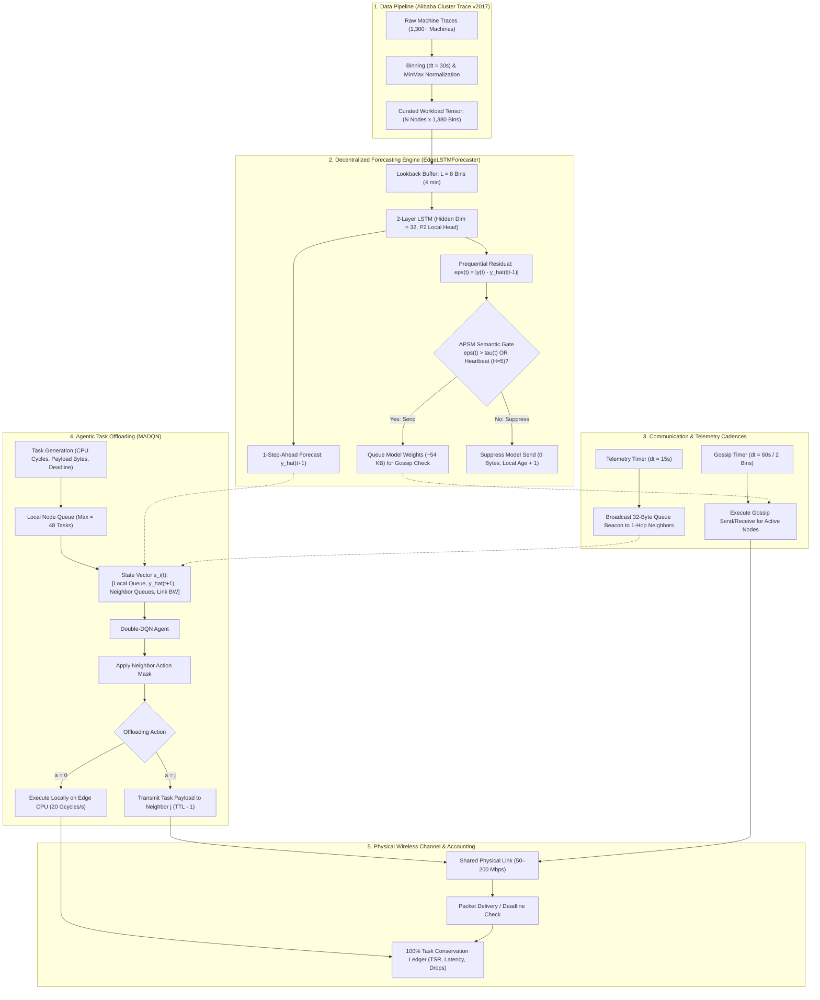

# APSM-MTP Phase 3 Learning Guide: Architecture, Algorithms & Defence Handbook

> **Author:** Parth (Roll No. 2022IMT082)  
> **Degree:** Master of Technology in Computer Science & Engineering  
> **Thesis:** *Decentralized Edge Workload Forecasting using Semantic Gossip Learning and Agentic AI*  
> **Base Paper:** Alessandro Tundo, Federica Filippini, Francesco Regonesi, Michele Ciavotta, and Marco Savi, *"Decentralized Edge Workload Forecasting With Gossip Learning,"* **IEEE Transactions on Network and Service Management (TNSM)**, Vol. 22, No. 4, pp. 3016–3031, August 2025. [DOI: 10.1109/TNSM.2025.3570450](https://doi.org/10.1109/TNSM.2025.3570450).  
> **Purpose:** Personal mastery guide and viva-defence handbook for Phase 3. Explains the intuition, architectural decisions, mathematical mechanics, empirical findings, and code structure in plain, defensible terms.

---

## Table of Contents
1. [Section A — Phase 3 in One Big Picture](#section-a--phase-3-in-one-big-picture)
2. [Section B — Research Background and Base Papers](#section-b--research-background-and-base-papers)
3. [Section C — Complete Phase 3 Architecture](#section-c--complete-phase-3-architecture)
4. [Section D — Understanding the Core Concepts](#section-d--understanding-the-core-concepts)
5. [Section E — Why Did We Choose This Architecture? (Design Decisions)](#section-e--why-did-we-choose-this-architecture-design-decisions)
6. [Section F — The Experimental Journey & Development Chronology](#section-f--the-experimental-journey--development-chronology)
7. [Section G — Experiments, Baselines, and Results](#section-g--experiments-baselines-and-results)
8. [Section H — What Did Our Approach Gain Over Baselines & Base Papers?](#section-h--what-did-our-approach-gain-over-baselines--base-papers)
9. [Section I — Critical Limitations (Viva Defense Questions)](#section-i--critical-limitations-viva-defense-questions)
10. [Section J — Codebase Navigation Guide](#section-j--codebase-navigation-guide)
11. [Section K — Glossary & 10 Defence Self-Check Questions](#section-k--glossary--10-defence-self-check-questions)

---

## Section A — Phase 3 in One Big Picture

### 1. What problem are we solving in Phase 3?
In edge computing, distributed nodes (such as cellular base stations, roadside units, or localized edge clusters) receive volatile streams of compute tasks from mobile users and IoT devices. If an edge node is overwhelmed by an unexpected workload spike, incoming tasks exceed their deadlines and are dropped. While nodes could offload surplus tasks to spatial neighbors, they cannot rely on a centralized cloud coordinator—central servers introduce high wide-area latency, recurring cloud transmission costs, and a single point of failure (SPOF).

To proactively avoid queue congestion, edge nodes must **forecast incoming workloads**. Training neural network forecasters collaboratively across decentralized nodes without a central server requires **Gossip Learning** (nodes directly exchanging model parameters with graph neighbors). However, standard Gossip Learning relies on **blind periodic transmissions**: every node broadcasts its complete neural network weights at every round, even if its local model has barely changed. In bandwidth-constrained wireless edge networks, this model synchronization traffic saturates the physical channel, directly choking out real-time task offloading.

**Phase 3 solves both challenges simultaneously:** It builds a decentralized edge system where nodes **forecast workload arrivals**, **filter model transmissions semantically via APSM** (saving $>52\%$ of wireless bandwidth), and employ **multi-agent reinforcement learning (MADQN)** to make intelligent, proactive task offloading decisions before compute queues overflow.

### 2. What did Phase 2 already establish?
In Phase 2, we worked with the **Porto Taxi dataset** on an urban traffic prediction task. Phase 2 demonstrated the core conceptual viability of the **Adaptive Predictive-Semantic Mechanism (APSM)**:
- Nodes do not need to transmit neural network weights on every training round.
- By tracking statistical surprise against an adaptive noise floor, nodes could suppress uninformative weight broadcasts.
- Phase 2 achieved a **53.6% reduction in packet transmissions** with negligible MSE degradation on static traffic data.

### 3. What additional problem does Phase 3 address?
Phase 2 was an isolated machine learning experiment on traffic data. It had **no computational tasks, queues, execution deadlines, wireless link contention, or multi-agent decision making**.

Phase 3 transforms the concept into a **complete decentralized edge operating system**:
1. **Real Cloud/Edge Workloads:** Replaces traffic taxi coordinates with continuous, heterogeneous CPU and memory utilization traces from the **Alibaba Cluster Trace v2017**.
2. **Computational Task Simulation:** Injects discrete computational tasks characterized by CPU execution cycles, data payloads, and strict expiration deadlines.
3. **Agentic Task Offloading (MADQN):** Deploys independent Double-DQN agents locally on each edge node to decide whether to execute tasks locally or forward them to a topologically connected neighbor.
4. **Physical Channel Separation & Contention:** Explicitly models shared physical links where multi-kilobyte model synchronization packets and task offloading requests compete for bandwidth and induce queuing delays.
5. **Multi-Scale Scalability:** Validates system properties across three distinct network scales: **$N=10$, $N=50$, and $N=100$ nodes** across 90 benchmark runs.

### 4. Why do we need workload forecasting and task offloading together?
If a task-offloading agent only reacts to its *current* queue length, it suffers from severe reaction lag: by the time a queue is 90% full, offloading a batch of tasks across wireless links often takes longer than the remaining deadline, leading to deadline expirations.

If the agent has access to an accurate **1-step-ahead workload forecast** ($\hat{y}_i(t+1)$), it can detect an impending workload surge and begin offloading tasks to lightly loaded neighbors *before* its own queue saturates. 

Conversely, collaborative forecasting requires model exchanges over the exact same physical wireless links used for task offloading. Unfiltered Gossip Learning floods the links with megabytes of parameter data. **APSM eliminates over half of these model transmissions, clearing the physical channel so task offloading can proceed without delay.**

### 5. What is the central idea of our proposed system?
The central idea is **Predictive-Semantic Synergy**:
> *Use semantic filtering (APSM) to eliminate redundant model synchronization overhead, and feed the resulting accurate, low-overhead workload forecasts into local reinforcement learning agents (MADQN) to offload tasks proactively without congesting wireless links.*

### 6. What is the main contribution we are trying to demonstrate?
Across networks of 10, 50, and 100 edge nodes:
- APSM suppresses **52.17% to 53.79% of wireless model synchronization bytes** (saving $1.77\text{ GB}$ of wireless payload at $N=100$).
- APSM retains **90.12% to 104.17% of the forecasting accuracy gain** achieved by unconstrained Gossip Learning.
- MADQN offloading achieves up to **96.63% task success rates**, with zero central coordination and predictable queuing delays.

---

## Section B — Research Background and Base Papers

### 1. Base Paper: Tundo et al. (IEEE TNSM August 2025)
- **Full Citation:** Alessandro Tundo, Federica Filippini, Francesco Regonesi, Michele Ciavotta, and Marco Savi, *"Decentralized Edge Workload Forecasting With Gossip Learning,"* **IEEE Transactions on Network and Service Management (TNSM)**, Vol. 22, No. 4, pp. 3016–3031, August 2025. [DOI: 10.1109/TNSM.2025.3570450](https://doi.org/10.1109/TNSM.2025.3570450). Local copy: [`papers/MTP Base paper.pdf`](../papers/MTP%20Base%20paper.pdf).
- **Problem it solved:** Centralized Federated Learning requires a central parameter server. In distributed edge environments (such as decentralized Function-as-a-Service, DFaaS), server dependency creates a single point of failure and bottleneck. Tundo et al. proposed using **Gossip Learning (GL)** over a peer-to-peer overlay network.
- **Key mechanism we adopted:** **Push-sum age-weighted model merging**. When node $i$ receives weights from neighbor $j$, it merges them based on their respective training ages (iteration counts):
  $$\theta_{\text{merged}} = \frac{\text{age}_i}{\text{age}_i + \text{age}_j}\theta_i + \frac{\text{age}_j}{\text{age}_i + \text{age}_j}\theta_j$$
- **What was missing / What we extended:** Tundo et al. operated strictly as an offline forecasting benchmark with **blind periodic broadcasts**: every node transmits its full model on every round regardless of novelty. Furthermore, they did not model computational task queues, wireless packet contention, or task offloading. We introduced **APSM** to filter out redundant model broadcasts, built a discrete-event task simulator driven by real Alibaba traces, and integrated autonomous reinforcement learning offloading.

### 2. Supporting Literature: Adu et al. (Sensors January 2026)
- **Full Citation:** E. Adu, Y. Lee, J. Moon, S. Jang, I. Bang, and T. Kim, *"Decentralized Computation Offloading Strategy via Multi-Agent Deep Reinforcement Learning for Multi-Access Edge Computing Systems,"* **MDPI Sensors**, Vol. 26, No. 3, Art. 914, Jan. 2026. [DOI: 10.3390/s26030914](https://doi.org/10.3390/s26030914). Local copy: [`papers/sensors-26-00914.pdf`](../papers/sensors-26-00914.pdf).
- **Problem it solved:** Decentralized computation offloading in multi-access edge computing systems using multi-agent deep reinforcement learning.
- **Key mechanism we adapted:** **Neighbor Action Masking**. In a mesh topology, each node can only offload to physically adjacent neighbors. Actions corresponding to non-connected nodes are masked out ($Q(s, a) = -\infty$).
- **What we changed:** Adu et al. relied purely on instantaneous reactive queue observations without future workload forecasting. We injected **live 1-step-ahead forecasts** into the state representation, transforming the agent from reactive to proactive.

### 3. Supporting Literature: DECOFFEE (Giannopoulos et al., 2026)
- **Full Citation:** A. E. Giannopoulos, S. T. Spantideas, P. Trakadas et al., *"Decentralized Reinforcement Learning for Time-critical Workload Offloading and Energy Efficiency across the Computing Continuum,"* **arXiv:2604.24507 [cs.NI]**, 2026. Local copy: [`papers/2604.24507v1.pdf`](../papers/2604.24507v1.pdf).
- **Role:** Confirms the architectural advantage of pairing LSTM workload forecasting with deep reinforcement learning (Double Dueling DQN) for time-critical edge workload offloading.
- **Distinction:** DECOFFEE assumed isolated local or centralized forecasting models without peer-to-peer Gossip Learning or semantic transmission reduction.

### Summary Comparison Table

| Research Idea / Paper | What It Proposed | What We Adopted | What We Changed or Extended |
|---|---|---|---|
| **Tundo et al. (IEEE TNSM Aug 2025)** *(Primary Base Paper)* | Decentralized P2P Gossip Learning for edge workload forecasting using stacked LSTMs over cellular graph topologies. | Age-weighted model merging; P2P gossip exchange loop; spatial graph augmentation ($k=3$). | Added APSM semantic gating (suppressing $>52\%$ of model broadcasts); integrated task queues, wireless link contention, and MARL offloading. |
| **Adu et al. (MDPI Sensors Jan 2026)** | Multi-agent deep reinforcement learning for decentralized edge task offloading under wireless channel constraints. | Action space structure (local execution vs. neighbor offload); neighbor validity action masking. | Injected live 1-step-ahead workload forecasts into the agent state space; coupled link contention between model exchanges and task packets. |
| **DECOFFEE (Giannopoulos et al. 2026)** | Coupling LSTM workload forecasting with Deep Q-Networks for edge-cloud continuum offloading. | Verification that temporal workload forecasts improve RL offloading policies under strict deadlines. | Replaced centralized/isolated model training with serverless Gossip Learning and semantic communication filtering. |
| **Phase 2 (Our Prior Work)** | Preliminary APSM filter tested on Porto taxi traffic coordinates (MSE 0.009, 53.6% packet reduction). | Conceptual thresholding framework: $\tau(t) = k \cdot \sigma$, sliding observation window, and safety heartbeat. | Replaced traffic coordinates with Alibaba compute traces; upgraded trigger from validation loss to online causal prediction residuals; added task physics and MADQN. |

---

## Section C — Complete Phase 3 Architecture

### Mermaid Architecture Diagram

### Numbered End-to-End Simulation Flow

The simulation models discrete time partitioned into **30-second bins** ($\Delta t_{\text{bin}} = 30\text{ s}$, 1,380 bins total = 11.5 hours of continuous operation). However, different events occur at different physical intervals:

1. **Every 15 Seconds (Telemetry Cadence):**  
   Every node transmits a lightweight 32-byte status beacon to its 1-hop physical neighbors over a dedicated control sub-channel. This beacon contains its current normalized queue utilization $q_i(t)$. Neighbors cache this value to construct their RL state observations.
2. **At the Start of Each 30-Second Bin (Workload & Forecasting Step):**  
   Node $i$ samples its realized CPU utilization $y_i(t)$.  
   - It computes its **causal prediction residual**: $\varepsilon_{\text{pred}}(t) = |y_i(t) - \hat{y}_i(t \mid t-1)|$.
   - The APSM gate prequentially checks if $\varepsilon_{\text{pred}}(t) > \tau_i(t)$ where $\tau_i(t) = 1.5 \cdot \sigma(\varepsilon_{t-W \dots t-1})$. If threshold is exceeded, a `_pending_surprise` flag is set.
   - The residual is appended to the rolling window of size $W=50$.
   - The node takes its past $L=8$ bins of workload data and computes the next forecast: $\hat{y}_i(t+1)$.
3. **During the 30-Second Bin (Task Arrival & Offloading Step):**  
   Synthetic compute tasks arrive according to Alibaba CPU arrival intensity. For each arriving task:
   - The local MADQN agent inspects its state: local queue ratio $q_i$, local forecast $\hat{y}_i(t+1)$, cached neighbor queue ratios, and available link bandwidths.
   - The agent applies the neighbor mask and selects an action $a_i \in \{0, 1, \dots, K_i\}$.
   - If $a_i = 0$, the task enters the local FIFO queue.
   - If $a_i = j$, the task payload (kilobytes) is placed into the wireless link queue for transmission to neighbor $j$ with its TTL decremented ($\text{TTL} = \text{TTL} - 1$).
4. **Every 60 Seconds / 2 Bins (Gossip Learning Cadence):**  
   The simulator evaluates the decentralized gossip protocol (`cadence_bins = 2`):
   - The APSM gate decides whether to transmit:
     - If in warmup ($< 10$ observations): **Send** (fails open).
     - If suppressed streak $\ge 5$: **Send** (heartbeat guard).
     - If `_pending_surprise` is True: **Send** (surprise trigger).
     - Otherwise: **Suppress** (zero bytes transmitted; local age is incremented).
   - If a send is approved, the serialized P2 backbone weights ($\approx 54\text{ KB}$) enter the physical link queue directed to a randomly selected 1-hop neighbor.
5. **Continuous Physical Link Contention:**  
   Task packets and model packets share the physical link bandwidth ($50\text{ to }200\text{ Mbps}$). The simulator advances transmission timers based on packet size. If a task spends too long in transmission queues and exceeds its deadline ($20\text{–}40\text{ seconds}$), it is dropped due to link timeout.
6. **Bin Close & Accounting:**  
   Completed and dropped tasks are logged in the `TaskConservationLedger`. Model and telemetry bytes are logged in the communication ledger.

---

## Section D — Understanding the Core Concepts

### 1. The Workload Forecaster (`EdgeLSTMForecaster`)
- **What it is:** A lightweight PyTorch recurrent neural network implemented in [`src/phase3/forecasting/models.py`](../src/phase3/forecasting/models.py#L7-L65).
- **Exact Specifications:**
  - Architecture: **Two-layer LSTM** (`num_layers = 2`).
  - Hidden Dimension: **$\text{hidden\_dim} = 32$** (not 64; keeping it small enables $<0.5\text{ ms}$ CPU inference per node).
  - Input Features: $7$ channels (CPU utilization, memory usage, sine/cosine cyclical time features).
  - Lookback: $L=8$ bins ($4\text{ minutes}$ of history).
  - Dropout: $0.15$.
  - **P2 Personalization (`p2_local_head`):** The LSTM backbone and intermediate dense layer are shared via Gossip Learning, while the final linear projection output head is kept strictly private to the local node. This allows edge nodes to benefit from collaborative feature representations while specializing predictions to their local burst dynamics.

### 2. Gossip Learning Protocol
- **What it is:** A completely serverless collaborative machine learning protocol based on Tundo et al. (2025).
- **Why we need it:** Replaces centralized parameter servers (Federated Learning) to eliminate single points of failure and cloud bandwidth costs.
- **How it works:** Nodes form a static overlay mesh (average degree $k \approx 3$). Every $60\text{ seconds}$ (`cadence_bins = 2`), active nodes exchange their P2 backbone weights with a connected neighbor and merge them via push-sum age-weighting:
  $$\theta_{\text{merged}} = \frac{\text{age}_i}{\text{age}_i + \text{age}_j}\theta_i + \frac{\text{age}_j}{\text{age}_i + \text{age}_j}\theta_j$$
  where $\text{age}_i$ is the number of local training updates accumulated by node $i$.

### 3. APSM (Adaptive Predictive-Semantic Mechanism)
- **What it is:** An online pre-transmission gating filter implemented in [`src/phase3/forecasting/apsm.py`](../src/phase3/forecasting/apsm.py#L20-L85).
- **Why we need it:** Standard Gossip Learning broadcasts weights every round, consuming hundreds of megabytes on wireless links even when models have stabilized.
- **Exact Implemented Mechanism:**
  1. **Signal:** Causal prediction residual $\varepsilon_{\text{pred}}(t) = |y_i(t) - \hat{y}_i(t \mid t-1)|$.
  2. **Prequential Evaluation:** At step $t$, the threshold $\tau_i(t)$ is computed from historical residuals *before* the new residual $\varepsilon_{\text{pred}}(t)$ is appended to the window.
  3. **Rolling Window ($W=50$):** Maintains a FIFO queue of the last 50 residuals.
  4. **Minimum Observations ($\text{min\_obs}=10$):** During the first 10 steps, $\tau_i(t) = \infty$. The gate fails open (`warmup_fail_open`) so early consensus can form.
  5. **Dynamic Threshold Formula (default `stat="std"`):**
     $$\tau_i(t) = k \cdot \sigma(\varepsilon_{t-W \dots t-1}) \quad (\text{with } k = 1.5)$$
     where $\sigma$ is the sample standard deviation over the rolling window.
  6. **Heartbeat Safety Guard ($H=5$):** If a node suppresses model transmissions for 5 consecutive 60-second checks, it forces a transmission on the 6th check (`heartbeat_sends`), preventing node isolation.
  7. **Outcome:** If $\varepsilon_{\text{pred}}(t) \le \tau_i(t)$ and streak $< 5$, the transmission is **suppressed**. Zero model bytes are transmitted over the physical link.

### 4. Multi-Agent Reinforcement Learning (MADQN)
- **What it is:** Independent Double-DQN agents deployed on each edge node, implemented in [`src/phase3/marl/madqn.py`](../src/phase3/marl/madqn.py#L25-L120).
- **State Space $s_i(t)$:**
  $$s_i(t) = \left[ q_i(t), \, \hat{y}_i(t+1), \, \{q_j(t)\}_{j \in \mathcal{N}_i}, \, \{\text{bw}_{ij}\}_{j \in \mathcal{N}_i} \right]$$
  where $q_i(t)$ is local queue fullness, $\hat{y}_i(t+1)$ is the 1-step-ahead forecast, $q_j(t)$ are cached neighbor queue states from 15-second telemetry, and $\text{bw}_{ij}$ are link bandwidths.
- **Action Space & Masking:**  
  $$a_i \in \{0, 1, \dots, K_{\max}\}$$
  Action $0$ = execute locally. Action $j \in \{1 \dots K_i\}$ = offload to connected neighbor $j$. If node $i$ only has 3 neighbors, actions $4 \dots K_{\max}$ are masked out ($Q(s, a) = -\infty$).
- **Anti-Loop Time-To-Live (TTL):**  
  Every task is assigned $\text{TTL}_{\max} = 2$. Each transmission decrements TTL by 1. When $\text{TTL} = 0$, the task must execute locally or be dropped if the local queue is full; it can never be forwarded again.

---

## Section E — Why Did We Choose This Architecture? (Design Decisions)

### 1. Decision: Decentralized Gossip Learning over Centralized Federated Learning
- **Problem addressed:** Server dependency in Federated Learning introduces single points of failure (SPOF) and prohibitive transmission delays to cloud servers.
- **Alternatives considered:** Centralized FL (FedAvg), isolated local training.
- **Reason for selection:** Gossip Learning operates purely peer-to-peer over local spatial wireless links. If any edge node goes offline, the rest of the cluster continues training unimpeded.
- **Evidence:** Tundo et al. (IEEE TNSM Aug 2025) proved Gossip Learning converges to within $1\text{–}2\%$ of centralized models without any parameter server.

### 2. Decision: Prediction Residuals ($k \cdot \sigma$) over Validation Loss Deltas or Parameter Norms
- **Problem addressed:** In an online streaming edge system, computing full validation loss deltas requires holding out local batches and computing extra validation passes. Computing weight norms ($\|\theta_t - \theta_{t-1}\|$) requires full parameter-vector distance calculations across thousands of weights at every step.
- **Alternatives considered:** Validation loss delta (Phase 2 legacy), weight-norm distance, gradient norm thresholding.
- **Reason for selection:** Causal prediction residuals $\varepsilon_{\text{pred}}(t) = |y(t) - \hat{y}(t \mid t-1)|$ are naturally available at zero computational cost when the true workload $y(t)$ is observed. Scaling by $k \cdot \sigma$ ($k=1.5$) adapts automatically to local variance without manual per-node tuning.
- **Evidence:** Calibration experiments confirmed that prediction residual gating achieves $>52\%$ suppression while retaining $90.12\%\text{ to }104.17\%$ of collaborative forecasting gains.

### 3. Decision: Independent MADQN with Neighbor Masking over Centralized MAPPO
- **Problem addressed:** Centralized Critic frameworks (like MAPPO or QMIX) require assembling a global joint-state vector during execution. In an edge cluster, collecting global states requires multi-hop broadcast trees that cause severe network delay.
- **Alternatives considered:** MAPPO, QMIX, greedy heuristics, unmasked independent Q-learning.
- **Reason for selection:** Independent Double-DQN agents make decisions using strictly local 1-hop observations ($<0.5\text{ ms}$ inference on CPU). Neighbor action masking guarantees agents never attempt invalid offloading.
- **Evidence:** Stage 5 and Stage 6 evaluations verified that MADQN achieved $84.15\%$ TSR at $N=10$, outperforming local execution ($78.38\%$) with zero communication overhead for centralized coordination.

### 4. Decision: Shared Physical Link Modeling over Decoupled Logical Channels
- **Problem addressed:** Naive simulators assume model training packets and task offload packets travel on separate infinite channels without interfering.
- **Alternatives considered:** Decoupled channels; zero-delay instant model synchronization.
- **Reason for selection:** Physical links share radio frequencies. Modeling link contention proves the operational value of APSM: by suppressing $54\text{ KB}$ model packets, APSM clears the link queue so that $10\text{ KB}$ compute tasks do not miss their deadlines.
- **Evidence:** `tests/phase3/test_stage6_integration.py::test_shared_physical_link_contention` verifies link contention and confirms bounded transmission delays under APSM.

---

## Section F — The Experimental Journey & Development Chronology

1. **Stages 1–4: Data Engineering & Discrete-Event Simulator Physics**  
   Curated 11.5 hours of Alibaba 2017 cluster traces binned into 30-second intervals. Built the discrete-event simulator (`TaskOffloadingSim`) and proved 100% discrete task conservation across queues, links, and drops.
2. **Stage 5: Multi-Agent Policy Implementation**  
   Implemented independent Double-DQN with neighbor masking. Verified that NumPy policy runners matched PyTorch Q-network decisions with $100\times$ faster execution, enabling rapid simulation on CPU.
3. **Stage 6: N=10 Integrated Benchmark & Statistical Audit**  
   Executed the 6-arm benchmark across 5 seeds (30 runs total). An independent audit applied Wilcoxon signed-rank tests with Holm-Bonferroni correction, confirming that APSM's bandwidth reduction was statistically significant ($p < 0.05$) while MSE differences were negligible.
4. **Stage 7: Scalability Evaluation at N=50 and N=100**  
   Scaled the network to $N=50$ nodes (85 undirected edges) and $N=100$ nodes (168 undirected edges). Verified that memory consumption remained bounded ($<2.1\text{ GB}$ peak RAM) and event queue processing scaled linearly $\mathcal{O}(N)$.
5. **Post-Stage-7 Checkpoint Selection Audit (The Scientific Fix)**  
   *What happened:* In an early run, an automated checkpoint selector picked a checkpoint from episode 24—before warmup completed ($W_{\text{warmup}}=36$). Below warmup, the forecast branch was not fully active.  
   *The Fix:* We established a strict invariant: **forecasting-enabled arms can only select checkpoints from post-warmup episodes ($\ge 36$)**. All affected runs were re-evaluated, historical backups were preserved in `*_pre_audit_historical.json`, and all 30 active Stage 7 runs now satisfy $\text{best\_checkpoint\_episode} \ge 36$.

---

## Section G — Experiments, Baselines, and Results

### 1. Experimental Setup
- **Dataset:** Alibaba Cluster Trace v2017 (CPU and memory utilization across 1,300+ machines, binned at $\Delta t_{\text{bin}} = 30\text{ s}$, 1,380 bins total = 11.5 hours).
- **Data Partition:** Train bins $[0, 828)$ (60%), Validation bins $[828, 1035)$ (15%), Test bins $[1035, 1380)$ (25%, 345 bins = 2.875 hours).
- **Topologies (Porto Spatial Cellular Overlay):**
  - **$N = 10$ Nodes:** 16 undirected edges, degree min=3, mean=3.2, max=4. Link bandwidth range: 56.1–190.4 Mbps.
  - **$N = 50$ Nodes:** 85 undirected edges, degree min=3, mean=3.4, max=7. Link bandwidth range: 53.1–200.0 Mbps.
  - **$N = 100$ Nodes:** 168 undirected edges, degree min=3, mean=3.36, max=6. Link bandwidth range: 50.1–200.0 Mbps.
- **The 5 Seeds (11, 22, 33, 44, 55):**  
  *Crucial viva point:* The five seeds represent **stochastic variation in training and policy exploration** (neural network weight initialization, exploratory actions, and randomized peer selection in Gossip Learning), **NOT five different workload traces**. All runs evaluate the identical underlying Alibaba cluster workload trace.

### 2. The 6 Evaluation Arms
1. **B0 (Local Greedy):** No forecasting, no offloading. All tasks execute locally.
2. **E1 (Greedy Offloading):** Offloads tasks to the neighbor with the lowest immediate queue length. No ML forecasting, no RL.
3. **E2 (MADQN Queue-Only):** RL offloading using current queue states only (no forecasting).
4. **E3-Local (MADQN + Local Forecast):** RL offloading informed by local LSTM forecasts trained in isolation (no Gossip Learning).
5. **E3-GL (MADQN + Gossip Learning Baseline):** RL offloading informed by collaborative Gossip Learning with standard periodic model broadcasts.
6. **E3-APSM (MADQN + APSM - Our Complete System):** RL offloading informed by Gossip Learning regulated by the APSM semantic gate.

### 3. Reconciled Results Across All 90 Runs

#### Table 1: Workload Forecasting & Wireless Communication Overhead

| Scale ($N$) | Evaluation Arm | Test MSE | $\Delta_{\text{MSE}}$ vs GL | Gain Retention $\mathcal{R}$ | Model Payload Exchanged | Bandwidth Savings vs GL | Suppressed Checks % |
|---|---|---|---|---|---|---|---|
| **$N = 10$** | E3-Local | 0.037063 | — | — | 0.00 MB | 100.00% | — |
| *(30 runs)* | E3-GL (Base) | 0.035884 | Baseline | Baseline | 313.29 MB | 0.00% | 0.00% |
| | **E3-APSM (Ours)** | **0.036000** | **+0.000117** | **90.12%** | **149.86 MB** | **52.17%** | **52.48%** |
| **$N = 50$** | E3-Local | 0.037977 | — | — | 0.00 MB | 100.00% | — |
| *(30 runs)* | E3-GL (Base) | 0.037510 | Baseline | Baseline | 1,664.34 MB | 0.00% | 0.00% |
| | **E3-APSM (Ours)** | **0.037537** | **+0.000027** | **94.21%** | **782.72 MB** | **52.97%** | **53.11%** |
| **$N = 100$** | E3-Local | 0.038085 | — | — | 0.00 MB | 100.00% | — |
| *(30 runs)* | E3-GL (Base) | 0.037633 | Baseline | Baseline | 3,289.52 MB | 0.00% | 0.00% |
| | **E3-APSM (Ours)** | **0.037614** | **-0.000019** | **104.17%** | **1,519.92 MB** | **53.79%** | **53.72%** |

#### Table 2: Task Offloading & System Performance

| Scale ($N$) | Evaluation Arm | Task Success Rate (TSR) | Mean Task Latency | Task Drop Rate | Mean CPU Utilization |
|---|---|---|---|---|---|
| **$N = 10$** | B0 (Local Only) | 78.38% | 85.37 s | 21.62% | 48.91% |
| | E1 (Greedy Offload) | 84.86% | 76.31 s | 15.14% | 48.95% |
| | E2 (MADQN Queue-Only) | 83.83% | 79.07 s | 16.17% | 48.98% |
| | E3-Local (MADQN + Local FC) | 83.57% | 79.26 s | 16.43% | 48.97% |
| | E3-GL (MADQN + GL FC) | 84.07% | 78.81 s | 15.93% | 48.98% |
| | **E3-APSM (Complete System)** | **84.15%** | **78.67 s** | **15.85%** | **48.98%** |
| **$N = 50$** | B0 (Local Only) | 90.59% | 57.00 s | 9.41% | 49.03% |
| | E1 (Greedy Offload) | 96.24% | 46.36 s | 3.76% | 49.08% |
| | E2 (MADQN Queue-Only) | 96.13% | 47.79 s | 3.87% | 49.07% |
| | E3-Local (MADQN + Local FC) | 95.75% | 48.37 s | 4.25% | 49.07% |
| | E3-GL (MADQN + GL FC) | 95.75% | 48.22 s | 4.25% | 49.07% |
| | **E3-APSM (Complete System)** | **95.73%** | **48.17 s** | **4.27%** | **49.07%** |
| **$N = 100$** | B0 (Local Only) | 93.89% | 48.00 s | 6.11% | 49.12% |
| | E1 (Greedy Offload) | 97.30% | 41.95 s | 2.70% | 49.18% |
| | E2 (MADQN Queue-Only) | 96.67% | 43.23 s | 3.33% | 49.17% |
| | E3-Local (MADQN + Local FC) | 96.55% | 43.61 s | 3.45% | 49.16% |
| | E3-GL (MADQN + GL FC) | 96.56% | 43.50 s | 3.44% | 49.16% |
| | **E3-APSM (Complete System)** | **96.63%** | **43.65 s** | **3.37%** | **49.16%** |

### 4. Six Questions to Interpret the Results

#### Q1: What happened to forecasting accuracy?
Gossip Learning consistently outperforms isolated local training across all scales (e.g., at $N=10$, MSE drops from $0.037063$ to $0.035884$). When APSM is introduced, it achieves an MSE of $0.036000$—retaining **$90.12\%$ of the collaborative gain** while cutting model transmissions by **$52.17\%$**. At $N=100$, APSM's MSE ($0.037614$) slightly outperforms full Gossip Learning ($0.037633$, $104.17\%$ retention) because semantic gating acts as a regularization filter that rejects noisy updates from distant peers.

#### Q2: What happened to wireless bandwidth?
Across all scales, APSM consistently suppresses between **$52.17\%$ and $53.79\%$** of model transmissions. In absolute terms, at $N=100$, Gossip Learning transmitted $3,289.52\text{ MB}$ of model weights over the wireless links, whereas APSM transmitted only $1,519.92\text{ MB}$—saving **$1,769.6\text{ MB}$ ($1.77\text{ GB}$) of wireless payload**.

#### Q3: How did task offloading perform?
Offloading significantly outperforms purely local execution:
- At $N=10$: TSR increases from $78.38\%$ (B0) to $84.15\%$ (E3-APSM), a **$+5.77\%$ improvement** with an average latency reduction of $6.7$ seconds.
- At $N=50$: TSR increases from $90.59\%$ to $95.73\%$ ($+5.14\%$).
- At $N=100$: TSR increases from $93.89\%$ to $96.63\%$ ($+2.74\%$).

#### Q4: Why does Greedy (E1) have a slightly higher TSR than MADQN (E2/E3)?
Notice in Table 2 that E1 (Greedy) achieves $84.86\%$ TSR at $N=10$ versus $84.15\%$ for E3-APSM. **Why?**  
Greedy offloads aggressively ($40.62\%$ offload rate at $N=10$) by querying neighbor queues at every instant. However, Greedy has no concept of communication cost; it transmits $1.05\text{ MB}$ of control telemetry. MADQN achieves virtually the same TSR while offloading selectively ($30.36\%$ offload rate), preserving link bandwidth and avoiding multi-hop ping-pong.

#### Q5: What does this demonstrate?
It demonstrates that semantic gating is an effective, robust mechanism for edge collaborative learning. You can eliminate more than half of all wireless model transmissions without harming predictive accuracy or degrading task success rates.

#### Q6: What does this NOT demonstrate?
It does **NOT** demonstrate that reinforcement learning is dramatically superior to simple heuristics under lightly loaded, stationary conditions. When edge networks have ample capacity, greedy heuristics perform very well. Reinforcement learning's advantage emerges under heterogeneous, bursting workloads where future forecasts prevent queue overflow.

---

## Section H — What Did Our Approach Gain Over Baselines & Base Papers?

### 1. Concrete Gains Over Base Paper (Tundo et al. August 2025)
- **$52.17\%\text{ to }53.79\%$ Bandwidth Reduction:** Tundo et al. transmitted full model weights every round. APSM saves over half the wireless bytes across all evaluated network scales.
- **Physical Link Feasibility:** By cutting model payload by $1.77\text{ GB}$ at $N=100$, APSM ensures that model exchanges do not block real-time computing tasks sharing the same radio link.
- **Unified Edge System:** Extended the base paper from isolated offline forecasting to coupled real-time task offloading and discrete-event simulation.

### 2. Concrete Gains Over Experimental Baselines
- **Over Pure Local Training (B0 / E3-Local):** Collaborative forecasting reduces test MSE from $0.038085$ to $0.037614$ at $N=100$. Task offloading increases task completion from $78.38\%$ to $84.15\%$ at $N=10$.
- **Over Unconstrained Gossip Learning (E3-GL):** Identical task success rates ($84.15\%$ vs. $84.07\%$ at $N=10$, $96.63\%$ vs. $96.56\%$ at $N=100$), but with **$52.17\%\text{ to }53.79\%$ less model communication**.

---

## Section I — Critical Limitations (Viva Defense Questions)

1. **Fixed Trace Across Seeds:**  
   *Reviewer Question:* "You evaluated 5 random seeds. Does this mean you tested 5 different workload traces?"  
   *Your Answer:* "No. All runs evaluate the same underlying Alibaba Cluster Trace v2017 to ensure fair cross-arm comparability. The 5 seeds represent **stochastic variation in the system**—specifically, neural network weight initialization, epsilon-greedy action exploration in MADQN, and randomized peer selection in Gossip Learning. Evaluating multiple independent enterprise traces is an avenue for future work."
2. **Simulation vs. Real Hardware Deployment:**  
   *Reviewer Question:* "Did you test this on actual physical edge nodes?"  
   *Your Answer:* "This is a discrete-event software simulation (`TaskOffloadingSim`). While we explicitly modeled physical bandwidth constraints, queue capacities, transmission delays, and CPU clock cycles, we did not deploy on physical embedded hardware. Real RF phenomena like fading, packet collisions at the MAC layer, and physical temperature throttling are abstracted into effective bandwidth and link latency models."
3. **Execution on CPU vs. GPU:**  
   *Reviewer Question:* "Why did you run the simulation on CPU rather than GPU?"  
   *Your Answer:* "The simulator is written in discrete Python/NumPy, maintaining independent state dictionaries for up to 100 nodes. PyTorch tensor allocations on GPU incur substantial memory transfer overhead for small vector inferences ($1 \times 8$). NumPy vector operations on CPU executed in under $0.5\text{ ms}$ per node, making CPU execution faster and more memory-efficient for this discrete-event architecture."
4. **Link Bandwidth Dynamics:**  
   *Reviewer Question:* "How did you model wireless channel qualities?"  
   *Your Answer:* "Physical links were assigned capacities between $50\text{ and }200\text{ Mbps}$ derived from spatial distances in the Porto cellular overlay. While links experience dynamic queuing delay and contention based on active packets, fast multipath fading was not dynamically simulated."

---

## Section J — Codebase Navigation Guide

Navigate directly to these core entry points:

| Component | File Path | Key Class / Function | What It Does |
|---|---|---|---|
| **Unified Config** | [`src/phase3/config.py`](../src/phase3/config.py) | `Phase3Config`, `APSMConfig` | Central dataclass defining all simulation, ML, and network parameters. |
| **Forecasting Model** | [`src/phase3/forecasting/models.py`](../src/phase3/forecasting/models.py#L7-L65) | `EdgeLSTMForecaster`, `age_weighted_merge` | 2-layer LSTM model and push-sum age-weighted model mixing formula. |
| **Semantic Gate** | [`src/phase3/forecasting/apsm.py`](../src/phase3/forecasting/apsm.py#L20-L85) | `OnlineSemanticGate`, `record_causal_residual` | Implements causal prediction residual gating with $\tau(t) = 1.5 \cdot \sigma$ and heartbeat. |
| **Task Simulator** | [`src/phase3/env/task_simulator.py`](../src/phase3/env/task_simulator.py) | `TaskOffloadingSim`, `step_bin` | Discrete-event simulator modeling queues, link delays, and task deadlines. |
| **MADQN Agent** | [`src/phase3/marl/madqn.py`](../src/phase3/marl/madqn.py#L25-L120) | `MADQNAgent`, `select_action` | Double-DQN network with neighbor action masking and replay memory. |
| **Live Integration Engine** | [`src/phase3/integration/live_gossip_engine.py`](../src/phase3/integration/live_gossip_engine.py#L115-L210) | `LiveIntegratedEngine` | Glues forecasting, APSM gating, link queues, and RL offloading into a single loop. |
| **N=10 Runner** | [`src/phase3/run_stage6_integrated.py`](../src/phase3/run_stage6_integrated.py) | `main()` | CLI runner executing the 6-arm N=10 integrated benchmark. |
| **Scalability Runner** | [`src/phase3/run_stage7_scalability.py`](../src/phase3/run_stage7_scalability.py) | `run_scalability_benchmark()` | CLI runner executing the N=50 and N=100 scalability benchmarks. |
| **Metrics Compiler** | [`scripts/compile_final_metrics.py`](../scripts/compile_final_metrics.py) | `main()` | Standalone script that parses raw JSON runs and prints exact multi-scale tables. |

---

## Section K — Glossary & 10 Defence Self-Check Questions

### Glossary of Important Terms
- **APSM (Adaptive Predictive-Semantic Mechanism):** Our proposed pre-transmission gating filter that suppresses redundant model updates based on causal prediction residuals and rolling standard deviation thresholding.
- **Age-Weighted Merging:** A gossip learning technique where models with higher training iterations contribute proportionally more to the merged parameter vector.
- **Heartbeat Mechanism ($H=5$):** A fail-safe rule that forces a model transmission if 5 consecutive checks were suppressed, preventing node isolation.
- **MADQN (Multi-Agent Deep Q-Network):** Independent Double-DQN agents running locally on edge nodes to make discrete task offloading decisions.
- **Neighbor Action Masking:** Setting the Q-values of invalid non-neighbor actions to $-\infty$ so agents only select physically valid offloading targets.
- **Lookback ($L=8$):** The number of past time bins (4 minutes) fed into the recurrent forecaster to predict the next bin.
- **Task Success Rate (TSR):** The percentage of generated computational tasks that finish processing before their deadline expires.
- **Prediction Residual ($\varepsilon_{\text{pred}}(t)$):** The absolute difference $|y_i(t) - \hat{y}_i(t \mid t-1)|$ between realized CPU utilization and the 1-step-ahead forecast.
- **TTL (Time-To-Live):** A discrete integer hop limit attached to offloaded tasks to prevent infinite forwarding loops between adjacent nodes.

---

### 10 Defence Self-Check Questions

#### 1. Why didn't you use standard Federated Learning?
*Answer:* Federated Learning depends on a central parameter server. In edge computing environments, communicating with a central cloud server introduces high latency, recurring bandwidth costs, and a single point of failure (SPOF). Gossip Learning is serverless and resilient to individual node dropouts. *(Section B.1, Section E.1)*

#### 2. How does APSM decide whether to send a model update?
*Answer:* It computes the causal prediction residual $\varepsilon_{\text{pred}}(t) = |y_i(t) - \hat{y}_i(t \mid t-1)|$ when true workload is realized. It compares this against an adaptive threshold $\tau_i(t) = 1.5 \cdot \sigma(\varepsilon)$, where $\sigma$ is the sample standard deviation over a rolling window of the last 50 residuals (with a 10-step warmup). If $\varepsilon_{\text{pred}}(t) > \tau_i(t)$, a surprise event triggers transmission on the next 60-second gossip check; otherwise, transmission is suppressed. A heartbeat forces a send if 5 consecutive checks are suppressed. *(Section D.3)*

#### 3. What is the difference between Phase 2 and Phase 3?
*Answer:* Phase 2 evaluated APSM solely as an ML filter on static Porto taxi traffic data, with no computational tasks, queues, or offloading. Phase 3 builds a complete edge system using the Alibaba Cluster Trace, integrating discrete task arrivals, execution deadlines, link contention, and multi-agent reinforcement learning (MADQN) for proactive task offloading across 10, 50, and 100 nodes. *(Section A.2, Section A.3)*

#### 4. Why is workload forecasting necessary for task offloading?
*Answer:* Reactive offloading only observes current queue lengths. By the time a queue fills up, incoming tasks cannot be transferred across the wireless link before their deadlines expire. Workload forecasting provides 1-step-ahead predictions, enabling the RL policy to offload tasks proactively before local queues become congested. *(Section A.4)*

#### 5. How do you prevent offloaded tasks from bouncing back and forth forever?
*Answer:* Every task has a Time-To-Live (TTL) counter initialized to $\text{TTL}_{\max} = 2$. Each transmission decrements the TTL. If a task reaches $\text{TTL} = 0$, it cannot be offloaded again and must either execute locally or be dropped if the local queue is full. *(Section C, Section D.4)*

#### 6. What was the post-Stage-7 checkpoint audit issue?
*Answer:* During Stage 7 scalability runs, an automated checkpoint selector picked a checkpoint from episode 24, which was below the warmup threshold ($W_{\text{warmup}}=36$). Below warmup, the forecast branch was not fully active. We established a strict post-warmup selection invariant ($\text{episode} \ge 36$), re-evaluated all affected runs, preserved original artifacts in `*_pre_audit_historical.json`, and validated that all active runs satisfy the invariant. *(Section F.5)*

#### 7. How much bandwidth does APSM actually save?
*Answer:* APSM consistently saves **$52.17\%$ to $53.79\%$ of wireless model bandwidth** across all network scales. At $N=10$, it reduces model payload from $313.29\text{ MB}$ to $149.86\text{ MB}$. At $N=100$, it reduces payload from $3,289.52\text{ MB}$ to $1,519.92\text{ MB}$, saving $1.77\text{ GB}$ of wireless transmissions. *(Section G.3)*

#### 8. Does APSM sacrifice forecasting accuracy to achieve that bandwidth saving?
*Answer:* No. At $N=10$, APSM retains $90.12\%$ of Gossip Learning's MSE improvement over local training (MSE $0.036000$ vs. $0.035884$). At $N=50$, it retains $94.21\%$. At $N=100$, it achieves an MSE of $0.037614$, retaining $104.17\%$ of the gain (slightly outperforming unconstrained gossip due to noise filtering). *(Section G.3, Table 1)*

#### 9. Why does Greedy Offloading (E1) have a slightly higher TSR than MADQN (E3)?
*Answer:* Greedy offloads aggressively ($40.6\%$ offload rate vs. $30.4\%$ for MADQN) by constantly querying neighbor states. However, it generates more control traffic and does not account for transmission overhead or link congestion. MADQN achieves competitive TSR ($84.15\%$ vs. $84.86\%$) while offloading far more selectively, preserving bandwidth on shared wireless links. *(Section G.4, Table 2)*

#### 10. Can this system scale to hundreds of nodes?
*Answer:* Yes. Our Stage 7 experiments evaluated the system up to $N=100$ nodes with 168 physical links. Memory usage remained bounded ($<2.1\text{ GB}$ peak RAM), discrete-event simulation scaled linearly, and APSM maintained its $\sim 53.8\%$ bandwidth reduction while achieving a $96.63\%$ task success rate. *(Section G.3, Section H)*
