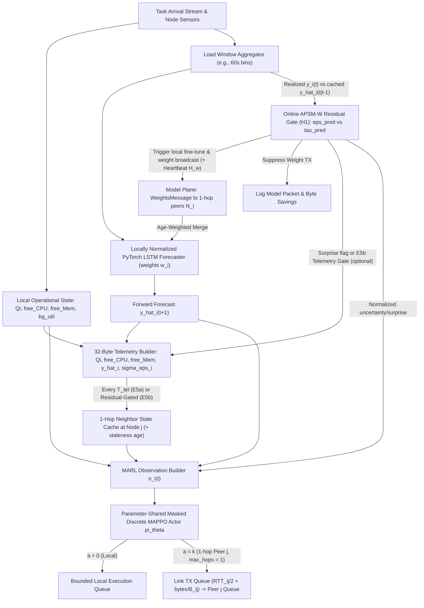
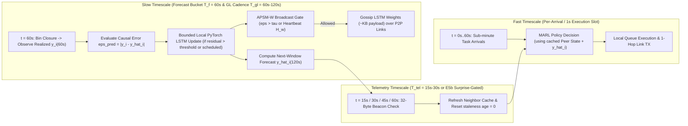
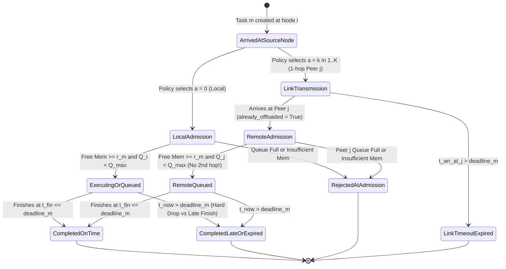
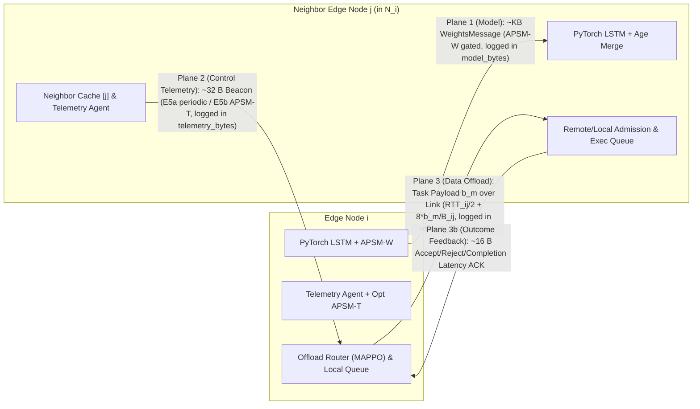

# Phase 3 Pre-Implementation Architecture & Research Plan

> **Document Status:** **Stage 1 & Stage 3 Gates PASSED (`v4` — Stage 3 Validated, Building Stage 4 Task DES)**  
> **Scope:** Research architecture, audit reconciliation, interface specification, verified dataset gate results, verified Stage 3 forecasting/APSM gate results, MARL & online-APSM design, and staged execution roadmap for Phase 3 of *"Decentralized Edge Workload Forecasting Using Semantic Gossip Learning and Agentic AI"* (`2022IMT082`).  
> **Workspace Execution Constraint:** Phase 2 code & results **FROZEN** (`DR-1`). **Stage 1 Gate PASSED** and **Stage 3 Gate PASSED** on `N=6, K=2` Tier 1 dev cluster. Advancing to **Stage 4 (Deterministic Task-Queueing DES & Baselines `B0`, `E1`)** before Stage 5 MARL (`E2, E3, O1`) and Stage 6 Closed-Loop integration (`E4, E5a, E5b`).

---

## Epistemic Labeling Convention

Every material claim in this document carries one of five explicit verification tags:

| Label | Meaning |
| :--- | :--- |
| **`[Verified]`** | Directly confirmed by reading source code, configuration schemas, CSV/JSON/log artifacts, or network files inside `d:\coolage study materials\MTP`, or verified open bibliographic metadata. |
| **`[Source-reported]`** | Reported in local markdown/scripts (`README.md`, `RESEARCH_REPORT.md`, `presentation_script.md`) or paper abstracts/documentation without full backing raw files or full-PDF verification locally. |
| **`[Assumption]`** | Explicit modeling overlay or simulated proxy required where trace/physical measurements do not exist (e.g., network link RTT/bandwidth, task payload bytes, deadlines, DVFS power). |
| **`[Candidate design]`** | Proposed Phase 3 mechanism, interface, signal, or MARL configuration awaiting empirical validation and/or supervisor approval before coding. |
| **`[Unresolved]`** | Open architectural, methodological, or supervisory policy choice requiring an explicit decision or data gate. |

---

## 1. Executive Recommendation & Core Research Question

### 1.1 Executive Recommendation

Proceed into Phase 3 only under a disciplined, two-stage-gated **Hybrid Two-Timescale Architecture (`Architecture D`)** implemented in a **clean Phase 3 simulator branch/module** (leaving all Phase 2 code and [`results/phase2_full_*`](file:///d:/coolage%20study%20materials/MTP/results/phase2_full_100n/three_way_summary.json) artifacts untouched as the historical MTP-1 baseline):

1. **Decoupled Control & Offloading Simulation Kernel:** Do **not** build task offloading inside the existing TensorFlow/Keras DES loop ([`Simulator`](file:///d:/coolage%20study%20materials/MTP/src/gossiplearning/simulator.py#L36-L206) + [`Node.train_model`](file:///d:/coolage%20study%20materials/MTP/src/gossiplearning/node.py#L219-L269)), which rebuilds Keras graphs every update and requires ~125 minutes for a single 10-node forecasting run without RL (`[Verified]` in [`phase2_run.log`](file:///d:/coolage%20study%20materials/MTP/results/phase2_full/phase2_run.log#L533)). Instead, separate a **fast discrete-slot/event task-offloading engine** from a **lightweight PyTorch forecaster & Gossip-APSM plane** (`[Candidate design]`).
2. **Fix the Broken "Weights $\implies$ Peer State" Link via Two Explicit Planes (`Architecture D`):**
   - **Slow Forecasting & Gossip Plane (`~60s` aggregation / `~30s–120s` gossip cadence):** Locally normalized/calibrated PyTorch LSTM forecasters trained on real bursty load windows, sharing parameters via age-weighted Gossip Learning gated by an **online causal APSM filter (`H1`)** (`[Candidate design]`).
   - **Fast Coordination Telemetry & Decision Plane (`15s–30s` bounded beacons or `E5b` residual-gated beacons + per-arrival MARL):** Compact `~32-byte` 1-hop state tuples `(node_id, ts, Q_j, avail_cpu_j, avail_mem_j, y_hat_j, apsm_alert_j)` paired with **Parameter-Shared Masked Discrete MAPPO** (with a trivial critic switch to **IPPO** if strict training-time decentralization is mandated, and **Masked Double Dueling MADQN** as a value-based comparator) (`[Candidate design]`).
3. **Audit All Five Communication Metrics Honestly (`H2`) & Pass Data Gate Before RL:** Complete a **Stage 1 Dataset Feasibility Gate** on `cluster-trace-v2017` (`12h`, `~1,300` servers) and a **Stage 3 Forecast-Only Gate** (verifying that GL+APSM actually beats or matches local-only LSTMs under short/heterogeneous trace slices) *before* coupling forecasts into MARL (`[Candidate design]`).

### 1.2 Defensible Core Research Question (`[Candidate design]`)

> **Primary Research Question:**  
> *In a serverless, sparse peer-to-peer edge cluster where nodes possess only partial, asynchronous, and potentially stale 1-hop workload visibility, how does **APSM semantic gating**—jointly controlling decentralized LSTM weight dissemination and/or peer-load telemetry broadcasts—affect the Pareto trade-off between **end-to-end total control-plane communication cost** (model bytes + telemetry bytes) and **proactive MARL task-offloading performance** (deadline-miss rate, tail latency, and cluster load balance)?*

**Why this framing is scientifically stronger than component stacking:** Full-text verification of **DECOFFEE (`arXiv:2604.24507v1`, 2026)** (`[Verified Full PDF]`) confirms it already combines an **`1 × 20` LSTM** load predictor with **Double Dueling DQN** for edge-cloud offloading—*but* does so over **synthetic Bernoulli arrivals** (`P ∈ [0.1, 0.9]`), relies on unconstrained Telemetry Agents broadcasting global cluster active-queue matrices `L(t) ∈ Z_+^{W × (N+1)}` every `0.1 s`, includes **zero Gossip Learning or APSM**, and explicitly identifies federated/collaborative agent knowledge sharing as open future work (Sec. VI-B). Focusing instead on **how semantic suppression (`APSM-W` / `APSM-T`) induces bounded, time-varying peer staleness inside a trace-driven CTDE MARL loop—and whether total control-plane byte savings survive honest accounting—yields a falsifiable, deeply coupled M.Tech thesis contribution** (`[Candidate design]`).

---

## 2. Repository Verification Table (Prior Audits vs. Active Checkout)

Before designing Phase 3, every major claim from existing project documents, scripts, and the three prior handover audits ([`APSM_Knowledge_Audit.md`](file:///C:/Users/parth/.gemini/antigravity/brain/d54aa77b-89c4-4cc4-89a1-2c200ccf8e66/APSM_Knowledge_Audit.md), [`Phase3_Literature_and_Research_Audit.md`](file:///C:/Users/parth/.gemini/antigravity/brain/d54aa77b-89c4-4cc4-89a1-2c200ccf8e66/Phase3_Literature_and_Research_Audit.md), [`Phase3_Design_and_Gap_Review.md`](file:///C:/Users/parth/.gemini/antigravity/brain/d54aa77b-89c4-4cc4-89a1-2c200ccf8e66/Phase3_Design_and_Gap_Review.md)) was re-verified directly against the active workspace checkout (`d:\coolage study materials\MTP`).

| Domain | Claim in Prior Docs / Scripts | Direct Repository Evidence | Status & Finding |
| :--- | :--- | :--- | :--- |
| **Gossip Simulator Core** | Asynchronous priority-queue DES running Tundo et al. (2025) Gossip Learning extended with APSM (`master` docs) | [`Simulator`](file:///d:/coolage%20study%20materials/MTP/src/gossiplearning/simulator.py#L36-L206), [`Node`](file:///d:/coolage%20study%20materials/MTP/src/gossiplearning/node.py#L37-L414), [`event.py`](file:///d:/coolage%20study%20materials/MTP/src/gossiplearning/event.py#L15-L359), [`pyproject.toml`](file:///d:/coolage%20study%20materials/MTP/pyproject.toml#L1-L35) | **`[Verified]`** Core DES faithfully implements Tundo et al.'s `gl-forecasting-edge` base with APSM hooks in `Node` and `event.py`. |
| **Workload Dataset Provenance** | Real Microsoft Azure Serverless Traces mapped to Porto Taxi GPS trajectories (~1.7M trips) ([`presentation_script.md`](file:///d:/coolage%20study%20materials/MTP/presentation_script.md#L55), [`RESEARCH_REPORT.md`](file:///d:/coolage%20study%20materials/MTP/docs/RESEARCH_REPORT.md#L85-L88)) | [`2_dataset_generation.py`](file:///d:/coolage%20study%20materials/MTP/src/2_dataset_generation.py#L62-L437), [`porto_cells.parquet`](file:///d:/coolage%20study%20materials/MTP/assets/porto_cells.parquet) | **`[Verified Contradiction]`** Only cell antenna lat/lon coordinates (`porto_cells.parquet`) are real Porto data. Traffic curves in repo are **purely synthetic** (`Akima1DInterpolator` + shared AR(4) noise over `2018-01-01..2019-01-01` at `15min` = `35,041` steps). No Azure or GPS trajectory files exist locally. |
| **Train / Val / Test Split** | `70% / 10% / 20%` split ([`RESEARCH_REPORT.md`](file:///d:/coolage%20study%20materials/MTP/docs/RESEARCH_REPORT.md#L119)) | [`data.py`](file:///d:/coolage%20study%20materials/MTP/src/utils/data.py#L37-L83), [`phase2_run.log`](file:///d:/coolage%20study%20materials/MTP/results/phase2_full/phase2_run.log#L2-L11) | **`[Verified Contradiction]`** Actual split is `test_perc=0.3`, `val_perc_on_train=0.1` $\implies$ **63% train (`21,946`) / 7% val (`2,439`) / 30% test (`10,452`)**. |
| **LSTM Architecture** | Docs mostly say 2-layer 50-unit LSTM; `presentation_script.md` L55 says *1-layer 16-unit* LSTM | [`create_LSTM`](file:///d:/coolage%20study%20materials/MTP/src/utils/model_creators.py#L10-L48) | **`[Verified]`** `Input(4,9)` $\to$ `LSTM(50, seq=True)` $\to$ `LSTM(50)` $\to$ `Dropout(0.2)` $\to$ `Dense(32, relu)` $\to$ `Dropout(0.2)` $\to$ `Dense(1, relu)`. Exact count = **`33,865` params** ($\approx \mathbf{135.46\text{ KB}}$ in float32). |
| **APSM Surprise Signal (`ε`)** | [`presentation_script.md`](file:///d:/coolage%20study%20materials/MTP/presentation_script.md#L66) calls it prediction error `|actual - predicted|`; handover docs call it `|val_loss - best_val_loss|` | [`update_semantic_state`](file:///d:/coolage%20study%20materials/MTP/src/gossiplearning/node.py#L134-L154) | **`[Verified]`** Code computes `abs(best_update_val_loss - self._best_val_loss)` (training-time scalar loss delta relative to lifetime best), **not** live test-time prediction residual. |
| **Window Engagement Timing** | [`experiment_config.py`](file:///d:/coolage%20study%20materials/MTP/src/experiment_config.py#L44) & [`RESEARCH_REPORT.md`](file:///d:/coolage%20study%20materials/MTP/docs/RESEARCH_REPORT.md#L593) say window must fill `50` updates before threshold stabilizes | [`update_semantic_state`](file:///d:/coolage%20study%20materials/MTP/src/gossiplearning/node.py#L150-L154) | **`[Verified Contradiction]`** Gate engages at **update 2** (`len(_error_window) >= 2`). Furthermore, update 1 pushes raw `val_loss` into the deque, inflating $\tau(t)$ until it exits at update 51. |
| **Transmitted Weights** | Implicit assumption that APSM transmits the validated/best checkpoint matching surprise evaluation | [`Node.save_model`](file:///d:/coolage%20study%20materials/MTP/src/gossiplearning/node.py#L315), [`Node.marshal_model`](file:///d:/coolage%20study%20materials/MTP/src/gossiplearning/node.py#L271-L285) | **`[Verified Discrepancy]`** Surprise uses `best_update_val_loss`, but `save_model` sets `self._model` to **`latest_weights` (epoch 3)**, so gossip always transmits `latest_weights`. `_best_weights` is only saved at run end (`{id}.h5`). |
| **3-Way Scalability Metrics (`10/50/100n`)** | Master comparison table (`54.2%`, `50.3%`, `50.6%` reduction; `N_SEEDS=1`) | [`results/phase2_full_10n`](file:///d:/coolage%20study%20materials/MTP/results/phase2_full_10n/three_way_summary.json), [`50n`](file:///d:/coolage%20study%20materials/MTP/results/phase2_full_50n/three_way_summary.json), [`100n`](file:///d:/coolage%20study%20materials/MTP/results/phase2_full_100n/three_way_summary.json) | **`[Verified]`** Numbers match saved CSV/JSONs exactly. However, the `%` formula is `suppressed_5s_polls / (GL_edge_pkts + suppressed_5s_polls)`, whereas physical sent packet reduction is **`9.19%` (`10n`), `17.15%` (`50n`), `14.14%` (`100n`)**. |
| **June 30 Run (`53.6%`) & MTP-1 Run (`49.61%`, Joules)** | Reported in [`README.md`](file:///d:/coolage%20study%20materials/MTP/README.md#L24-L33), [`RESEARCH_REPORT.md`](file:///d:/coolage%20study%20materials/MTP/docs/RESEARCH_REPORT.md#L547-L565), [`presentation_script.md`](file:///d:/coolage%20study%20materials/MTP/presentation_script.md#L77-L82) | Absent paths (`results/Phase2_Full/`, `src/experiments_full/`, `2022IMT082-MTP1(1).pdf`), zero Joule code in `src/` | **`[Source-reported]`** Cannot be reproduced from current repo. Additionally, [`RESEARCH_REPORT.md`](file:///d:/coolage%20study%20materials/MTP/docs/RESEARCH_REPORT.md#L581) wrongly blames `finetuning_epochs=2` for log vs CSV differences (`_evaluate()` is never called after fine-tuning). |
| **Base Paper Authors** | [`MASTER_RESEARCH_HANDOVER_CONTEXT.md`](file:///d:/coolage%20study%20materials/MTP/docs/MASTER_RESEARCH_HANDOVER_CONTEXT.md#L27) & [`COMPLETE_EXPERIMENT_COMPARISON`](file:///d:/coolage%20study%20materials/MTP/docs/COMPLETE_EXPERIMENT_COMPARISON_10_50_100.md#L6) cite *"A. Tundo, M. Mobilio, and L. Mariani"* | [`pyproject.toml`](file:///d:/coolage%20study%20materials/MTP/pyproject.toml#L5) & IEEE TNSM DOI `10.1109/TNSM.2025.3570450` | **`[Verified Error]`** Actual authors are **Alessandro Tundo, Federica Filippini, Francesco Regonesi, Michele Ciavotta, and Marco Savi**. |
| **Alibaba Trace, External PDFs & Prior Audits** | Target Phase 3 inputs (`cluster-trace-v2017`, `DECOFFEE`, `Tundo`, `Adu`, `Yao`, `Zhao`, `Chen 2023`) & local workspace audits | **`papers/` now contains 5 verified full PDFs** (`2604.24507v1.pdf`, `MTP Base paper.pdf`, `sensors-26-00914.pdf`, `multi agent 2.pdf`, `Multi-Agent_..._UAV-Assisted_MEC.pdf`). Missing: `Chen, Guo, Song (2023)` PDF, `cluster-trace-v2017` CSVs, `50n/100n` raw `.npz`/`adj_list.txt`. Prior audits live in artifact dir | **`[Verified]`** Five core references verified end-to-end against full PDFs. Only **Chen et al. (2023)** (`DSP 140`) remains `[Source-reported]`. `Alibaba 2017` schema remains `[Source-reported]` until Stage 1 download completes. |
| **Flower FL Package & Sweep Scripts** | `fl-baseline/` is the FedAvg runner; `threshold_sweep.py` proves `k=2` empirically | [`run_all_comparisons.py`](file:///d:/coolage%20study%20materials/MTP/src/run_all_comparisons.py#L58), [`federated_training.py`](file:///d:/coolage%20study%20materials/MTP/src/utils/federated_training.py#L30-L210), [`threshold_sweep.py`](file:///d:/coolage%20study%20materials/MTP/src/threshold_sweep.py#L41-L141) | **`[Verified]`** `run_all_comparisons.py` ignores [`fl-baseline/`](file:///d:/coolage%20study%20materials/MTP/fl-baseline/fl_baseline/server_app.py) and uses custom TF `run_federated_simulation`. `threshold_sweep.py` and `scalability_simulation.py` contain broken paths/attributes (`self._SEMANTIC_K`, `seed1000`). |

---

## 3. Exact Phase 2 System Reconstruction & Inherent Limitations

### 3.1 Discrete-Event Execution Flow (`[Verified]`)

1. **Graph & Link Construction:** [`build_network`](file:///d:/coolage%20study%20materials/MTP/src/1_network_generation.py#L29-L64) draws $N$ antennas without replacement from `assets/porto_cells.parquet` and solves minimum-weight $k$-edge augmentation (`K_EDGE_CONNECTIVITY = 3`). Note this yields an **undirected $k$-edge-connected graph**, not strict $k$-regular degree-3 (verified in [`porto_10n_3k/0/adj_list.txt`](file:///d:/coolage%20study%20materials/MTP/data/networks/porto_10n_3k/0/adj_list.txt#L4-L13): Node 0 has degree 4; Node 1 has degree 3). [`add_node_and_links_to_config`](file:///d:/coolage%20study%20materials/MTP/src/gossiplearning/links_strategy.py#L7-L30) attaches link delays from [`round_trip_fn`](file:///d:/coolage%20study%20materials/MTP/src/utils/gossip_training.py#L50-L51) (hardcoded `1`) and `model_transmission_fn` (overridden in [`run_all_comparisons.py`](file:///d:/coolage%20study%20materials/MTP/src/run_all_comparisons.py#L203) to constant `30` seconds).
2. **Bootstrap & Gossip Loop:** [`Simulator.run_training_simulation`](file:///d:/coolage%20study%20materials/MTP/src/gossiplearning/simulator.py#L102-L104) enqueues an initial [`SendModelsLoopEvent`](file:///d:/coolage%20study%20materials/MTP/src/gossiplearning/event.py#L36-L37) for each node at `t ~ UniformInt(0, 59)`. Nodes initially transmit **untrained weights (`accumulated_weight = 0`)**.
3. **Send Handler ([`process_send_model_event`](file:///d:/coolage%20study%20materials/MTP/src/gossiplearning/event.py#L146-L238)):**
   - Evaluates [`Node.should_suppress_transmission`](file:///d:/coolage%20study%20materials/MTP/src/gossiplearning/node.py#L156-L189).
   - **If suppressed:** increments `history.suppressed_packets[node.id] += 1` (broadcast decision counter, not per neighbor) and reschedules `SendModelsLoopEvent` at **`t + TRAIN_TIME` (`t + 5s`)** ([`event.py`](file:///d:/coolage%20study%20materials/MTP/src/gossiplearning/event.py#L173)).
   - **If transmitting (`is_baseline=True`, $\tau=\infty$, $\varepsilon > \tau$, or heartbeat $H=5$ reached):** selects `ceil(deg * target_probability)` (all active unstopped neighbors since `target_probability=1.0`), calls `marshal_model()`, schedules `ReceiveModelEvent` per neighbor at `t + 30s`, logs one `MessageHistoryLog` per edge, and reschedules `SendModelsLoopEvent` at **`t + 30s`** ([`event.py`](file:///d:/coolage%20study%20materials/MTP/src/gossiplearning/event.py#L233-L237)).
4. **Receive, Merge & Train ([`process_receive_model_event`](file:///d:/coolage%20study%20materials/MTP/src/gossiplearning/event.py#L242-L306)):**
   - Drops incoming models if `FAILED`, stopped, or currently `TRAINING`.
   - Once `len(_received_weights) >= 1`, runs [`merge_weights_with_age_weighted_avg`](file:///d:/coolage%20study%20materials/MTP/src/gossiplearning/aggregators.py#L56-L101), calls [`perform_update`](file:///d:/coolage%20study%20materials/MTP/src/gossiplearning/node.py#L191-L217) synchronously (`epochs_per_update = 3`), increments `_completed_updates`, evaluates [`_evaluate()`](file:///d:/coolage%20study%20materials/MTP/src/gossiplearning/node.py#L381-L390) every `freq = 5` updates, and schedules [`SaveModelEvent`](file:///d:/coolage%20study%20materials/MTP/src/gossiplearning/event.py#L287-L298) at `t + 5s`.
5. **Semantic Update & Save ([`process_save_model_event`](file:///d:/coolage%20study%20materials/MTP/src/gossiplearning/event.py#L310-L359)):**
   - Calls `update_semantic_state(best_update_val_loss)` *before* updating `_best_val_loss`.
   - Sets `self._model` weights to `latest_weights`, updates `_best_weights` conditionally, and sets `NodeState.STOPPED` when `completed_updates >= 100`.
   - After DES termination, [`Simulator`](file:///d:/coolage%20study%20materials/MTP/src/gossiplearning/simulator.py#L166-L175) runs `finetuning_epochs = 2` (from [`config.json`](file:///d:/coolage%20study%20materials/MTP/src/config.json#L17)) and writes `{node_id}.h5`.

### 3.2 Structural Limitations for Phase 3 (`[Verified]`)

1. **Zero Task/Queue/Offloading Layer:** Nodes possess only static `.npz` arrays (`34,837` offline supervised sequences) — zero task arrivals, queues, deadlines, execution times, transmission buffers, or reward signals.
2. **Weights Only, Zero State/Feature Exchange:** `WeightsMessage` ([`models.py`](file:///d:/coolage%20study%20materials/MTP/src/gossiplearning/models.py#L52-L55)) transfers parameter vectors and scalar sample age; receiving $w_j$ does **not** convey $X_j(t)$, $Q_j(t)$, $u_j(t)$, or $\hat{y}_j(t+1)$.
3. **Massive Simulation Wall-Clock Cost:** Recreating a compiled Keras LSTM inside every `train_model` call caused a 10-node benchmark to consume `125.1 min` ([`phase2_run.log`](file:///d:/coolage%20study%20materials/MTP/results/phase2_full/phase2_run.log#L533)) — making inner-loop multi-episode MARL computationally unviable on the legacy DES engine.

---

## 4. Confirmed Bugs, Questionable Metrics, Missing Artifacts & Protected Legacy Results

### 4.1 Confirmed Phase 2 Code & Methodological Bugs (`[Verified]`)

| ID | Location | Exact Defect | Impact | Phase 3 Disposition |
| :--- | :--- | :--- | :--- | :--- |
| **B1** | [`node.py`](file:///d:/coolage%20study%20materials/MTP/src/gossiplearning/node.py#L204-L210), [`event.py`](file:///d:/coolage%20study%20materials/MTP/src/gossiplearning/event.py#L344-L351) | `_evaluate()` executes inside `perform_update()` on `self._model` **before** `SaveModelEvent` installs `latest_weights`. | Reported GL/APSM `eval_metrics` measure **pre-training merged weights** rather than post-update or `_best_weights` models, contributing to noisy curves in `graph2`. | **Fix in Phase 3** (`eval` on post-update deployed weights). Keep Phase 2 untouched. |
| **B2** | [`node.py`](file:///d:/coolage%20study%20materials/MTP/src/gossiplearning/node.py#L233-L234) | `train_model()` instantiates `self._create_model()` every update (`Adam` state wiped each round). | Destroys optimizer first/second moments every 3 epochs and drives multi-hour Keras recompilation overhead. | **Fix in Phase 3** (persistent optimizer state per PyTorch forecaster, lightweight incremental steps). |
| **B3** | [`node.py`](file:///d:/coolage%20study%20materials/MTP/src/gossiplearning/node.py#L277-L285), [L315](file:///d:/coolage%20study%20materials/MTP/src/gossiplearning/node.py#L315) | APSM surprise measures `best_update_val_loss`, but `save_model()` stores `latest_weights` (epoch 3) into `self._model` which `marshal_model()` broadcasts. | Transmitted weights do not match the weights whose loss produced the surprise decision. | **Fix in Phase 3** (gating evaluates the actual deployable/transmitted weights or prediction residuals). |
| **B4** | [`event.py`](file:///d:/coolage%20study%20materials/MTP/src/gossiplearning/event.py#L155-L186) | `process_send_model_event` aborts on `FAILED` but never checks `STOPPED` (`NodeState.STOPPED`). | Nodes finishing `100` updates early continue broadcasting stale weights to still-running peers until all neighbors stop. | **Fix in Phase 3** (continuous simulation horizon or explicit shutdown checks). |
| **B5** | [`node.py`](file:///d:/coolage%20study%20materials/MTP/src/gossiplearning/node.py#L142-L154) | Update 1 pushes raw `val_loss` (`~100x` larger than later `|Δ|`) into `deque(maxlen=50)`; gating activates at `len >= 2`. | Produces the artificial threshold spike at updates `2..50` and cliff drop at update `51` seen in all `graph4_semantic_surprise.png` plots. | **Fix in Phase 3** (clean warmup guard; do not mix incompatible quantities in one window). |
| **B6** | [`event.py`](file:///d:/coolage%20study%20materials/MTP/src/gossiplearning/event.py#L173) vs [L233-237](file:///d:/coolage%20study%20materials/MTP/src/gossiplearning/event.py#L233-L237) | Suppressed nodes reschedule send checks at **`t + 5s`** while transmitting nodes reschedule at **`t + 30s`**. | Multiplies suppression polling frequency by `6x` (`4,205` vs `3,011` events in `phase2_run.log`), inflating suppression counts and extending simulation duration (`2540s` vs `2035s`). | **Fix in Phase 3** (equal check cadence between GL and APSM). |
| **B7** | [`federated_training.py`](file:///d:/coolage%20study%20materials/MTP/src/utils/federated_training.py#L173-L198) vs [`run_all_comparisons.py`](file:///d:/coolage%20study%20materials/MTP/src/run_all_comparisons.py#L263-L295) | FL writes local non-IID test evaluations into `nodes_test_history` (post-FedAvg aggregation), whereas GL/APSM write `common_test_set` into `nodes_test_history`; `extract_metrics` reads `nodes_test_history` first. | Makes FL vs. GL/APSM MSE comparisons asymmetric (even causing monotonically rising MSE on certain FL local-test curves in `graph2`). | **Fix in Phase 3** (unified test split protocol across all baselines). |
| **B8** | [`aggregators.py`](file:///d:/coolage%20study%20materials/MTP/src/gossiplearning/aggregators.py#L87-L99) | When `node_model_age == 0`, `ages_sum += 0` while `sums += weights * 1`; `new_model_age = max(...)` grows monotonically without reflecting freshness after convergence. | Early zero-age asymmetric scaling; model age ceases to distinguish fresh vs. stale models later in training. | **Audit/Replace in Phase 3** (decayed freshness or explicit sample-age/staleness handling). |
| **B9** | [`run_all_comparisons.py`](file:///d:/coolage%20study%20materials/MTP/src/run_all_comparisons.py#L334), [L526](file:///d:/coolage%20study%20materials/MTP/src/run_all_comparisons.py#L526), [L577](file:///d:/coolage%20study%20materials/MTP/src/run_all_comparisons.py#L577); [`threshold_sweep.py`](file:///d:/coolage%20study%20materials/MTP/src/threshold_sweep.py#L88) | Hardcoded `305² = 93025` scale factor absent from generator; `Graph 4` hardcodes `"Nodes 0..9"` over arbitrary completion keys (`65, 81, 77...` at `100n`); `N_SEEDS = 1` creates flat boxplots; `threshold_sweep.py` patches non-existent `_SEMANTIC_K`. | Minor-to-moderate reporting inaccuracies; `threshold_sweep.py` unrunnable as written. | **Fix in Phase 3** (`>= 3–5` seeds, real unit scaling, verified ablation scripts). |

### 4.2 Legacy Communication Metric Reconciliation (`H2` Historical Clarification)

Both communication statistics cited in previous project summaries measure **different physical vs. decision quantities**, and neither should be falsely conflated with the other:

- **Decision/Opportunity Suppression Rate (`50.26% – 54.22%`):** Computed in [`run_all_comparisons.py`](file:///d:/coolage%20study%20materials/MTP/src/run_all_comparisons.py#L327-L328) as $\frac{\text{suppressed\_events}}{\text{GL\_sent\_pkts} + \text{suppressed\_events}}$. While valid as an internal decision-gating ratio in spirit, it mixes **degree-1 decision polls running at `5s` intervals** with **neighbor-multiplied (`~3x`) edge packets running at `30s` intervals** — inflating the numerator relative to the network layer (`[Verified]`).
- **Physical Packet Reduction (`9.19% – 17.15%`):** $\frac{\text{GL\_sent\_pkts} - \text{APSM\_sent\_pkts}}{\text{GL\_sent\_pkts}} \times 100\%$ (`[Verified]` directly from `three_way_summary.json`). This measures actual P2P traffic avoided over fixed `100`-update completions (`132 / 1,437` at `10n`; `1,377 / 8,029` at `50n`; `2,181 / 15,421` at `100n`). Both metrics are preserved as distinct facts; Section 14 establishes **five clean metrics** for Phase 3 to prevent future ambiguity.

### 4.3 Missing Artifacts & Protected Legacy Results

- **Protected Historical Phase 2 Outputs (`DO NOT MODIFY`):**
  - `10n`: [`results/phase2_full_10n/three_way_summary.json`](file:///d:/coolage%20study%20materials/MTP/results/phase2_full_10n/three_way_summary.json) (`[Verified]`: GL `0.031063`, `1,437` pkts; APSM `0.032376` [`+4.23%`], `1,305` pkts [`9.19%` saved], `1,702` suppressed [`54.22%`])
  - `50n`: [`results/phase2_full_50n/three_way_summary.json`](file:///d:/coolage%20study%20materials/MTP/results/phase2_full_50n/three_way_summary.json) (`[Verified]`: GL `0.010750`, `8,029` pkts; APSM `0.011083` [`+3.10%`], `6,652` pkts [`17.15%` saved], `8,112` suppressed [`50.26%`])
  - `100n`: [`results/phase2_full_100n/three_way_summary.json`](file:///d:/coolage%20study%20materials/MTP/results/phase2_full_100n/three_way_summary.json) (`[Verified]`: GL `0.007967`, `15,421` pkts; APSM `0.008495` [`+6.64%`, fails `<=5%` threshold], `13,240` pkts [`14.14%` saved], `15,769` suppressed [`50.56%`])
  - Kaggle 10n Log: [`results/phase2_full/phase2_run.log`](file:///d:/coolage%20study%20materials/MTP/results/phase2_full/phase2_run.log#L504-L522) (`[Verified]`: GL `0.00582`, `1,447` pkts; APSM `0.00545` [`-6.34%` improved, falsely printed `❌` due to `abs(...) <= 5`], `1,254` pkts [`13.34%` saved], `1,491` suppressed [`50.7%`])
- **Missing Locally:** Raw per-run `history.json` / `.h5` weights (`src/experiments/` gitignored), `50n/100n` `.npz` & `adj_list.txt`, backing files for June 30 `53.6%` run (`results/Phase2_Full/`), MTP-1 PDF (`2022IMT082-MTP1(1).pdf`), energy code (`100,200 J` vs `50,490 J`), `cluster-trace-v2017` CSVs, and external reference PDFs.

---

## 5. Related-Work Matrix (Full-PDF Verified) & Defensible Research Gap

| Work / Reference | Verification Tier & Access | Problem, Topology & Trace | Forecasting? | Peer Info Shared | RL / MARL Approach | Actions & Reward / Trade-Off | Key Verified Limitations / Thesis Contrast |
| :--- | :--- | :--- | :--- | :--- | :--- | :--- | :--- |
| **Tundo et al. (2025)** (*IEEE TNSM* 22(4):3016–3031, DOI `10.1109/TNSM.2025.3570450`) | **`[Verified Full PDF]`** + **`[Verified Code]`** ([`MTP Base paper.pdf`](file:///d:/coolage%20study%20materials/MTP/papers/MTP%20Base%20paper.pdf)) | Serverless DFaaS edge P2P workload forecasting (`k=3` Porto `20×20` grid + Azure Functions `14d` traces mapped via Porto taxis) | **Yes** — Age-weighted GL + PENS `N=3` + subsampling over `2×50` LSTM (`τ=4->1`) | Model weights + sample age only (no queues/raw load) | **None** (supervised regression only; motivational DFaaS threshold offloading only) | MSE / generalization MSE vs comm load `2 r m̄ M`; profiles `carbontracker` / `scalene` energy (`1.93 J` fit, `0.16 J` send, `20.74 J` recv) | Proves `EarlyStopping` on local `val_loss` hurts generalization (`3256 -> 6392`, Table VI); repo lacks Azure script & profilers and has no RL/queues. |
| **DECOFFEE (2026)** (`arXiv:2604.24507v1`, Giannopoulos, Spantideas, Trakadas) | **`[Verified Full PDF]`** ([`2604.24507v1.pdf`](file:///d:/coolage%20study%20materials/MTP/papers/2604.24507v1.pdf)) | Time-critical offloading across `N=20` (`5..25`) EAs + `1` Cloud CA (`Δ=0.1s`, `T=110`, CFS CPU sharing, synthetic Bernoulli arrivals `P∈[0.1,0.9]`, `R^H=30`, `R^V=10` Mbps) | **Yes** — Local **`1×20` LSTM** (`W=10`) predicting cluster active-queue vector `L̂(t+1)` | **Unconstrained TA continuum:** broadcasts global matrix `L(t) ∈ Z_+^{W×(N+1)}` + remote public WS lengths `l^{pub}_n(t-1)` every `0.1 s` | **Independent Double Dueling DQN** (`3×1024` ReLU, `α=5e-4`, `γ=0.99`, `N_E=2000`, `N_B=64`, reward-delayed replay `D_n(t)`) | Discrete destination (`local / peer / CA`, eq. 32 writes `2^{N+1}` notation); min weighted delay `w_d` + energy `w_e` + drop penalty `C=40` (`T^max=2s` drop / `10s` delay) | **No Gossip Learning, no APSM**, assumes unbounded global telemetry every `0.1s`, purely synthetic Bernoulli arrivals; Sec. VI-B explicitly leaves collaborative/federated model sharing for future work! |
| **Adu et al. (2026)** (*Sensors* 26(3):914, DOI `10.3390/s26030914`) | **`[Verified Full PDF]`** ([`sensors-26-00914.pdf`](file:///d:/coolage%20study%20materials/MTP/papers/sensors-26-00914.pdf)) | `K=1..15` edge devices offloading to single MIMO BS (`J∈{4,8,16}` antennas) over grant-free random access (`n≤J` vs NACK retries, MATLAB/Simulink) | **None** (purely reactive) | BS broadcasts scalar active user count `K(t)`; agents use local `[|H_k(t)|, K(t)]` | **Independent MADQN** (`2×24` ReLU, `τ=0.5` soft target, NO parameter sharing, NO CTDE) | Discrete partial offload factor `β_k ∈ {0, 0.1, ..., 1.0}` (`11` actions); reward `-L_k = -max(T^l_k, T^r_k)` | Single-BS wireless PHY/MAC contention (`0.1 Gbits` fixed tasks), no multi-server routing, no forecasts; Sec. 5 leaves parameter sharing / federated MADQN + multi-server selection for future work. |
| **Yao, Liu, Dai (2025)** (*ICDA 2025*, ACM, pp. 680–687, DOI `10.1145/3772726.3772833`) | **`[Verified Full PDF]`** ([`multi agent 2.pdf`](file:///d:/coolage%20study%20materials/MTP/papers/multi%20agent%202.pdf)) | Cloud-native database resource orchestration evaluated on **Google Cluster Data v2** (`1s` replay, Kubernetes v1.27 + Ray RLlib / PyTorch 2.0, 4× A100) | **None** | Global state aggregator `S_t^(g)` in centralized critic + inter-role attention across roles | **Off-policy CTDE Actor-Critic** with **HRAC** (role policies + attention) & **LGRS** (`r̃ = λ r_i + (1-λ)[V^(g)(S_t)-V^(g)(S_{t-1})]`) | Beats MAPPO (`84.6%`, `213.7ms`), Weighted QMIX, HAPPO (`89.7%` util, `178.5ms` avg); tested `0%–70%` info loss (`Fig. 4`) & fairness | Assumes centralized global state aggregation `S_t^(g)`, zero edge workload forecasting, zero Gossip Learning/APSM; throughput saturates `>20` agents (`1.7->7.3s` update time). Supports CTDE + incomplete-info framing! |
| **Zhao et al. (2022)** (*IEEE TWC* 21(9):6949–6960, DOI `10.1109/TWC.2022.3153316`) | **`[Verified Full PDF]`** ([`Multi-Agent_..._MEC.pdf`](file:///d:/coolage%20study%20materials/MTP/papers/Multi-Agent_Deep_Reinforcement_Learning_for_Task_Offloading_in_UAV-Assisted_Mobile_Edge_Computing.pdf)) | Multi-UAV collaborative MEC (`N=2..3` UAVs, `K=2` ECs, `M=30..80` mobile/fixed UEs in `400×400m²`) | **None** | Centralized cloud gathers UAV states + joint actions during training (`O(N)` comm); **0** inter-UAV runtime comm | **CTDE Cooperative MATD3** (`400/300` MLP, twin critics, `λ=1e-4`, `δ=0.99`, `τ=0.005`, `100` eps) | Continuous trajectory `(l, ϑ, Δz)`, TX power `P_n`, & continuous task split ratios `γ^n_{mk} ∈ [0,1]`; sum-cost (`w_1 E + w_2 T`) + constraint penalties | Outperforms MADDPG at `N=3`, but purely continuous/flying-BS geometry (`N≤3`), zero forecasting, zero gossip/APSM; reinforces avoiding MADDPG past `15–20` nodes. |
| **Chen, Guo, Song (2023)** (*DSP* Vol. 140, Art. 104127, DOI `10.1016/j.dsp.2023.104127`) | **`[Source-reported]`** (Paywalled Elsevier; absent from `papers/`) | Collaborative offloading among Multi-Edge Servers (MES) | None verified in abstract | **CTDE** (centralized training critic; decentralized runtime) | Cooperative MADRL under CTDE | Maximize processed tasks (`+12.5%`), offload rate (`+17%`), cut completion time (`-53%`) | Exact algorithm, state/action equations, topology & simulator unverified (PDF absent — cite strictly as CTDE MEC context, not equation baseline). |

### Defensible Research Gap Framing

- **Not Defensible:** *"No one has combined LSTM forecasting with decentralized MARL"* — **DECOFFEE (`2026`)** explicitly feeds a `1×20` LSTM load predictor into Double Dueling DQN for edge-cloud placement.
- **Defensible & Verified Research Gap (`[Candidate design]`):** All five verified works lack **communication-constrained, Gossip-trained proactive MARL under trace-driven bursts**:
  1. **DECOFFEE (2026)** omits Gossip Learning & APSM entirely, assumes an unrealistic `0.1s`-fresh global continuum load matrix `L(t)` via Telemetry Agents, and runs solely on synthetic Bernoulli arrivals (`P`). **Adu et al. (2026)** omits forecasting and cross-server routing. **Yao et al. (2025)** and **Zhao et al. (2022)** verify CTDE superiority (and sensitivity to observation loss `Fig. 4` in Yao et al.) without workload forecasting or semantic communication suppression. **Tundo et al. (2025)** solves Gossip forecasting without offloading control loops.
  2. **Phase 3 Unique Synthesis:** Studying how **APSM semantic suppression** (`APSM-W` on Gossip LSTM weights and `APSM-T` on `32 B` peer telemetry) governs **bounded asymmetric observation staleness (`info_age`)** inside a **real production trace (`Alibaba` / FaaS)** CTDE **MAPPO** offloading loop—audited end-to-end across **total control-plane bytes** vs. **TSR, P95 latency, and fairness**!

---

## 6. Architecture A–D Comparison & Recommended Candidate

All four architectural paradigms were audited against the distributed systems realities of serverless edge offloading:

| Evaluation Criterion | **Arch A:** Personalized LSTM + Weight GL Only | **Arch B:** Shared LSTM + Weight GL Only | **Arch C:** Local LSTM + Telemetry Only *(DECOFFEE-style Baseline)* | **Arch D:** Hybrid Two-Timescale GL + Online APSM + Bounded Peer Telemetry *(Recommended)* |
| :--- | :--- | :--- | :--- | :--- |
| **Can Node $i$ Estimate Peer $j$ Load/Capacity?** | **NO.** Receiving $w_j$ without $X_j(t)$ or $Q_j(t)$ cannot predict $j$'s queue or future arrivals. | **NO.** Same fundamental blindness to peer queues $Q_j(t)$ and raw windows $X_j(t)$. | **YES.** Peer $j$ runs its own LSTM on $X_j(t)$ and sends `(Q_j, cpu_j, y_hat_j)`. | **YES.** Peer $j$ runs calibrated GL-LSTM locally and advertises `(Q_j, cpu_j, mem_j, y_hat_j, staleness/alert)`. |
| **Handles Node Heterogeneity** | Good (keeps local calibration), but still peer-blind for offloading. | **Poor.** Naive averaging erases per-node capacity/traffic bias. | High locally, but fails under short/sparse 12h traces lacking cross-node transfer. | **High.** Local capacity normalization/head calibration preserves local bias while GL transfers temporal burst motifs. |
| **Total Comm. Overhead** | High model bytes (`~135 KB` legacy or compact PyTorch), `0` telemetry bytes. | High model bytes, `0` telemetry bytes. | **`0` model bytes**; compact telemetry bytes only (`~32 B` beacons). Lowest baseline traffic! | Audited sum: **APSM-gated model bytes** + **periodic (`E5a`) or APSM-gated (`E5b`) 32 B telemetry bytes**. |
| **Continuity With Phase 1–2 APSM** | High on weights, zero utility for MARL peer routing. | Same flaw. | **Breaks thesis continuity** (abandons GL and weight-level APSM entirely). | **Full scientific continuity & Phase 3 extension** (`APSM-W` + optional `APSM-T` / MARL surprise conditioning). |
| **Verdict** | **REJECTED** | **REJECTED** | **MANDATORY BASELINE (`E3`)** | **RECOMMENDED TARGET ARCHITECTURE (`E4, E5a, E5b`)** |

**Conditional Rule (`[Candidate design]`):** **Architecture D** proceeds into RL integration **only if Stage 3 Forecast-Only Validation shows Gossip Learning (`E4`/`E5`) matches or beats isolated Local LSTM (`E3`) on short/heterogeneous edge traces** (preventing a situation where `E3` outperforms `E4/E5` purely because naive weight averaging hurts local accuracy).

---

## 7. End-to-End Architecture & Two-Timescale Timing Diagrams

### 7.1 Hybrid Two-Timescale Node Architecture (`Architecture D`)

### 7.2 Two-Timescale Execution & Telemetry Timing Diagram

### 7.3 Task Offloading Lifecycle State Machine (`max_hops = 1`)

### 7.4 Two-Plane Neighbor Communication Topology

---

## 8. Detailed Plane Interfaces (`[Candidate design]`)

| Interface Plane | Sender $\to$ Receiver | Trigger / Cadence | Payload Schema (Exact Fields) | Nominal Payload Size | Byte Accounting Rule |
| :--- | :--- | :--- | :--- | :--- | :--- |
| **Model Plane (`WeightsMessage_v3`)** | Node $i \to$ 1-hop peers $\mathcal{N}_i$ | Post-window update every `T_gl` (`60s` or `120s`), gated by **APSM-W** (or forced at heartbeat $H_w$) | `sender_id` (`int16`), `seq_no` (`int32`), `timestamp_s` (`float32`), `model_age_samples` (`float32`), `train_loss_ema` (`float32`), `norm_stats` (`(mu_i, sigma_i)` if personalized), `shared_weights_bytes` (`float32[]` or `float16` ablation) | Exact serialized PyTorch state bytes: e.g., **compact PyTorch LSTM** (`~20–135 KB` + `24 B` header) | Logged to `model_bytes` per actual transmitted edge packet. Suppressed rounds add `+0` to `model_bytes` and increment `model_bytes_avoided`. |
| **Telemetry Plane (`PeerStateBeacon`)** | Node $j \to$ 1-hop peers $\mathcal{N}_j$ | **E5a:** Fixed $T_{\text{tel}} \in \{15\text{ s}, 30\text{ s}\}$ **E5b:** Residual-gated **APSM-T** when $\|s_j - \hat{s}_j\|$ exceeds band (max gap $H_{\text{tel}}$) | `node_id` (`int16`), `seq_no` (`int32`), `timestamp_s` (`float32`), `queue_norm` ($Q_j / Q_{\max}$, `float32`), `avail_cpu_norm` (`float32`), `avail_mem_norm` (`float32`), `y_hat_next` ($\hat{y}_j(t+1)/C_j$, `float32`), `uncertainty_norm` ($\tilde{\varepsilon}_j$, `float32`) | **`26–32 bytes`** + transport framing (`32 B` accounted baseline) | **Explicitly logged to `telemetry_bytes`** per transmitted peer edge. Included in `total_control_bytes` alongside `model_bytes`! |
| **Decision / Offload Data Plane (`OffloadTaskMsg` & `TaskOutcomeAck`)** | Source $i \to$ Chosen neighbor $j$ (and $j \to i$ ACK) | Event-driven on task arrival when `action = k` (`1 <= k <= deg(i)`) | **Forward:** `task_id`, `origin_id`, `target_id`, `cpu_work`, `mem_req`, `payload_bytes` ($b_m$), `deadline_ts`, `hop_count = 1`. **Return ACK:** `task_id`, `accepted_bool`, `finish_ts_or_drop`, `observed_delay` | Task header `32 B` + **`b_m` payload bytes**; ACK `16 B` | `b_m` logged separately under **`offload_data_bytes`** (determines network TX latency & energy proxy); `16 B` outcome ACK tracked transparently in control/feedback logs so credit assignment uses true completion times without cheating. |

**Critical Anti-Leakage Boundary (`CTDE` Isolation):** During **runtime / execution**, Node $i$'s MARL actor $\pi_\theta(a \mid o_i)$ accesses **only** local sensors and its `NeighborCache[k]` updated exclusively by delivered `PeerStateBeacon` / `TaskOutcomeAck` events (with true link latency + staleness $\Delta t_{i,j} = t - t_j^{\text{beacon\_rx}}$). Global simulation tensors $\mathbf{s}(t)$ are strictly isolated inside the offline training-only MAPPO critic $V_\phi(\mathbf{s})$.

---

## 9. Dataset Audit (`[Verified]`): `cluster-trace-v2017` Schema, Empirical EDA & Mapping (`GATE 1 PASSED`)

### 9.1 Verified Local Trace Acquisition & Schema Audit

- **Local Status (`[Verified]`):** Acquired full official tarball [`alibaba-trace-2017.tar.gz`](file:///d:/coolage%20study%20materials/MTP/data/alibaba_v2017/alibaba-trace-2017.tar.gz) (`232.05 MB`), extracted [`batch_instance.csv`](file:///d:/coolage%20study%20materials/MTP/data/alibaba_v2017/alibaba-trace-2017/batch_instance.csv) (`818.77 MB`), matched exact byte sizes against existing [`alibaba 2017/`](file:///d:/coolage%20study%20materials/MTP/alibaba%202017) (`batch_task.csv`, `server_event.csv`, `server_usage.csv`, `container_event.csv`, `container_usage.csv`), and downloaded official [`schema.csv`](file:///d:/coolage%20study%20materials/MTP/data/alibaba_v2017/schema.csv).
- **Verified Empirical Properties (Correcting Prior Assumptions):**
  - **Duration & Cadence (`Important Catch`):** `batch_instance.csv` (`16,094,656` rows across `1,293` machines) spans nearly **24 hours** (`start_ts = -1,074 .. 86,342 s`, `1,406` active `60s` bins in `0..86,400 s`). Meanwhile `server_usage.csv` (`187,963` rows, `1,310` machines) and `container_usage.csv` (`1,480,906` rows, `10,359` instances) cover **12 hours (`39,600 .. 82,500 s`) at `dt = 300 s` (`144` timestamps)**—NOT `60 s` (`720` samples)!
  - **Column Index Check (`schema.csv`):** In `batch_instance.csv` (`12` columns), col 9 (`idx 8`) is `maximum real cpu number` and col 10 (`idx 9`) is `average real cpu number` (`p50 = 0.76` cores, `p90 = 0.99`), with execution duration `p10 = 1 s`, `p25 = 3 s`, `p50 = 27 s`, `p75 = 104 s`, `p90 = 258 s`.

| Trace Table | Role | Verified Columns & Sizes ([`schema.csv`](file:///d:/coolage%20study%20materials/MTP/data/alibaba_v2017/schema.csv)) | Direct Phase 3 Simulator Usage |
| :--- | :--- | :--- | :--- |
| **`server_event.csv`** | Physical machine inventory & faults (`1,352` rows, `1,313` hosts) | `ts, machine_id, event_type, event_detail, cpu (64), mem, disk` | Filter **`974`** healthy hosts (`event_type == 'add'` without `softerror` + full `144` snapshots). |
| **`server_usage.csv`** | Periodic machine utilization (`187,963` rows, `dt = 300 s`) | `ts (39,600..82,500), machine_id, cpu_util (p50=27.6%), mem_util, disk_util, l1/5/15` | Drives genuine time-varying background CPU/mem occupancy $u_i^{\text{bg}}(t)$ over the full-overlap window `[39,600..81,000 s]`. |
| **`container_event.csv`** & **`container_usage.csv`** | Long-running online containers (`11,102` events; `1.48M` usage rows at `dt = 300 s`) | `Create` events (`1,138` machines); container utilization at `39,600..82,500 s` | Cross-validates un-offloadable steady service tier vs transient batch arrivals. |
| **`batch_task.csv`** | Batch task creation & aggregates (`80,553` rows, `12,951` jobs) | `create_ts (-1,078..60,181), modify_ts, job_id, task_id, instance_num, status, plan_cpu, plan_mem` | Cross-table arrival validation (`46,420` task groups in `0..43,200 s`; `lag-1 autocorr = 0.452` at `30s`). |
| **`batch_instance.csv`** | Atomic task instances (`16,094,656` rows, `1,293` hosts) | `start_ts, end_ts, job_id, task_id, machine_id, status, seq, total_seq, max_cpu, avg_cpu, max_mem, avg_mem` | **Zero synthetic task amplification needed:** 1-to-1 per-host arrival times, durations (`p50=27s`), & CPU/mem work across `[39,600..81,000 s]` (`8.29M` instances) & `[0..79,200 s]`. |

### 9.2 Verified Edge Mapping & Empirical Gate 1 Proof (`[Verified]`)

1. **Rejected Naive Hash Mapping (`machine_id % N`):** Auditing `machine_id % 10` produced near-IID spatial traces (`mean = 1,390..1,445` across all nodes), suppressing cross-node slack. Similarly, raw unbalanced KMeans yielded cluster sizes `[1 .. 403]` machines.
2. **Selected `SingleHost Diverse` Mapping (`1 Real Physical Machine = 1 Edge Node`):**
   - `845` stable physical servers independently achieve `>= 80%` active minutes and `>= 6` batch tasks/min.
   - Selecting `N ∈ {6, 10, 50}` servers via deterministic correlation-diversifying greedy selection over the **`[39,600 .. 81,000 s]` full multi-table overlap (`11.5 hours`)** at **`30 s` bins (`T = 1,380` bins/node)** yields:
     - **Window Density:** `87.7%–88.0%` nonzero `30s` bins (`94.3%` at `60s`; `1,320` `60s` bins at `97.5%` nonzero if using full `0..22h` batch span). Easily clears `>= 500` window gate!
     - **Genuine Spatial Asymmetry:** Inter-node correlation `0.56..0.78`; max/mean imbalance `1.96x` (`N=6`), `2.23x` (`N=10`), `3.13x` (`N=50`); **`64.8%` (`N=6`), `77%` (`N=10`), and `91%` (`N=50`) of `30s` steps have an idle peer `< 50%` of mean load**, plus heterogeneous `server_usage` baselines (`17.7% .. 35.7%` mean CPU).
     - **Temporal Forecastability (`Beats Persistence`):** Even simple Ridge `AR(4)` cuts MSE below naive Persistence by **`+26.9%` (`N=6`), `+28.6%` (`N=10`), and `+29.8%` (`N=50`)** on `30s` overlap bins (`+28.4%..+34.0%` on `60s` 22h bins). *(By contrast, `server_usage` alone at `300s` scored `-1.9%` vs persistence—confirming `batch_instance` CPU rate/arrivals must be the primary forecast target!)*
3. **Explicitly Synthesized Properties (`[Assumption]` — Absent in `cluster-trace-v2017`):**
   - **Edge Topology:** Undirected $k$-edge-connected mesh (`Tier 1: N = 5–6, K = 2`; `Tier 2: N ∈ {10, 50, 100}, K = 3`, generated via [`build_network`](file:///d:/coolage%20study%20materials/MTP/src/1_network_generation.py#L29-L64) from [`porto_cells.parquet`](file:///d:/coolage%20study%20materials/MTP/assets/porto_cells.parquet)).
   - **Link RTT & Bandwidth:** Propagation latency $\text{rtt}_{ij} \in [5, 40]\text{ ms}$ (fixing Phase 2's hardcoded `1s` RTT) and heterogeneous bandwidth $B_{ij} \in [50, 200]\text{ Mbps}$ (`[Assumption]`).
   - **Task Payload Bytes ($b_m$) & Deadlines ($\tau_m^{\text{dl}}$):** Log-normal/uniform input sizes (`50 KB – 2 MB`) and deadline slacks $\tau_m^{\text{dl}} = t_{\text{arr}} + \kappa \cdot t_{\text{exec,base}}$ (`kappa` calibrated so Baseline **`B0` (Local-Only)** hits `15%–35%` drops under peak bursts).
   - **Task Dependencies:** Strict independent atomic tasks (`v2017` lacks native DAG dependency tables).
   - **Energy Proxy:** Analytical dynamic CPU power + link TX power (`[Assumption]`, omitted/auxiliary unless calibrated).

### 9.3 Contingency Status (`Archived — Gate 1 Passed`)

Because `cluster-trace-v2017` cleanly passed every **Gate 1** density, spatial-diversity, multi-table overlap, and predictability threshold (`2.7x` window headroom, `+27–30%` predictability over persistence, zero synthetic arrival scaling), **`cluster-trace-v2018` and Azure Functions remain optional future robustness checks rather than needed fallbacks**.

---

## 10. Forecast Target, Model-Personalization Options & Forecast-Only Validation Protocol (`[Candidate design]`)

Before coupling any neural predictor to a MARL agent, the forecasting plane must stand on its own scientifically across heterogeneous short traces.

### 10.1 Target Definition (Aligned to Offloading Decision Utility)

Predict **next-window normalized total workload pressure** arriving at node $i$ over forecast interval $\Delta T_f$ (`60s` aligned with `server_usage`, or `30s` arrival intensity):
- **Primary Target $y_i(t+1)$:** Capacity-normalized incoming batch compute demand + co-located service pressure in $[t, t+\Delta T_f]$, defined in $[0, 1]$ (clipped at calibrated saturation scale or soft-scaled via fixed training percentile so local peak shifts remain distinguishable without dividing by global test max, **preventing future data leakage**!).
- **Features $x_i(t)$ (Strictly Causal, Local-Only):** `[norm_batch_arrivals(t), norm_cpu_demand(t), bg_util(t), queue_pressure(t), EMA_short_load(t), sin_tod(t), cos_tod(t)]` over lookback window $L \in \{4, 8, 12\}$ steps (`4–12 minutes` at `60s` resolution). Note replacing `BinaryEncoder` discrete buckets with smooth cyclic $\sin/\cos$ preserves continuity across the 12-hour trace boundary (`[Candidate design]`).

### 10.2 Three Model-Personalization Options for Heterogeneous Nodes

| Option | Weight Sharing via GL | Local Scale Handling | Pros / Cons for Phase 3 |
| :--- | :--- | :--- | :--- |
| **P1: Globally Normalized Shared Backbone** (`Phase 2 Style`) | Full shared LSTM weights merged via age-weighted averaging | Nodes normalize inputs/targets to `[0, 1]` using *local* static capacity $C_i^{\text{cpu}}$ | Simple, zero extra personalized state, preserves exact GL merging. Can blur distinct temporal diurnal shapes across machines if arrival regimes vary sharply. |
| **P2: Shared Gossiped LSTM Backbone + Local Affine/Output Calibration (`Recommended`)** | Shared LSTM encoder weights are gossiped via APSM-W; final `Dense` regression head + scaler $(\mu_i, \sigma_i)$ stay local (excluded from `marshal_model`) | Local head adapts bias/slope to node $i$'s own service mix and burst scale | **Best bias-variance trade-off:** Gossip transfers shared temporal burst dynamics across 12h windows while keeping node-specific baseline intensity intact! Minimal change (`~1.6K` local head params vs `~32K` gossiped backbone, or smaller `~8K` PyTorch backbone). |
| **P3: Personalized Gossip Weights + Periodic Local Fine-Tuning Steps** | Full weights gossiped cleanly, followed by `1–2` low-LR local Adam steps after merge | Local gradient pulls merged model back toward node $i$ before deployment | Matches post-merge inference without architectural partitioning, slightly slower adaptation to sudden permanent shifts. |

### 10.3 Mandatory Forecast-Only Validation Protocol (Stage 3 Hard Gate)

Evaluate **strictly chronologically** (e.g., Hours `0–7` Train, Hours `7–9` Validation / APSM warmup, Hours `9–12` Causal Online Test — zero shuffle across time!) across `>= 3` seeds comparing:
1. **Persistence Baseline:** $\hat{y}_i(t+1) = y_i(t)$ (mandatory naive lower bound — if an LSTM cannot beat last-value persistence on `60s` bins, stop and fix features/bins!).
2. **Isolated Local LSTM (`Arch C / E3`):** Per-node PyTorch LSTM trained only on node $i$'s data (with and without pretraining + online updates).
3. **Unfiltered GL-LSTM (`Arch D / E4`):** Options P1 vs P2 vs P3 with clean age-weighted merging (bug-free persistent Adam + causal eval).
4. **APSM-GL (`Arch D / E5`):** Candidate online APSM-W vs Legacy Val-Delta APSM.

**Stage 3 Go/No-Go Gate:** **GL+APSM (`E5`)** must beat naive Persistence, beat or match **Isolated Local LSTM (`E3`)** within acceptable error margins while cutting physical model bytes transmitted vs **`E4`** across `>= 3` seeds!

---

## 11. Online APSM Candidate Signal Design (`H1`) & Validation Plan (`[Candidate design]`)

### 11.1 Architectural Separation: Phase 2 Signal vs. Hypothesis `H1`

| Property | Current Phase 2 Implementation (`node.py` L134–154) | Proposed Phase 3 `H1` Candidate (`Online Causal Prediction Residual`) |
| :--- | :--- | :--- |
| **Signal Formula** | $\varepsilon_{\text{val}}(t) = |\text{best\_update\_val\_loss}(t) - \text{lifetime\_best\_val\_loss}|$ | $\varepsilon_{\text{pred}}(t) = |\tilde{y}_i(t) - \hat{y}_i(t \mid t-1)|$ (capacity-normalized actual vs causal prior forecast) |
| **Lifecycle Stage** | Training-time validation score on static dataset split | Live inference-time prediction error recorded upon every interval closure |
| **Response to Concept Drift** | Breaks after initial convergence: static `_best_val_loss` freezes historical best; can diverge permanently under traffic shift | **Immediate live drift detection:** sudden arrival bursts or online-service surges directly inflate $\varepsilon_{\text{pred}}(t)$ |
| **Warmup Anomaly** | Update 1 pushes raw `val_loss` (`~100x` scale) into `deque`, creating Update-51 cliff (`[Verified]`) | Explicit warmup buffer (`min_obs >= W_min = 10` before filtering) storing homogeneous residual units only |
| **Threshold Statistic** | $\tau(t) = k \cdot \text{std}(\varepsilon_{t-50:t})$ (sensitive to non-negative right-skewed outliers) | Compare both **Rolling Std (`k * std`)** AND **Median + MAD (`median + k * 1.4826 * MAD`)** or **EWMA residual variance** to handle skewed positive error magnitudes cleanly |

### 11.2 Resolving All 7 Distributed-Systems Mechanics of `H1`

1. **Strict Causality Buffer:** Node $i$ generates and caches $\hat{y}_i(t \mid t-1)$ at the start of bin $t$. Only once bin $t$ closes and true workload $y_i(t)$ is observed does it compute $\varepsilon_{\text{pred},i}(t)$.
2. **Two Distinct Triggers — Local Retrain vs. Weight Broadcast (`APSM-W`):**
   - Large $\varepsilon_{\text{pred},i}(t) > \tau_{\text{retrain}}(t)$ means Node $i$'s local forecaster failed to track its own incoming demand $\implies$ triggers **online gradient update / local retraining step** (rather than blindly broadcasting unchanged old weights!).
   - Once the local model finishes updating ($w_i^{\text{old}} \to w_i^{\text{new}}$), should Node $i$ transmit `WeightsMessage` to neighbors? The **APSM-W broadcast gate** sends if **both** live residual surprise signaled regime novelty **and/or** parameter change is non-trivial (e.g., predictive residual surprise exceeded $\tau_i(t)$ OR heartbeat counter $\ge H_w$ reached, ensuring weights transmitted actually reflect the updated post-training model!).
3. **Optional Peer Telemetry Gate (`APSM-T` for Ablation `E5b`):**
   - Instead of sending `32 B` beacons unconditionally every $T_{\text{tel}}$, Node $i$ tracks the state tuple $\mathbf{s}_i^{\text{last\_tx}}$ most recently broadcast to peers (and its predicted evolution). Node $i$ transmits a new beacon only when real queue/load deviation exceeds peer tolerance (`||[Q_i, u_i, y_hat_i] - expected_at_peers|| > tau_tel`) OR telemetry heartbeat $H_{\text{tel}}$ expires (`[Candidate design]`).
   - Neighbors treat silence under `APSM-T` as *"node $i$ remains near its last transmitted forecast within $\tau_{\text{tel}}$"*, updating **explicit `info_age` ($\Delta t_{i,j}$)** in MARL observation slots!
4. **Why Piggybacking Only Inside `WeightsMessage` Fails:** At slow gossip intervals (`60s–120s`) with `APSM-W` suppressing steady states, piggybacked-only peer queues go stale for minutes while bursty tasks arrive every second (`[Verified Gap]`). Hence `E5a` (periodic fast beacons) and `E5b` (APSM-T gated beacons) are cleanly benchmarked with full byte accounting.
5. **Dual Utility in MARL Observation (`Surprise Conditioning`):** Normalized causal residual $\tilde{\varepsilon}_i(t) = \min(\varepsilon_{\text{pred},i}(t) / (\tau_i(t) + \delta), 2.0)$ is exposed directly inside MARL state $o_i(t)$ so the agent knows when its own LSTM forecast is currently unreliable!
6. **Fixing Phase 2 Polling Skew:** GL-Baseline and APSM both evaluate send gates at the **exact same scheduled gossip cadence $T_{\text{gl}}$** (`[Fix for B6]`)—eliminating the `5s` vs `30s` polling asymmetry.
7. **Fair `H1` vs. Validation-Delta Ablation Plan:** In Stage 3 (Forecast-Only) and Stage 6 (Closed-Loop MARL), benchmark **(a) `APSM-ValDelta` (bug-fixed)** vs **(b) `APSM-PredResidual (H1)`** on both synthetic non-stationary drifts and Alibaba 12h bursts across equal cadence and matched heartbeat $H_w$.

---

## 12. Task Simulator Entity Model, Lifecycle, Mathematical Equations & Invariants (`[Candidate design / Assumption]`)

Designed as a fast, deterministic Python event/slot simulator (`Gymnasium` / vectorizable `PettingZoo`-compatible multi-agent API, zero Keras calls inside environment steps):

### 12.1 System Entities & State Equations

- **Graph $\mathcal{G} = (\mathcal{V}, \mathcal{E})$:** Two-tier scale protocol (`DR-12`) sharing one parameterized topology builder (`build_network`):
  - **Tier 1 (Local Dev & Verification):** `N ∈ [3, 6]` nodes on the Precision 7780 (`recommended default: N = 5 or 6 with K = 2`, ensuring non-complete 1-hop neighborhoods so partial observability, staleness, and action masking remain non-trivial during implementation and fast multi-seed smoke tests). *(Note: at `N = 3–4` with `K = 3`, every node connects to every peer, eliminating multi-hop partiality.)*
  - **Tier 2 (Full Thesis Evaluation — After Code Verified):** `N ∈ {10, 50}` (plus optional `N = 100` zero-shot policy transfer) with `K = 3` (`K_max = 8` observation/action slot padding). Each edge $(i, j)$ carries static propagation $\text{rtt}_{ij}$ (`seconds`) and symmetric/asymmetric link bandwidth $B_{ij}$ (`Mbps`).
- **Node Compute State ($i \in \mathcal{V}$):**
  - Static capacity `(C_cpu_i, C_mem_i)` and bounded execution queue limit `Q_max_i`.
  - Background un-offloadable container occupancy $u_i^{\text{bg}}(t) \in [0, 0.95]$ (`[Source-reported]` from `server_usage` / `container_usage`).
  - Available batch compute rate: $C_i^{\text{avail}}(t) = C_i^{\text{cpu}} \cdot \left(1 - u_i^{\text{bg}}(t)\right)$ (`CPU-units / sec`).
  - Memory check: $M_i^{\text{free}}(t) = C_i^{\text{mem}} \cdot (1 - u_i^{\text{mem\_bg}}(t)) - \sum_{m \in \text{Active}(i)} r_m$.
- **Task Entity ($m$):** Generated at arrival time $t_{\text{arr}, m}$ on origin node $i$:
  - Compute work $w_m$ (`CPU-seconds`), memory requirement $r_m$ (`MB`), synthesized payload bytes $b_m$ (`Bytes`, `[Assumption]`), absolute deadline $D_m = t_{\text{arr}, m} + \tau_m^{\text{dl}}$ (`[Assumption]`), and `hop_count = 0` (`already_offloaded = False`).

### 12.2 Latency, Queueing & Link Equations (`[Candidate design / Assumption]`)

1. **Link Transmission + Propagation Delay ($i \to j$):**
   Each outgoing link $(i, j)$ maintains a FIFO TX serialization queue tracking `link_free_at[i,j]`:
   $$t_{\text{tx\_start}} = \max(t, \text{link\_free\_at}[i, j]), \qquad d_{\text{tx}}(m, i \to j) = \frac{8 \cdot b_m}{B_{ij} \cdot 10^6}$$
   $$\text{link\_free\_at}[i, j] \leftarrow t_{\text{tx\_start}} + d_{\text{tx}}, \qquad t_{\text{arr\_peer}} = t_{\text{tx\_start}} + d_{\text{tx}} + \frac{\text{rtt}_{ij}}{2}$$
   Total offloading network latency is $d_{\text{net}}(m, i \to j) = t_{\text{arr\_peer}} - t_{\text{arr}, m}$ (with optional return result ACK propagation $+\frac{\text{rtt}_{ij}}{2}$).
2. **Execution Discipline (Bounded Queue + Processor Sharing or FCFS over $\Delta t = 1\text{ s}$):**
   - Upon admission at target node $v \in \{i, j\}$, if `len(queue_v) < Q_max` and `M_free_v >= r_m`, task $m$ enters execution; otherwise **RejectedAtAdmission** (`drop_reason = "admission_overflow"`).
   - Pending tasks receive work $\Delta w_m$ over slot $\Delta t = 1\text{ s}$ under FCFS (predictable queuing delay) or equal processor sharing across up to `n_cores` active slots.
   - If simulation clock $t > D_m$ before work reaches $0$: task is evicted as **ExpiredInQueue** (`drop_reason = "deadline_timeout"`), freeing its memory $r_m$ (`hard-deadline SLA model` — or optionally benchmark soft deadlines where completed-late counts as SLA miss).
3. **Success & Completion Latency:**
   For on-time completion ($t_{\text{fin}} \le D_m$), latency $L_m = t_{\text{fin}} - t_{\text{arr}, m}$ (including queue wait + network TX + execution).

### 12.3 Hard Simulator Invariants (Tested Before Any RL Training)

1. **`max_hops = 1` Anti-Loop Invariant:** A task offloaded from $i \to j$ carries `already_offloaded = True` and enters $j$'s admission gate directly—node $j$ **never** triggers its MARL policy to forward task $m$ again (`Stop Condition 3`).
2. **Work & Memory Conservation:** Every active task satisfies $0 < w_{\text{rem}, m} \le w_m$, and total allocated memory never exceeds $C_i^{\text{mem}}$ (`assert free_mem >= 0`).
3. **Strict Causality Invariant:** Every MARL observation, telemetry cache entry, and LSTM forecast used at simulation time $t$ strictly has source timestamp $\le t$ (and delivered peer timestamp $+ \text{rtt}/2 \le t$).
4. **Accounted Control vs. Data Bytes:** All bytes logged cleanly: `model_bytes + telemetry_bytes` (Control Plane) and `offload_data_bytes` (Data Plane).

---

## 13. MARL Observation, Action, Reward, Algorithm Alternatives & CTDE Boundary (`[Candidate design]`)

### 13.1 Observation Space $o_i(t)$ (Local + Bounded Stale 1-Hop Summary)

Zero one-hot `node_id` features (ensuring permutation invariance and transfer across $10 \to 50 \to 100$ nodes). Neighbors of node $i$ are deterministically ordered (e.g., ascending base $\text{rtt}_{i,j}$, breaking ties by peer ID) into $K_{\max}$ fixed slots (`K_max = 8` covers sparse `k=3` augmented degrees safely, validated in Stage 1):

- **Self Compute & Queue Vector (4 dims):** `[Q_i / Q_max, avail_cpu_i / cap_cpu_i, avail_mem_i / cap_mem_i, bg_util_i]`
- **Self Forecast & Semantic Uncertainty Vector (3 dims):** `[y_hat_i(t+1), delta_y_hat_i = y_hat_i(t+1) - cur_load_i, apsm_norm_surprise_i]`
- **Current Task Profile Vector (4 dims):** `[w_m / w_scale, r_m / mem_scale, b_m / bytes_scale, slack_rem / dl_scale]`
- **Local In-Flight Tracking + Per-Neighbor Slot $k \in \{1 \dots K_{\max}\}$ (7 dims $\times K_{\max}$):**
  `[valid_mask_k, rtt_norm_ik, avail_cpu_jk, queue_jk, y_hat_jk, inflight_i_to_jk / Q_max, info_age_ik / T_age_max]`
  *(Padded slots have `valid_mask_k = 0` and all values zeroed; `inflight_i_to_jk` tracks tasks node $i$ has sent to peer $k$ since peer $k$'s last telemetry beacon—mitigating thundering-herd self-double-booking `[Candidate design]`!)*

### 13.2 Action Space $a_i(t)$ & Degree Masking

- **Discrete Atomic Action $a_i(t) \in \{0, 1, \dots, K_{\max}\}$:**
  - `a = 0`: Enqueue locally at node $i$ (always valid; if local queue full, local admission/drop handling applies).
  - `a = k (1 <= k <= K_{\max})`: Offload 1-hop to neighbor in slot $k$.
- **Exact Action Masking:** Unconnected slots (`valid_mask_k == 0`) have actor policy logits set to $-\infty$ (or Q-values masked to $-\infty$ in MADQN) prior to softmax/argmax, guaranteeing topology compliance across variable node degrees without invalid actions (`[Candidate design]`).

### 13.3 Reward Function Design & Scale Safeguards

Computed cleanly when task $m$'s outcome resolves (attributed cleanly back to source decision `(o_i, a_i)` via `TaskOutcomeAck`—matching the reward-delayed resolution tuple discipline $\mathcal{D}_n(t)$ verified in **DECOFFEE (`Eq. 34`)**, while avoiding `2 s` slot-sync truncation bugs), normalized to bounded range $[-W_{\text{drop}}, 0]$:

$$r_m = - \left[ w_{\text{lat}} \cdot \text{clip}\left(\frac{L_m}{D_m - t_{\text{arr}, m}}, 0, 1.5\right) + w_{\text{drop}} \cdot \mathbb{I}[\text{drop or miss}] + w_{\text{net}} \cdot \mathbb{I}[\text{offload}] \cdot \frac{d_{\text{net}, m}}{D_m - t_{\text{arr}, m}} + w_{\text{imb}} \cdot |U_{\text{target}}(t) - \bar{U}_{\mathcal{N}_i}(t)| \right]$$

Optionally blended with local cooperative neighbor welfare ($r_m^{\text{coop}} = (1 - \beta) r_m + \beta \cdot r_{\text{peer\_penalty}}$ for overload caused at $j$, $\beta \in [0, 0.3]$) so agents avoid selfishly dumping heavy tasks onto strained neighbors (`[Candidate design]`).
- **Reward Calibration Safeguard:** Require $w_{\text{drop}} \gg w_{\text{lat}}$ (e.g., $w_{\text{drop}} = 3.0$, $w_{\text{lat}} = 1.0$, $w_{\text{net}} = 0.15$, $w_{\text{imb}} = 0.2$) so an agent can **never** earn higher return by intentionally dumping/dropping hard tasks to keep average completed latency artificially low!

### 13.4 MARL Algorithm Comparison & CTDE Governance Boundary (`H3`)

| Algorithm | Discrete Masked Routing fit | Scaling ($N=10 \to 50$) | Non-Stationarity & Stale Peer Telemetry | CTDE Governance (`Needs Supervisor Approval`) | Recommendation Role |
| :--- | :--- | :--- | :--- | :--- | :--- |
| **Parameter-Shared Masked Discrete MAPPO** | **Native** (Categorical softmax + `-inf` masking) | **Strong** (`O(1)` parameter size via weight sharing; mean-pooled cluster summary critic) | **Strong** (on-policy GAE avoids stale replay buffers; stochastic action probabilities curb herding bursts) | Uses **offline CTDE critic** $V_\phi(\mathbf{s})$ during training only; **100% decentralized runtime** | **Primary Recommended MARL Candidate** (`[Candidate design]`) |
| **Parameter-Shared Masked IPPO** | **Native** | **Good** at `10n`, higher critic variance at `50n` vs MAPPO | On-policy stability; 1-line switch by feeding only local+1-hop obs into critic | **Strict zero-coordinator compliance** (both training & execution strictly decentralized!) | **Primary Zero-CTDE Fallback / Ablation** |
| **Parameter-Shared Masked Double Dueling MADQN** | **Native** (Masked `Q(o, a)`) | Good at `10n`; off-policy replay drift risk at `50n` | Deterministic argmax risks synchronous herding onto idle neighbor unless $\varepsilon$/Boltzmann smoothing added | Can run **Purely Independent** (matches Adu/DECOFFEE) | **Mandatory Value-Based Comparator (`DECOFFEE` / `Adu` family)** |
| **QMIX / VDN** | Native discrete | Hypernetwork grows with $N$; fragile past `30–50` heterogeneous nodes | Assumes monotonic global $Q_{\text{tot}}$ ($\partial Q_{\text{tot}}/\partial Q_i \ge 0$), often violated by local overload cascades | Strictly CTDE | **Excluded from v1** unless needed for small-cluster study |
| **MADDPG** | **Poor fit** (continuous actor needs Gumbel-Softmax hacks) | **Breaks past `15–20` nodes** ($\mathcal{O}(N(|o|+|a|))$ critic) | Deterministic actor worsens stale herding | Strictly CTDE | **Rejected** for atomic discrete offloading |

> **CTDE Governance Resolution (`DR-8` APPROVED):** The user explicitly approved **CTDE (`Parameter-Shared Masked Discrete MAPPO`)** (aligning with **Yao, Liu, Dai 2025** and **Zhao et al. 2022**, while preserving 100% decentralized P2P runtime actors $\pi_\theta(a \mid o_i)$). Keeping the 1-line critic switch to **IPPO** + **Independent Double Dueling MADQN** comparator cleanly quantifies both CTDE credit-assignment gains and strict zero-coordinator ablations!

---

## 14. Experimental Baselines, Multi-Seed Protocol & Five-Metric Byte Accounting (`H2`)

### 14.1 Controlled 8-Point Experiment Suite (`B0`, `E1–E5b`, `O1`)

All paradigms run over identical unseen evaluation episodes (held-out chronological test window + matched workload realizations, node capacities, link bandwidths/RTTs, and task payloads):

| Exp ID | Configuration | Forecaster Plane | Control Telemetry Sent | Offloading Policy | What Comparison Isolates |
| :--- | :--- | :--- | :--- | :--- | :--- |
| **`B0`** | Local-Only Floor | None | None | Always `a = 0` | Confirms peak overload produces `15–35%` local misses (offloading is actually necessary). |
| **`E1`** | Reactive Greedy Heuristic | None | 1-hop `T_tel` `(Q_j, cpu_j)` | Estimated min `(queue_wait + rtt + exec)` when `local_util > th` | Baseline heuristic bar: proves MARL adds value over simple rules. |
| **`E2`** | Reactive MARL (*Adu-style family*) | None | 1-hop `T_tel` `(Q_j, cpu_j)` | Masked MAPPO (+ Independent MADQN comparator matching Adu 2026) | **`E3 vs E2` & `E4 vs E2`:** Quantifies value of proactive workload forecasts. |
| **`E3`** | MARL + Isolated Local LSTM (*DECOFFEE-style family*) | Local-only PyTorch LSTM (no GL; both unconstrained global-load comparator & 1-hop `T_tel`) | 1-hop `T_tel` `(Q_j, cpu_j, y_hat_j)` | Masked MAPPO (+ Independent Double Dueling MADQN matching DECOFFEE 2026) | **`E4 vs E3`:** Isolates whether Gossip Learning improves offloading over standalone LSTMs (and contrasts partial 1-hop vs DECOFFEE's global `L(t)` continuum). |
| **`E4`** | MARL + Unfiltered GL-LSTM | Standard GL-LSTM (unfiltered weights) | 1-hop `T_tel` `(Q_j, cpu_j, y_hat_j)` | Masked MAPPO | **`E5a vs E4`:** Isolates accuracy/offload penalty vs byte savings of APSM weight gating. |
| **`E5a`** | **APSM-Weights GL + Periodic Telemetry + MARL** *(Primary Hybrid)* | **APSM-W** (`H1` vs `ValDelta`) GL-LSTM | Unfiltered 1-hop `T_tel` `(Q_j, cpu_j, y_hat_j, eps_j)` | Masked MAPPO (`obs` includes `eps_i, age_ij`) | Primary APSM weight-gating system performance under honest total-byte logging. |
| **`E5b`** | **Dual Semantic APSM (`Weights + Telemetry`) + MARL** *(Optional Novelty Extension)* | **APSM-W** GL-LSTM | **APSM-T** residual-gated telemetry (`H_tel` max interval) | Masked MAPPO (`obs` includes `eps, age, inflight`) | Tests whether gating redundant peer telemetry cuts **total control bytes** further without degrading TSR/latency. |
| **`O1`** | Centralized Global-State Oracle | Centralized / shared exact view | Unconstrained (0-delay state visibility) | Global critic / centralized scheduler upper bound | Measures remaining headroom lost strictly to decentralization and staleness. |

### 14.2 Five Named Communication Metrics (`H2` Strict Accounting)

Phase 3 must **never** collapse communication overhead into Phase 2's confounded event ratio. Every run reports **all five** explicitly:

1. **Decision Suppression / Trigger Rate ($\text{SR}_{\text{dec}}$):** $\frac{\text{suppressed\_send\_gates}}{\text{total\_equal\_cadence\_send\_gates}} \times 100\%$ *(measured on identical equal-cadence timers `T_gl` — fixing Phase 2's `5s` vs `30s` polling bias).*
2. **Logical Broadcast Rounds Avoided ($\text{BR}_{\text{avoid}}$):** Count and `%` reduction in completed node transmit rounds (`rounds_E4 - rounds_E5`) over fixed simulation duration $T_{\text{sim}}$.
3. **Physical Point-to-Point Packets Avoided ($\text{PP}_{\text{avoid}}$):** $\frac{\text{Pkts}_{\text{model}}(E4) - \text{Pkts}_{\text{model}}(E5)}{\text{Pkts}_{\text{model}}(E4)} \times 100\%$ *(network-layer P2P truth metric matching legacy `9.19%–17.15%`).*
4. **Model-Plane Bytes Avoided ($\text{MB}_{\text{avoid}}$):** $\Delta \text{Pkts}_{\text{model}} \times \text{payload\_bytes}(\text{WeightsMessage\_v3})$ (absolute KB/MB saved on weight plane).
5. **Phase 3 Total Control-Plane Bytes ($\text{CB}_{\text{total}}$):**
   $$\text{CB}_{\text{total}} = \text{Bytes}_{\text{model}} + \text{Bytes}_{\text{telemetry}} + \text{Bytes}_{\text{acks}}$$
   *(Tracked alongside **`Offload Data-Plane Bytes`** separately, and plotted as primary x-axis in Pareto curves against Task Success Rate and Tail Latency!)*

### 14.3 Offloading & Statistical Protocol (`>= 3–5` Seeds)

- **Offloading & Cluster Metrics:** Task Success Rate ($\text{TSR}$, `%`), Deadline-Miss Rate ($\text{DMR}$, broken down into `RejectedAtAdmission` vs `ExpiredInQueue`), **Mean / P95 / P99 Latency** on completed tasks **AND Penalty-Imputed Effective Latency** (preventing drop-heavy policies from appearing fast!), Mean Node CPU Utilization, and Jain's Fairness / Cluster Utilization Coefficient of Variation $\sigma_u / \mu_u$.
- **Statistical Rigor & Two-Tier Execution (`Stopping Phase 2's N_SEEDS = 1 Flaw`):**
  - **Tier 1 (Local Build & Verification on Precision 7780):** Develop, unit-test, and run rapid convergence/causality/ablation verification on **`N = 3–6` nodes** (`default N = 5–6, K = 2`, multi-seed fast runs) until every hard invariant and stage gate passes.
  - **Tier 2 (Full Evaluation Campaign — Run Once Code Is Tested & Ready):** Scale cleanly via YAML/CLI config to **`5` seeds at `10` nodes** and **`>= 3` seeds at `50` nodes** (`K = 3`), reporting mean $\pm$ 95% confidence interval / std and paired Wilcoxon or t-test statistically significant $p$-values across matched episode seeds. Evaluate `100` nodes via **zero-shot transfer** of the `50`-node parameter-shared actor before deciding if full 100-node training is tractable.

---

## 15. Staged Implementation Plan (Stages 0–7 with Dependencies & Go/No-Go Gates)

Implementation progresses strictly stage-by-stage; no downstream stage begins until the preceding hard gate is passed:

| Stage | Name & Scope | Key Deliverables / Tests | Hard Go / No-Go Gate (Pass Criterion) |
| :--- | :--- | :--- | :--- |
| **Stage 0** | **Repo, Literature & Legacy Audit** | `APSM_Knowledge_Audit.md`, `Phase3_Literature_and_Research_Audit.md`, `Phase3_Design_and_Gap_Review.md` | **`[COMPLETE]`** All Phase 2 code/logs audited; discrepancies isolated; legacy results frozen. |
| **Stage 1** | **Dataset Feasibility & Exploratory Data Audit (Gate)** | Download `cluster-trace-v2017` + `schema.csv`; audit `16.09M` `batch_instance` rows, `server_usage` (`300s`), `batch_task`; validate `SingleHost diverse` mapping across `N ∈ {6, 10, 50}` at `30s`/`60s` bins + write reproducible extractor in `src/phase3/data/`. | **`[GATE 1 PASSED]`** Verified `1,380` `30s` bins (`11.5h` multi-table overlap, `87.7%` nonzero) & `1,320` `60s` bins (`22h`, `97.5%` nonzero); `65–91%` steps have idle peer `<50%` mean; `AR(4)` beats persistence by `+26.9%..+34.0%`. |
| **Stage 2** | **Written Architecture & Policy Sign-Off** | `PHASE3_PREIMPLEMENTATION_ARCHITECTURE_AND_PLAN.md` (v2); user sign-off on CTDE, dataset authorization, `max_hops=1`, `E5a/E5b`, Phase 2 freeze, & 5 verified full PDFs. | **`[COMPLETE / APPROVED]`** Decisions `DR-1`, `DR-8`, `DR-9`, `DR-10`, `DR-12` locked; 5/6 reference PDFs verified (`Chen 2023` optional). Zero Phase 3 code written prior to Stage 1 Gate! |
| **Stage 3** | **Standalone PyTorch Forecaster + Online APSM Validation** | Checked-in `src/phase3/forecasting/` (`EdgeLSTMForecaster`, `OnlineSemanticGate`, equal-cadence `gossip_runner`) + 3-seed validation on `N=6, K=2` [`stage3_forecast_gate_6n.json`](file:///d:/coolage%20study%20materials/MTP/results/phase3/stage3_forecast_gate_6n.json). | **`[GATE 3 PASSED]`** Common-init + damped `self_mix_alpha=0.70` cured basin mismatch (`0.04727 -> 0.03660`). **`APSM-H1` beats Persistence (`+28.74%..+29.62%`), beats `Local-LSTM` (`0.03617–0.03662` vs `0.03777`), beats `ValDelta` (`53.3–54.8%` `PP_avoid` vs `24–28%`, `dGL = +0.07–0.17%`), & saves `76.8%` pkts under `MAD k=2.0` (`dGL = +0.78%`).** |
| **Stage 4** | **Deterministic Task-Queueing DES & Heuristic Baselines (`B0, E1`)** | Queue/link/admission/deadline simulator with unit tests on invariants (`max_hops=1`, work/mem conservation, strict causal timestamps, byte accounting) + [`stage4_des_gate_6n.json`](file:///d:/coolage%20study%20materials/MTP/results/phase3/stage4_des_gate_6n.json). | **`[GATE 4 PASSED]`** `12/12` invariant/causality tests pass. Calibrated `node_cpu_cap=20.0, kappa=2.2` on `11,366` test tasks: `B0` exhibits `24.53%` DMR (`TSR=75.47%`), **`E1` strictly beats `B0`** (`TSR=81.69%`, `EffLat 85.3s vs 89.6s`, `P95 410.8s vs 443.8s`, `Jain 0.9930 vs 0.9665`, `Reward -1.091 vs -1.334`) in `~2.5s/ep`. |
| **Stage 5** | **Reactive & Local-Forecast MARL Core (`E2, E3, O1`)** | Masked Parameter-Shared MAPPO (with IPPO switch) + Double Dueling MADQN comparator verified first on **Tier 1 (`N = 5–6`, `K = 2`)** locally, then promoted to **Tier 2 (`N = 10`, `>= 5` seeds)**; evaluate `E2`, `E3`, `O1` without task-drop reward hacking. | **Gate 5:** `E2` and `E3` show reproducible multi-seed learning curves beating heuristic `E1` on TSR + P95 latency without dropping hard tasks; `E3 >= E2` validates forecast benefit. |
| **Stage 6** | **Closed-Loop GL + APSM + Telemetry Integration (`E4, E5a, E5b`)** | Wire Stage 3 Gossip-APSM forecasting plane into Stage 5 simulator; verify staleness/byte audits first on **Tier 1 (`N = 5–6`)**, then run full Pareto benchmarks across **Tier 2: `10` nodes (`5` seeds) + `50` nodes (`>= 3` seeds)**. | **Gate 6:** End-to-end causality & total-byte (`model + telemetry`) audits reconcile to zero leaked bytes; stable convergence at `N=50`. |
| **Stage 7** | **Scale Transfer (`100n`), Statistical Synthesis & Thesis Artifacts** | Optional zero-shot policy transfer on `N=100`, confidence intervals, significance tests, publication Pareto charts (`CB_total` vs `TSR / P95`), and thesis write-up. | **Final Gate:** Every table/plot in thesis reproducible from checked-in deterministic scripts + seeds + logged config files. |

---

## 16. Decision Register

| ID | Category | Item / Choice | Status | Owner | Summary of Rationale / Impact |
| :--- | :--- | :--- | :--- | :--- | :--- |
| **DR-1** | **Locked Constraint** | **Freeze Legacy Phase 2 Results & Code** | **APPROVED & LOCKED** | User + Architect | Leave `src/gossiplearning/*` historical code & [`results/phase2_full_*`](file:///d:/coolage%20study%20materials/MTP/results/phase2_full_100n/three_way_summary.json) untouched as MTP-1 baseline; implement Phase 3 cleanly in `src/phase3/`. |
| **DR-2** | **Locked Constraint** | **Reject Architectures A & B (Weights $\neq$ Peer State)** | **APPROVED (Technically Proven)** | Architect | `WeightsMessage` contains zero peer queues $Q_j$ or raw input sequences $X_j(t)$; bounded peer telemetry is mandatory for proactive peer offloading. |
| **DR-3** | **Locked Constraint** | **`max_hops = 1` & Atomic Independent Tasks in v1** | **APPROVED (Safety Invariant)** | Architect | Eliminates offload routing loops and unverified synthetic DAG overlays (`v2017` lacks native DAG dependency tables). |
| **DR-4** | **Approved Design** | **Architecture D (`Two-Timescale GL + APSM + 32 B Telemetry`)** | **APPROVED (`Gated by Stage 3`)** | User + Architect | Bridges Phases 1–2 into Phase 3 while requiring clean Stage 3 forecast & Stage 6 total-byte accounting checks (`Arch C` mandatory baseline `E3`). |
| **DR-5** | **Approved Design** | **Online Causal Residual APSM (`H1`) replacing Val-Loss Delta** | **APPROVED (`Ablate vs ValDelta`)** | User + Architect | True online prediction residual triggers local retrain on drift and feeds uncertainty/gating cleanly without Update-1/51 artifacts; benchmarked vs fixed `ValDelta` in Stage 3. |
| **DR-6** | **Locked Accounting** | **Five Separate Comm. Metrics (`H2` Byte Auditing)** | **APPROVED (Mandatory)** | Architect | Prevents mixing `5s` decision counts (`50–54%`) with physical packet counts (`9–17%`) and exposes total `model_bytes + telemetry_bytes`. |
| **DR-7** | **Approved Design** | **Parameter-Shared Masked Discrete MAPPO + MADQN Comparator** | **APPROVED** | User + Architect | Handles variable neighbor degrees via masking, stops replay drift at `N=50`, reduces herding via stochastic softmax, and benchmarks directly against DECOFFEE/Adu DQN families. |
| **DR-8** | **Approved Governance** | **CTDE (`MAPPO`) + `IPPO` Zero-Coordinator Switch** | **APPROVED BY USER** | User / Supervisor | Offline centralized critic $V_\phi(\mathbf{s})$ approved (`100%` decentralized runtime execution); keeps trivial 1-line `IPPO` ablation for strict zero-coordinator comparison. |
| **DR-9** | **Verified Data Gate** | **Workload Trace Choice (`cluster-trace-v2017`, `SingleHost Diverse`)** | **GATE 1 PASSED** | User | Downloaded `alibaba-trace-2017.tar.gz` + `schema.csv`; validated `1,380` `30s` overlap windows & `1,320` `60s` windows across `845` stable physical hosts with `+27–34%` predictability above persistence and `1.96–3.13x` spatial imbalance. |
| **DR-10** | **Approved Scope** | **Discrete Masked Targets & Telemetry (`E5a` Periodic vs `E5b` Dual APSM)** | **APPROVED (`Benchmark Both`)** | User | Proceed with discrete masked per-task target selection (`max_hops=1`) and benchmark both `E5a` (weight APSM + periodic beacons) and `E5b` (dual APSM on weights + telemetry). |
| **DR-11** | **Literature Access** | **Full PDFs Verified (`5 / 6` References)** | **PARTIAL (`5 / 6 VERIFIED`)** | User | **`Tundo 2025`, `DECOFFEE 2026`, `Adu 2026`, `Yao, Liu, Dai 2025`, & `Zhao 2022`** all verified via full PDFs in `papers/`. **Only `Chen, Guo, Song (2023)`** remains absent (`[Source-reported]`, paywalled Elsevier). |
| **DR-12** | **Approved Compute & Scale Protocol** | **Precision 7780 (`~32 GB RAM, 6 GB RTX 1000 Ada`) + Two-Tier Scaling (`3–6n` -> `10/50/100n`)** | **APPROVED & SIZED** | User | Implement, verify invariants, and tune fast locally on **Tier 1 (`N = 3–6`, recommended `5–6` nodes, `K = 2`)** first; promote to **Tier 2 (`10n × 5` seeds, `50n × >=3` seeds, zero-shot `100n`)** once implementation & verification pass cleanly. |

---

## 17. Current Execution Status & Notes (`Stage 4 Passed -> Building Stage 5 MARL Core`)

### 17.1 Stage 1, Stage 3 & Stage 4 Completed (`Tier 1 N=6, K=2`)
- **Stage 1 Gate 1 Passed (`[Verified]`):** [`curated_6n_30s.npz`](file:///d:/coolage%20study%20materials/MTP/data/alibaba_v2017/processed/curated_6n_30s.npz), `tasks_6n.parquet` (`45,749` real instances), and `EdgeTopology` validated with `4/4` data pytest assertions passing.
- **Stage 3 Gate 3 Passed (`[Verified]` in [`stage3_forecast_gate_6n.json`](file:///d:/coolage%20study%20materials/MTP/results/phase3/stage3_forecast_gate_6n.json)):**
  - *Initial Diagnostic Catch:* Independent per-node random initialization + un-damped `1/(deg+1)` P2P weight merges caused destructive hidden-unit basin mismatch (`GL = 0.04727–0.05017` vs `Local-LSTM = 0.03776`).
  - *Verified Fix (`common_init = True`, `self_mix_alpha = 0.70`, zero extra gradient compute bias):* Under matched `~1500` gradient steps (`P2`/`P1`, `std k=1.5`, `3` seeds): `Persistence = 0.05139`, `Local-LSTM = 0.03777`, `GL-Baseline = 0.03611–0.03660`, **`APSM-H1 = 0.03617–0.03662`** (`+28.74–29.62%` vs Persistence, `dGL = +0.07–0.17%`, **`53.3–54.8%` physical packets & bytes avoided** vs `24.0–27.8%` for bug-fixed `APSM-ValDelta`), plus **`76.8%` packets saved** (`0.03715`, `dGL = +0.78%`) under `MAD k=2.0`, and consistent wins over `Local-LSTM` on mixed cold-start (`0.03821` vs `0.03867`, `54.5%` saved).
- **Stage 4 Gate 4 Passed (`[Verified]` in [`stage4_des_gate_6n.json`](file:///d:/coolage%20study%20materials/MTP/results/phase3/stage4_des_gate_6n.json)):**
  - `TaskOffloadingSim` (`1s` CFS proportional execution, FIFO TX link serialization, `max_hops=1`, delayed `TaskOutcomeAck`, exact `inflight_records` dedup) verified on `12/12` Phase 3 pytest assertions (`test_stage4_simulator.py`).
  - Full `11,366`-task test trace (`node_cpu_cap=20.0, kappa=2.2`): **`B0` = `75.47%` TSR (`24.53%` DMR)**, **`E1` (`15s` periodic) = `81.69%` TSR (`EffLat 85.3s`, `P95 410.8s`, `Jain 0.9930`, `CB=291.6 KB`)**, **`E1-Oracle` = `82.10%` TSR**, executing in `~2.5s` per full episode.
- **Workstation / Sandbox Assumptions (`Locked`):** Target evaluation workstation is **Dell Precision 7780 (32 GB RAM, 24 cores, RTX 1000 Ada 6 GB VRAM)**; Tier 1 (`3–6` nodes) runs locally until Stage 6 verification completes. All commands keep strict `rtk` prefix (`BypassSandbox: true` used when `C:\Users\parth\bin\rtk.exe` requires host path access).

### 17.2 Optional / Non-Blocking Items
1. **PDF Identity Note (`Zhao 2022` vs. `Chen, Guo, Song 2023`):** `papers/Multi-Agent_Deep_Reinforcement_Learning_for_Task_Offloading_in_UAV-Assisted_Mobile_Edge_Computing.pdf` is **Zhao, Ye, Pei, Liang, Niyato (*IEEE TWC* 2022)**, not **Chen, Guo, Song (*DSP* 2023)**. Optional unless uploaded separately.
2. **Legacy Phase 2 Root Additions (`DR-1` Preserved):** Root [`2022IMT082-MTP1.pdf`](file:///d:/coolage%20study%20materials/MTP/2022IMT082-MTP1.pdf), `exp-backup/`, and `results/Phase2_Full/` were spotted in workspace root and remain untouched under **DR-1 (Phase 2 Freeze)**.

---

## 18. Active Progress — Stage 4 Passed -> Implementing Stage 5 MARL Core (`E2, E3, O1`)

Stage 0 audits, five PDF verifications, Stage 2 design approvals (`DR-1..DR-12`), **Stage 1 Data Gate**, **Stage 3 Forecast/APSM Gate**, and **Stage 4 Task-Queueing DES Gate (`12/12` tests + calibrated `B0`/`E1` baselines)** are all **PASSED**. Active work now builds **Stage 5** (`src/phase3/marl/`: Masked Parameter-Shared Discrete MAPPO + IPPO switch + Double Dueling MADQN comparator on `N = 6, K = 2`).

