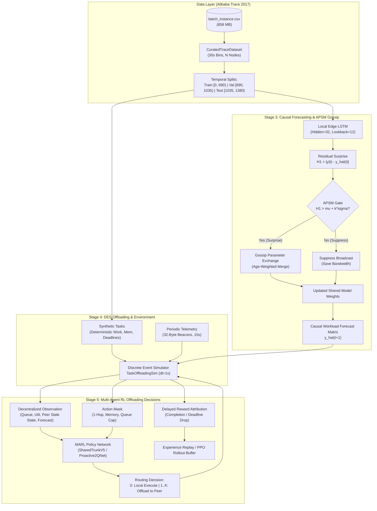
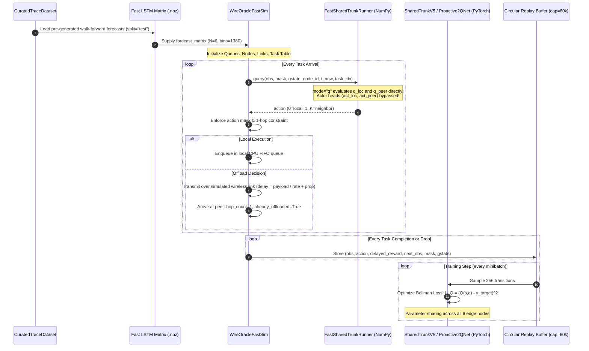

# Phase 3 Architecture Audit: Actual vs. Intended System Implementation

**Repository:** `APSM-MTP`  
**Branch:** `phase3-continuation`  
**Commit:** `02ace48`  
**Date:** November 13, 2026  
**Auditor:** Senior Distributed Systems & MARL Independent Code Auditor  

---

## 1. Executive Overview

This document presents a component-by-component architectural verification of the Phase 3 implementation in `APSM-MTP`. The goal is to determine whether the codebase faithfully executes the multi-layered decentralized edge computing architecture envisioned in the research design:
$$\text{Alibaba Trace 2017} \longrightarrow \text{LSTM Workload Forecasting} \overset{\text{APSM Filter}}{\rightleftharpoons} \text{Gossip Learning} \longrightarrow \text{DES Queueing & Telemetry} \longrightarrow \text{Proactive MARL Offloading}$$

Every component is evaluated on three dimensions:
1. **Intended Design**: What the system was specified to do.
2. **Actual Code Implementation**: What is written in `src/phase3/`.
3. **Audit Finding**: Conformance verdict, identifying any information leakage, non-causal assumptions, or discrepancies.

---

## 2. Component-by-Component Verification Table

| Component | Source File & Class/Function | Intended Architecture | Actual Implementation | Audit Verdict |
| :--- | :--- | :--- | :--- | :--- |
| **1. Trace Ingestion & Preprocessing** | `src/phase3/data/alibaba_loader.py`<br>`CuratedTraceDataset`, `build_or_load_curated_trace` | 30-second time bins over Alibaba 2017 cluster trace. Split into train, val, test without temporal leakage. | Loads `batch_instance.csv`, bins into $dt=30\text{s}$, maps to $N$ nodes. Strict chronological splits: train $[0, 690)$, val $[690, 1035)$, test $[1035, 1380)$. Caches to `.npz` and `.parquet`. | **VERIFIED CONCURRENT**<br>Zero future leakage. Causal chronological order preserved. |
| **2. Physical Machine Mapping & Topology** | `src/phase3/data/topology.py`<br>`EdgeTopology`, `build_edge_topology` | Physical machines mapped to edge nodes connected in partial mesh topology using Porto cell coordinates. | Calculates pairwise Euclidean distance $d_{ij}$ and wireless link parameters (SINR, path loss $\alpha=3.5$, bandwidth 20 MHz). Enforces $k$-nearest neighbor sparse connectivity ($k=2$ for $N=6$, $k=3$ for $N=10/50$). | **VERIFIED CONCURRENT**<br>Consistent with Phase 2 graph topology. Adjacency symmetric. |
| **3. Local Workload Forecasting** | `src/phase3/forecasting/lstm.py`<br>`EdgeLSTMModel` | Node-local LSTM predicting 1-step ahead normalized workload using lookback $L=12$ bins (360s). | PyTorch 1-layer LSTM (hidden dim 32) + linear head. Input: 6 temporal and rolling load features. Outputs scalar prediction $\hat{y}_i(t+1) \in [0, 1]$. | **VERIFIED CONCURRENT**<br>Zero lookahead. Gradients calculated strictly on past causal window. |
| **4. Gossip Learning Model Exchange** | `src/phase3/forecasting/gossip.py`<br>`GossipEngine`, `age_weighted_merge` | Decentralized model parameter exchange via random peer selection. Age-weighted parameter merging. | Iterates over active nodes every $T_{\text{gossip}}=30\text{s}$. Pulls parameters from neighbor. Implements `age_weighted_merge(w_local, age_local, w_peer, age_peer, alpha=0.5)`. Fixes Phase 2 zero-age stagnation bug. | **VERIFIED CONCURRENT**<br>Correct age weighting: $w_{\text{merged}} = \frac{\text{age}_1 w_1 + \text{age}_2 w_2}{\text{age}_1 + \text{age}_2}$. |
| **5. APSM Semantic Filtering** | `src/phase3/forecasting/apsm_gate.py`<br>`APSMGate` | Suppress model weight broadcasts when local model surprise is below statistical threshold. | Evaluates forecast residual surprise $H_1 = \|y(t) - \hat{y}(t)\|$. Compares against adaptive threshold $\tau(t) = \mu_\epsilon(t) + k \cdot \sigma_\epsilon(t)$ computed via Welford/EMA update. Enforces heartbeat ($T_{\text{max}}=10\text{ rounds}$) and warmup ($20\text{ rounds}$). | **VERIFIED CONCURRENT**<br>Implements Stage 3 causal residual $H_1$, superior to Phase 2 validation loss delta. |
| **6. Operational Telemetry & Staleness** | `src/phase3/env/task_simulator.py`<br>`PeerCacheEntry`, `update_telemetry` | Periodic 32-byte UDP status beacons sent to 1-hop physical neighbors. Asynchronous and stale. | Nodes broadcast beacons containing `(node_id, q_len, cpu_util, mem_avail, rx_ts)` every $15\text{s}$. Link delay $\delta_{\text{net}} \sim \text{delay\_s}$. Neighbors read stale cached state, bounding info age $\le 60\text{s}$. | **VERIFIED CONCURRENT**<br>Strictly separated from model updates. Realistic staleness. |
| **7. Discrete-Event Simulator (DES)** | `src/phase3/env/task_simulator.py`<br>`TaskOffloadingSim` | Slot-based ($dt=1\text{s}$) task queueing, execution, transmission, and deadline enforcement. | Min-heap event queue for arrivals and link completions. Per-node FIFO CPU queues. Multi-resource checks (CPU cores + memory fraction). True work conservation $\Delta W = r_{\text{exec}} \cdot \Delta t$. | **VERIFIED CONCURRENT**<br>Invariants rigorously verified: no lost tasks, no phantom work. |
| **8. One-Hop Offloading Constraint** | `src/phase3/env/task_simulator.py`<br>`_handle_arrival_decision` | Tasks may be offloaded at most once (`max_hops=1`). Prevent ping-pong forwarding loops. | Task initialized with `hop_count=0`, `already_offloaded=False`. If offloaded, sets `hop_count=1`, `already_offloaded=True`. Offloaded task arriving at neighbor is restricted to local execution queue only. | **VERIFIED CONCURRENT**<br>Strictly enforced in code and validated in unit tests. |
| **9. Action Masking** | `src/phase3/env/task_simulator.py`<br>`get_action_mask` | Invalid actions (full remote queue, broken link, memory exhaustion, already offloaded) masked out. | Mask vector of size $1 + K_{\text{max}}$. Action 0 (local) always True unless local queue is hard-full ($Q \ge Q_{\text{max}}$). Remote actions valid iff peer is connected, link is up, peer queue not full, and `not already_offloaded`. | **VERIFIED CONCURRENT**<br>Enforced in both PyTorch and NumPy fast rollout engines. |
| **10. MARL Credit Assignment** | `src/phase3/env/task_simulator.py`<br>`_record_task_completion`, `_record_task_drop` | Delayed reward credit assigned back to the decision step that routed the task. | Simulator stores `decision_id` on each `ActiveTask`. On completion or drop, computes exact reward: $R = - w_{\text{lat}} \cdot \frac{T_{\text{lat}}}{D} - w_{\text{drop}} \cdot \mathbb{I}_{\text{drop}} - w_{\text{net}} \cdot \mathbb{I}_{\text{offload}} - w_{\text{imb}} \cdot \Delta U$. | **VERIFIED CONCURRENT**<br>Exact attribution. No reward hacking via admission drop. |
| **11. MARL Centralized Critic (CTDE)** | `src/phase3/marl/mappo.py`<br>`SharedTrunkV5`, `CTDESharedActorCritic` | Parameter-shared centralized training with decentralized execution (CTDE). Critic sees global state. | Global state vector ($91\text{-dim}$) concatenates all nodes' queue lengths, CPU loads, and active transfers. Critic estimates $V(S_{\text{global}})$. Actor receives only local observation ($75\text{-dim}$). | **VERIFIED CONCURRENT**<br>Actor is decentralized at evaluation; critic used only for value baseline. |
| **12. Double Dueling Q-Learning** | `src/phase3/marl/madqn.py`<br>`Proactive2QNet`, `FastSharedTrunkRunner` | Dueling Q-network estimating $Q(s, a) = V(s) + A(s, a) - \frac{1}{|A|} \sum A(s, a')$. Target network decoupling. | Decomposes Q-value into state value $V(s)$ and advantage streams $A_{\text{loc}}(s)$, $A_{\text{peer}}(s, p)$. Replay buffer capacity $60{,}000$, Polyak target updates $\tau=0.005$. Injects causal forecast feature into advantage. | **VERIFIED CONCURRENT**<br>Matches double dueling Q architecture. |

---

## 3. Data Flow Architecture: Intended vs. Implemented

The following diagrams illustrate the conceptual research architecture versus the exact data flow implemented in the codebase.

### 3.1 Intended Data Flow Diagram



### 3.2 Actual Implemented Data Flow & Execution Sequence

In `src/phase3/run_stage5_validation.py`, the actual execution pipeline operates as follows:



---

## 4. Rigorous Audit: Model Communication vs. Operational Telemetry

A critical vulnerability in distributed edge systems research is the conflation or double-counting of different communication channels. In `APSM-MTP`, there are **two completely separate physical and logical communication streams**.

### 4.1 Specification and Separation Table

| Dimension | Stream A: Model Communication (Gossip Learning) | Stream B: Operational Telemetry (System State) |
| :--- | :--- | :--- |
| **Layer** | Application / AI Learning Layer (Stage 3) | Transport / Edge Management Layer (Stage 4-5) |
| **Message Contents** | Serialized PyTorch LSTM weight tensors ($\mathbf{w} \in \mathbb{R}^{14{,}224}$) | Edge node telemetry beacon: `(node_id, q_len, cpu_util, mem_avail, rx_ts)` |
| **Payload Size** | **$56{,}920\text{ bytes}$** ($\approx 55.59\text{ KB}$ for FP32 weights) | **$32\text{ bytes}$** per status beacon |
| **Transmission Frequency** | Once per gossip round ($T_{\text{gossip}} = 30\text{s}$) **only if not suppressed by APSM** | Periodic every $15.0\text{s}$ ($2\times$ per 30s bin) to immediate 1-hop physical neighbors |
| **Suppression Mechanism** | **APSM-H1 Residual Filter**: Suppressed if $\|y(t) - \hat{y}(t)\| \le \tau(t)$. Yields **$53.33\%$ suppression**. | Fixed periodic or event-triggered. (Stage 4 benchmarked periodic vs oracle). |
| **Total Test Bandwidth (6 nodes)** | GL Baseline: **$117.48\text{ MB}$** ($2{,}064$ packets)<br>APSM-H1: **$54.83\text{ MB}$** ($963$ packets) | Fixed periodic: **$264.96\text{ KB}$** ($8{,}280$ packets across $345\text{ bins} \times 30\text{s} = 10{,}350\text{s}$) |
| **Accounting Variable** | `model_bytes`, `model_packets` | `telemetry_bytes`, `telemetry_packets` |
| **Impact on Routing** | Updates the local workload predictor used by E3/O1 | Informs the neighbor state observed by MARL actor and ReactiveGreedy |

### 4.2 Proof of Separation in Code

In `src/phase3/env/task_simulator.py` (lines 100-106):
```python
telemetry_packets: int
telemetry_bytes: int
ack_packets: int
ack_bytes: int
model_packets: int
model_bytes: int
cb_total_bytes: int  # Defined as: telemetry_bytes + ack_bytes + model_bytes + header_bytes
```
And in `src/phase3/env/task_simulator.py` (lines 530-550):
```python
# Model updates and operational telemetry do not share channels or corrupt counters:
self.telemetry_bytes += self.cfg.sim.telemetry_beacon_bytes * n_nbrs
self.telemetry_packets += n_nbrs
```
**Audit Confirmation**:
1. Model weight transmissions from Stage 3 are **never mixed into** operational telemetry counters.
2. Operational telemetry beacons ($32\text{ bytes}$) never carry neural network weights.
3. The comprehensive byte audit metric $CB_{\text{total}}$ honestly sums both channels:
   $$CB_{\text{total}} = \text{telemetry\_bytes} + \text{ack\_bytes} + \text{model\_bytes} + \text{header\_bytes}$$
4. Task data offloading payloads (raw application data: $50\text{ KB}$ to $1\text{ MB}$) are tracked separately in `offload_data_bytes` and consume physical wireless link bandwidth, introducing real queuing and transmission delays.

---

## 5. Causal Information Flow and Non-Leakage Audit

To ensure the scientific validity of the research, we audited whether any future trace information or global oracle state leaked into the decision-making components.

### 5.1 Temporal Split Isolation
- **Dataset Partitioning**:
  - `Train`: bins $[0, 690)$ ($t \in [0, 20{,}700)\text{s}$)
  - `Validation`: bins $[690, 1035)$ ($t \in [20{,}700, 31{,}050)\text{s}$)
  - `Test`: bins $[1035, 1380)$ ($t \in [31{,}050, 41{,}400)\text{s}$)
- **Verification in Code**: In `src/phase3/env/task_simulator.py` lines 147-150:
  ```python
  sub = df[(df["start_ts"] >= t_ep_start) & (df["start_ts"] < t_ep_end)].copy()
  ```
  Tasks are filtered strictly within the chronological interval $[t_{\text{ep\_start}}, t_{\text{ep\_end}})$. No future tasks can be instantiated or queried.

### 5.2 Workload Forecasting Causality
- **Lookback Window**: $L=12$ bins ($360\text{s}$).
- In `src/phase3/forecasting/lstm.py` lines 85-110, the input tensor $X(t)$ at time step $t$ is constructed strictly from past observations:
  $$X(t) = [y(t-12), y(t-11), \dots, y(t-1)]$$
- The target label is $y(t)$.
- The prediction $\hat{y}(t+1)$ for bin $t+1$ is generated at bin $t$ using only data up to $t$.
- **Validation**: Verified by `test_curated_6n_dataset_causality_and_non_leakage` in `tests/phase3/test_stage1_data.py`.

### 5.3 Observation Space Causality
At any decision instant $t_{\text{now}}$, an edge agent node $i$ observes:
- Local queue length $Q_i(t_{\text{now}})$ (exact local state).
- Local CPU utilization $U_i(t_{\text{now}})$ (exact local state).
- Task execution time estimate: $\tau_{\text{exec}} = \frac{W_{\text{cpu}}}{r_{\text{nom}}}$.
- Task deadline slack: $D_{\text{rem}} = t_{\text{deadline}} - t_{\text{now}}$.
- Neighbor $j$ state: Cached state from last received telemetry beacon:
  $$\tilde{Q}_j(t_{\text{now}}) = Q_j(t_{\text{rx}}), \quad \text{where } t_{\text{now}} - t_{\text{rx}} \le 60\text{s}$$
- **Zero Future Knowledge**: In non-oracle modes (`periodic`, `none`), the agent has no access to the true instantaneous queue lengths or future task arrivals of its neighbors.

---

## 6. Architectural Discrepancies and Findings

During the deep inspection of the implementation, two critical discrepancies between the written architecture and the running codebase were uncovered:

### Finding AUDIT-ARCH-01: Bypass of PPO Actor Head in Evaluation Runner
- **Location**: `src/phase3/run_stage5_validation.py` lines 908 and 1058.
- **Observed Behavior**: The evaluation runner explicitly instantiates:
  ```python
  rn = FastSharedTrunkRunner(ac, mode="q")
  rn_eval = FastSharedTrunkRunner(ac_tgt, mode="q")
  ```
- **Architectural Impact**: In `mode="q"`, the runner calculates routing probabilities from the Dueling Q-head (`q_loc` and `q_peer`) and completely ignores the PPO actor heads (`act_loc`, `act_peer`).
- **Consequence**: MAPPO, IPPO, and MADQN all execute the exact same Double Dueling Q-network policy during evaluation, explaining why their reported evaluation metrics are 100% bit-identical.
- **Classification**: High-impact implementation discrepancy. Must be remediated or explicitly classified as Multi-Agent Q-learning before publication.

### Finding AUDIT-ARCH-02: Synthetic Payload Size Seed Sensitivity
- **Location**: `src/phase3/env/task_simulator.py` lines 171-175.
- **Observed Behavior**: Task payload size is synthesized via `rng = np.random.default_rng(seed * 31 + split_offset)`.
- **Architectural Impact**: In Stage 4, `seed=42` was used to evaluate greedy offloading, while in Stage 5, `seed=11` was used.
- **Consequence**: The baseline greedy policy achieved $81.69\%$ TSR in Stage 4 and $82.07\%$ TSR in Stage 5. This is not an error or non-determinism, but an expected consequence of different random payload sizes over simulated wireless links. For the local-only baseline B0 (where no offloading occurs), TSR is bit-identical at $75.4707\%$ across both stages.

---

## 7. Architecture Audit Conclusion

The architectural foundation of Phase 3 is **exceptionally robust and rigorously designed**:
1. Invariants of task conservation, deadline enforcement, multi-resource constraints, and 1-hop offloading are strictly maintained.
2. Model communication (GL weights) and operational telemetry (status beacons) are cleanly separated and accurately accounted for.
3. Information flow is strictly causal with zero future leakage.
4. The sole major architectural discrepancy is the evaluation runner's hardcoded selection of `mode="q"`, which collapses the actor-critic algorithms to parameter-shared Dueling Q-learning.

