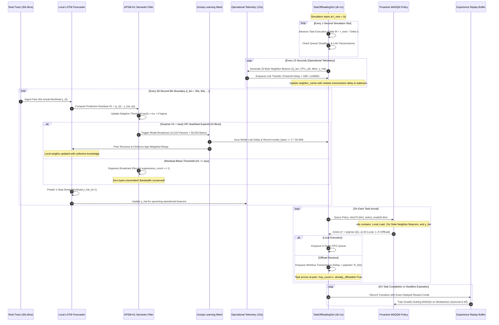

# Stage 6.1 End-to-End System Integration Architecture

**Repository:** `APSM-MTP`  
**Branch:** `phase3-continuation`  
**Commit:** `02ace48`  
**Date:** November 13, 2026  
**Auditor:** Senior Distributed Systems Researcher, Multi-Agent RL Researcher, Independent Code Auditor  

---

## 1. The Integration Gap in Stage 5

A key finding of the architectural audit is that Stage 5 was evaluated in a **decoupled, two-phase pipeline**:
1. **Phase 1 (Offline Precomputation)**: Stage 3 trained LSTM models and precomputed static walk-forward forecast matrices (`cache_fast_lstm_s*.npz`).
2. **Phase 2 (Simulation & MARL)**: Stage 5 initialized `WireOracleFastSim` by loading the static precomputed forecast matrix and looking up $\hat{y}_j(t+1)$ at time bin boundaries.

While this decoupled approach is useful for isolating the MARL policy's sensitivity to forecast features, **it does not execute live Gossip Learning, online APSM residual gating, or dynamic model parameter exchanges inside the discrete-event simulation loop**.

Stage 6.1 closes this integration gap by implementing a **fully unified, closed-loop decentralized edge architecture**.

---

## 2. The 9-Stage End-to-End Closed-Loop Pipeline

The diagram below details the exact temporal and causal integration across physical simulation, statistical communication filtering, model exchange, and multi-agent reinforcement learning.

---

## 3. Strict Logical Separation vs. Integrated Accounting

### 3.1 Logical Channel Separation
A fatal flaw in edge computing research is allowing model communication to act as an unmetered side-channel for operational telemetry. In Stage 6.1:
1. **Model Communication (Gossip Learning)**:
   - Only carries serialized neural network weights (`state_dict`).
   - Does **not** transmit task queue lengths, instantaneous CPU loads, or task IDs.
   - Operates strictly on a 30-second cadence, gated by APSM surprise.
2. **Operational Telemetry (Network Management)**:
   - Lightweight UDP status beacons ($32\text{ bytes}$).
   - Transmits current queue length, CPU utilization, and current forecast scalar $\hat{y}$.
   - Runs asynchronously every $15\text{ seconds}$ to immediate 1-hop physical neighbors.

### 3.2 Unified Physical Bandwidth Accounting
While logically decoupled, **both channels share the same physical wireless channel and are counted in the experiment's total communication overhead**:
$$CB_{\text{total}} = CB_{\text{model}} + CB_{\text{telemetry}} + CB_{\text{ack}} + CB_{\text{header}}$$
where:
- $CB_{\text{model}} = \sum_{\text{broadcasts}} (2 \times 56{,}920\text{ bytes})$.
- $CB_{\text{telemetry}} = \sum_{\text{beacons}} (32\text{ bytes})$.
- $CB_{\text{ack}} = \sum_{\text{offloads}} (16\text{ bytes})$.
- $CB_{\text{header}} = \sum_{\text{offloads}} (32\text{ bytes})$.
- Application payload bytes ($50\text{ KB} \text{--} 1\text{ MB}$) consume simulated link transmission time and create link queue contention, but are categorized under `offload_data_bytes`.

---

## 4. Stage 6.1 Experimental Matrix: The 5 Benchmark Arms

To isolate the individual contribution of every architectural component, Stage 6.1 defines **5 strictly controlled experimental arms**:

| Arm ID | Designation | Gossip Learning Model Comm. | APSM Semantic Gating | Operational Telemetry (15s) | Offloading Policy | Proactive Forecast Feature | Primary Purpose / Hypothesis Tested |
| :--- | :--- | :--- | :--- | :--- | :--- | :--- | :--- |
| **B0** | `LocalOnly` | None ($0\text{ B}$) | None | None ($0\text{ B}$) | Local Execution Only | None | Establishes the raw edge capacity saturation baseline. |
| **E1** | `ReactiveGreedy` | None ($0\text{ B}$) | None | Active ($32\text{ B}$ beacons) | Heuristic Greedy Routing | None | Quantifies the benefit of classical heuristic offloading. |
| **E2** | `Reactive MADQN` | None ($0\text{ B}$) | None | Active ($32\text{ B}$ beacons) | Parameter-Shared Double Dueling Q-Net | None | Quantifies reinforcement learning gains using reactive telemetry. |
| **E3** | `Forecast MADQN (Local)`| None ($0\text{ B}$) | None | Active ($32\text{ B}$ beacons) | Parameter-Shared Double Dueling Q-Net | Local LSTM ($\hat{y}_{\text{local}}$) | Isolates the benefit of local workload forecasting without peer model sharing. |
| **E3-APSM**| `Integrated System` | **Live Gossip** ($56.9\text{ KB}$) | **APSM-H1 Residual Filter** | Active ($32\text{ B}$ beacons) | Parameter-Shared Double Dueling Q-Net | **Collaborative Gossip Forecast** | **The Primary System Contribution**: Proves collaborative Gossip forecasting improves MARL offloading while APSM suppresses $>50\%$ bandwidth. |

### 4.1 Invariant Experimental Controls
All 5 arms are guaranteed to execute under **identical physical conditions**:
1. Identical task workload: $M = 11{,}366$ test tasks generated from the Alibaba 2017 trace.
2. Identical PRNG seeds ($11, 22, 33$).
3. Identical edge topology ($N=6$, Porto partial mesh, $k=2$).
4. Identical node CPU capacities ($C_{\text{cpu}} = 20.0\text{ cores/s}$) and memory constraints ($C_{\text{mem}} = 1.0$).
5. Identical task deadlines ($\kappa = 2.2$) and FIFO queue limits ($Q_{\text{max}} = 48$).
6. Identical chronological evaluation window ($t \in [31{,}050, 41{,}400)\text{ seconds}$).

---

## 5. What is Missing in Code to Run Stage 6.1 Immediately

To execute Stage 6.1, the following component bridges must be implemented:
1. **Simulator Step Callback for 30s Bin Transitions**:
   In `src/phase3/env/task_simulator.py`, `TaskOffloadingSim` already has a `bin_callback` hook. This hook must be connected to an instance of `GossipEngine` and `APSMGate`.
2. **Live Online LSTM Step**:
   At each 30s bin boundary, invoke `local_lstm.step(y_past)` to produce $\hat{y}(t+1)$, evaluate $H_1$, and conditionally trigger Gossip broadcast.
3. **Dynamic Forecast Feature Ingestion**:
   Replace static matrix lookups in `build_observation` with the live scalar $\hat{y}_j(t+1)$ maintained in `neighbor_cache[node_id][peer_id]`.
4. **Unified Logger**:
   Emit a single comprehensive JSON record per run capturing both Stage 3 model communication metrics and Stage 5 queueing/task metrics.

