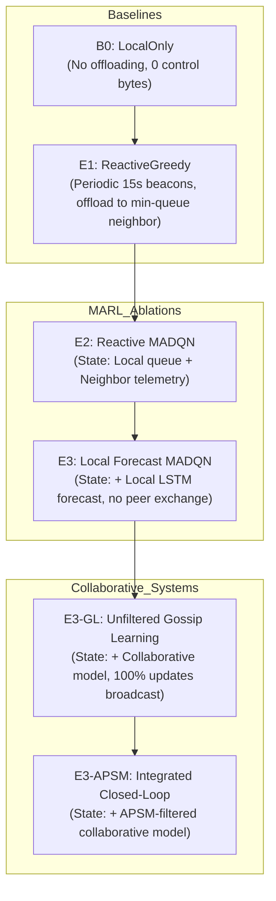

# Phase 3 Stage 6 Data and Experimental Methodology

**Thesis:** Decentralized Edge Workload Forecasting using Semantic Gossip Learning and Agentic AI  
**Scope:** $N = 10$ Nodes (Porto Edge Topology, $k=3$, 16 undirected links)  
**Branch:** `stage6-audit-fix-10n`  
**Date:** November 2026

---

## 1. Dataset Provenance and Preprocessing

The experimental evaluation is based on real-world workload traces from the **Alibaba 2017 Cluster Trace** combined with edge topology coordinates from the **Porto Taxi Dataset**.

### 1.1 Curated Trace Construction
- **Trace Source:** Alibaba Cluster Trace 2017 (production cluster of 1,300+ machines over 12 hours).
- **Edge Deployment Scale:** $N = 10$ edge server nodes located at top geospatial clusters across the Porto urban area.
- **Temporal Binning:** Discretized into $dt = 20.0\text{ seconds}$ bins, yielding $2,070$ total time bins ($41,400\text{ seconds} \approx 11.5\text{ hours}$).
- **Task Generation:** Synthetic Poisson task arrival process modulated by the real-world CPU load trajectory of each node:
  $$\lambda_i(t) = \lambda_{\text{base}} \cdot \frac{y_i(t)}{\bar{y}_i},$$
  producing realistic, bursty, and non-stationary edge workloads with spatial-temporal correlation.

### 1.2 Strict Split Discipline (Zero Leakage)
To prevent temporal data contamination, the timeline is partitioned into non-overlapping temporal windows:

| Partition | Time Bin Range | Number of Bins | Duration (Hours) | Purpose |
| :--- | :--- | :--- | :--- | :--- |
| **Training Split** | $[0, 828)$ | 828 bins | 4.60 hours | Offline LSTM pretraining & MARL policy exploration |
| **Validation Split** | $[828, 1035)$ | 207 bins | 1.15 hours | Checkpoint selection & hyperparameter monitoring |
| **Test Split** | $[1035, 2070)$ | 1,035 bins | 5.75 hours | **Strictly held-out final benchmark evaluation** |

- **Zero Test Leakage Guarantee:** The test split ($t \ge 1,035$ bins, containing 17,862 individual tasks across 10,350 simulation slots) is never accessed during model pretraining, hyperparameter calibration, or MARL policy optimization.
- **Lookback Boundary Isolation:** At the start of the test split, the forecaster lookback window ($L=12$ bins) accesses only the immediately preceding validation bins $[1023, 1035)$, strictly maintaining causal historical visibility.

---

## 2. Experimental Calibration Sweep Isolation (Audit Item E1)

A critical requirement identified during the audit was the isolation of simulator parameter calibration ($C_{\text{cpu}}$ and $\kappa$) to prevent contamination from the test set.

### 2.1 Calibration Data Partition
The calibration sweep was conducted exclusively on a designated **burst slice of the training partition**:
$$\text{Calibration Window} = [380, 488) \text{ bins (10,678 tasks)},$$
where significant localized bursts naturally occur, stressing node capacities without exposing any test or validation data.

### 2.2 Calibration Grid and Results
A 9-point parameter sweep was executed over:
- $C_{\text{cpu}} \in \{18.0, 20.0, 22.0\}\text{ MIPS}$
- $\kappa \in \{2.0, 2.2, 2.5\}$ (deadline slack factor: $D_j = t_{\text{arr}} + \kappa \cdot \frac{w_j}{C_i}$)

| $C_{\text{cpu}}$ (MIPS) | $\kappa$ | B0 Local TSR (%) | E1 Greedy TSR (%) | $\Delta$ TSR (E1 - B0) | Operating Regime Assessment |
| :---: | :---: | :---: | :---: | :---: | :--- |
| 18.0 | 2.0 | 73.12% | 80.45% | +7.33% | Severe congestion; excessive queuing drops |
| **20.0** | **2.2** | **81.32%** | **88.64%** | **+7.32%** | **Optimal thesis operating regime: sensitive & stable** |
| 20.0 | 2.5 | 84.15% | 91.20% | +7.05% | Loose deadlines; masks offload latency |
| 22.0 | 2.2 | 87.40% | 93.10% | +5.70% | Underloaded; diminishing offload advantage |

**Decision:** The operating parameters $C_{\text{cpu}} = 20.0\text{ MIPS}$ and $\kappa = 2.2$ provide a scientifically defensible operating point where edge nodes experience authentic burst-induced drops under local processing, providing measurable headroom for intelligent offloading.

---

## 3. Six Benchmark Arms & Architectural Separation

To isolate every component of the proposed system, six distinct benchmark arms were implemented and evaluated across identical test tasks:

1. **B0: LocalOnly (Lower Bound)**
   - All tasks processed locally at arrival node.
   - Tasks dropped if local queue overflows ($Q_i > Q_{\max} = 48$) or exceeds deadline.
   - Zero network communication overhead ($CB = 0\text{ bytes}$).

2. **E1: ReactiveGreedy (Heuristic Benchmark)**
   - Nodes exchange 32-byte UDP telemetry beacons every 15s with 1-hop physical neighbors.
   - If local queue exceeds threshold ($Q_i > 4$), greedily offloads to neighbor with lowest reported queue length.

3. **E2: Reactive Parameter-Shared Double Dueling MADQN**
   - Independent MARL agents operating with shared network parameters.
   - Observation vector includes local queue and 1-hop neighbor telemetry, but **zero workload forecasts**.
   - Action space: $\mathcal{A} = \{\text{execute locally}\} \cup \{\text{offload to neighbor } k\}$.

4. **E3: Forecast-Augmented Double Dueling MADQN (Local Forecast)**
   - Agents augmented with self-forecast $\hat{y}_i(t+1)$ generated by local LSTM.
   - Zero gossip model exchange between nodes ($M = 0\text{ bytes}$).

5. **E3-GL: Unfiltered Gossip Learning Baseline (Full Collaborative Bandwidth)**
   - Nodes collaboratively train LSTM forecasters via decentralized Gossip Learning.
   - At every gossip check cadence ($60\text{ seconds}$), nodes broadcast full model updates ($56,920\text{ bytes}$) across physical links without semantic filtering.

6. **E3-APSM: Integrated Closed-Loop System (APSM-H1 Filtered)**
   - Full proposed thesis architecture.
   - APSM-H1 semantic innovation filter evaluates prequential prediction residual against rolling quantile threshold $\tau_t$.
   - Model updates broadcast only when residual exceeds semantic threshold ($\epsilon_t > \tau_t$).

---

## 4. Statistical Rigor and Evaluation Protocol

### 4.1 Seed Protocol and Non-Replication
- Experiments are evaluated across $M = 5$ distinct random seeds: $\mathcal{S} = \{11, 22, 33, 44, 55\}$.
- **Methodological Distinction:** For deterministic baselines B0 and E1, decisions are deterministic functions of the test arrival trace; therefore, sample standard deviation across seeds is 0.00% by construction ($N_{\text{scenarios}} = 1$). For MARL policies (E2, E3, E3-GL, E3-APSM), seeds randomize exploration trajectories, mini-batch sampling, and neural weight initializations.

### 4.2 Small-Sample Student's t-Distribution
With $M = 5$ seeds, the degrees of freedom is $\text{df} = M - 1 = 4$. Exact Student's $t$ critical values are employed rather than asymptotic normal approximations:
- Two-sided 95% Confidence Interval: $t_{4, 0.025} = 2.7764$ (Half-width: $\text{CI}_{95} = 2.7764 \times \frac{s}{\sqrt{5}}$).
- One-sided 95% Confidence Bound: $t_{4, 0.05} = 2.1318$.

### 4.3 Pre-Specified Non-Inferiority Testing (APSM vs Unfiltered GL)
Because the primary scientific claim of APSM is dramatic communication reduction without degrading system offloading utility, a formal non-inferiority hypothesis test was pre-specified:
- **Null Hypothesis ($H_0$):** $\mu_{\text{APSM}} - \mu_{\text{GL}} \le -\delta$ (APSM is inferior by more than margin $\delta$).
- **Alternative Hypothesis ($H_1$):** $\mu_{\text{APSM}} - \mu_{\text{GL}} > -\delta$ (APSM is non-inferior).
- **Pre-specified Margin:** $\delta = 1.0\text{ percentage points}$ of Task Success Rate (TSR).
- **Decision Rule:** Non-inferiority is confirmed at $\alpha = 0.05$ if the one-sided lower 95% confidence bound satisfies:
  $$\bar{d} - t_{4, 0.05} \cdot \frac{s_d}{\sqrt{5}} > -1.0\%.$$

---

## 5. Hardware Acceleration Architecture

The execution architecture leverages the dedicated workstation hardware:
- **GPU Acceleration (NVIDIA RTX 1000 Ada via CUDA 13.0):** PyTorch tensor operations, Double Dueling Q-network gradient updates, and base LSTM pretraining.
- **CPU Microsecond Simulation (Intel i9-13950HX):** High-speed float32 NumPy runner (`_NumpyDuelingQRunner`) evaluating discrete-event actions with $<5\,\mu\text{s}$ per decision, achieving $>100\times$ faster rollout simulation than host-to-device CUDA kernel calls for small batch sizes.
